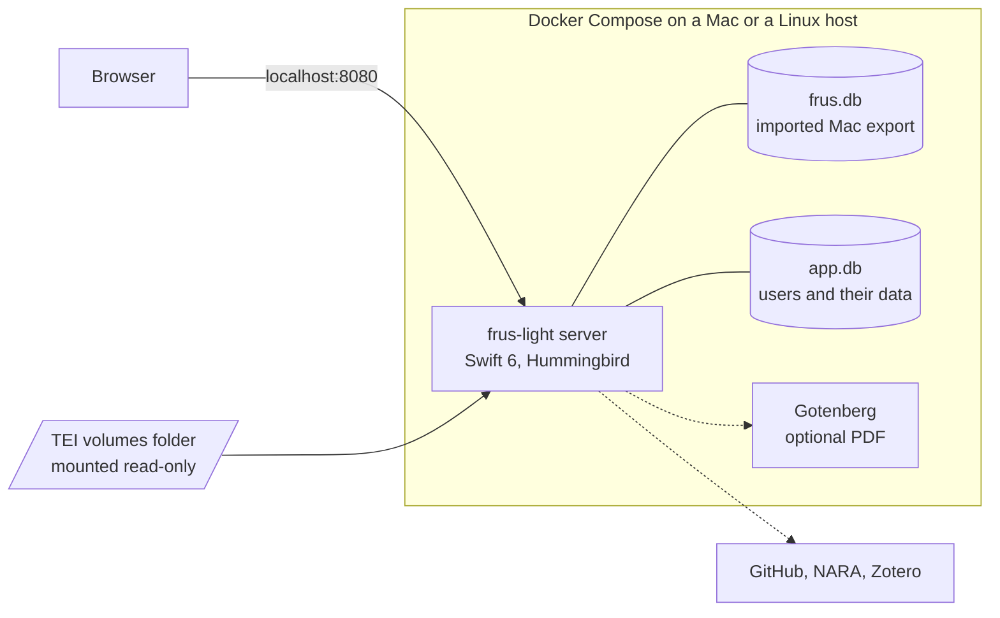

# FRUS Explorer Light

FRUS Explorer Light is a self-hosted web edition of [FRUS Explorer](https://github.com/joshbotts/FRUS-Explorer), the iOS, iPadOS and macOS app for researching the *Foreign Relations of the United States* series. One container serves the corpus, its full-text index, and each researcher's notes and highlights to any modern browser.

## Status

Phases 0 to 3 are done. Phase 1, a Docker Compose install that serves a FRUS Explorer research export at `http://localhost:8080`, was signed off on 13 October 2026; phase 2, each researcher's notes, highlights, collections and the rest of the research layer, on 29 October; and phase 3, the library and the archives, on 23 November. FRUS Explorer 1.0 (1861) is on the App Store, and since 22 November the server compiles the app's code at that release, the tag `1.0-release`, and since the same day at `v2`'s `4556c4d5`, nine commits on, and serves its exports, at index version 75; the first release, `1.0-1861.1`, came the same day. The code holds all three of this project's batches of moves into the app's shared kit, ten more pull requests of this project's there, the last three on 22 November, for six issues this project filed: each reader's own summaries on Related Documents' and Chronology's lines, and on Suggested Next's through #1902's call, which the same move took up, three of the analytics' workarounds retired, and a boundary test for every shared kit; and the app's own fixes to eight more: the cross-reference graph's two, so the server works around nothing of the app's, its timeline's eligibility, the NARA client's reading of NARA's live answers, a CIA job's row in a volume's Sources, the export's record of the file each volume was indexed from, the index version the Mac shows beside Export Research Database…, and Import from JSON on the Mac, iPhone and iPad, with its rules in the kit. Phase 3's server track is done: since 14 November a server can keep a library of its own, Standalone mode, which downloads, indexes, side-loads, removes and compacts its volumes, checks them for the Office of the Historian's corrections and reviews with each researcher what a correction changed, and a curator corrects the index everyone shares, a document's classification and the people, on either kind of server. On the features track the S23 group was done on 13 November: Related Documents, Suggested Next and the cross-reference graph, each by the app's own engine; the S22 group on 14 November: Source Explorer reads where a document came from by the app's own rules, and Look Up in NARA, the NARA Catalog's search and Send to Zotero Library ask NARA and Zotero through the server, with each researcher's own key or, for NARA, the server's; and the S24 group on 23 November: the four analytics, Chronology and About the Series, each from the app's own code, and the Word Cloud from the clouds the app bundles. Phase 3's sign-off, S25b, held a Standalone server that downloaded and indexed all 553 volumes itself to the Mac's own full export: the same index rows, every citation lookup the app's, and every source note's record the app's export generator's, on the full corpus (checks 2, 7 and 8), and the owner used it with an account of their own. [`docs/INSTALL.md`](docs/INSTALL.md) is the install guide, [`docs/PLAN.md`](docs/PLAN.md) the plan and [`docs/DEVLOG.md`](docs/DEVLOG.md) the record of each session.

**What works today**, from the published image `ghcr.io/joshbotts/frus-explorer-light:edge`, for amd64 and arm64.

*The corpus:*

- Import of a Mac export copied into the `/data` volume, checked and served read-only. The server refuses an export from another index version. One that holds the owner's writing has it kept in the user's research data, marked as from a research database, and removed from the served copy; a read-only server refuses it.
- Search with the app's query language, with the facets, the Query Inspector, the order by relevance or date, and the timeline and concordance readings, each saying which results it read. Each result carries its date, drawn as the app draws it, and a search you replace stops on the server.
- Browse, which lists a section's own text first, as the app does: a meeting's list of those present, say, above its minutes, and the editors' annotations of every volume, its page's sixteen layers and an axis of them across the series. The reader, with its text size and Reading Width, its links, which follow a printed page into a volume the server does not hold as 1.0 does, and the cards for people and terms. All of it is usable by keyboard and free of axe violations.
- Cite, with BibTeX and RIS, and Citation Lookup, opened by Search's Find by Citation: a citation pasted, its fields typed, or a chapter's footnotes at once, each looked up by the app's own matcher, its results labelled as the app labels them.
- Related Documents, beside Cite: the documents most related to the one you read, ranked by the app's own engine by their archival provenance, the cross-references between them, their dates, where the editors placed them, and the people and subjects they share, each reason a chip, and each row's line your own summary of it where you wrote one, with the app's scopes and weights. Project Home's Suggested Next ranks the same way, on Refresh and after an import.
- The cross-reference graph, beside Related: the documents that cite the one you read and those it cites, one to three hops out, widened when it has few, as the app's graph shows them, with the citers in volumes the server does not hold counted, the archival material its footnotes cite and FRUS did not print, and a volume's documents gathered once they pass thirty; on a timeline of their dates, with the documents close in date grouped, or as a network. Its nodes, dates and timeline are the app's own code's, its network the app's layout; every node is reached by keyboard, and the reference list beside it lists every document it draws.
- Source Explorer, beside Cite: where a document came from, its source note read by the app's own rules over the archival indexes the app bundles, a lot's NARA series with NARA's facts about it, a decimal file's filing period and scans, a presidential library's collection, the rolls a document from before 1906 was likely filed in, with the other documents drawn from the same archival source in the app's three scopes, the collection the note names with its record, and the unprinted material its footnotes point at; a volume's Sources outline in Browse; and, with a NARA Catalog key, the person's own or the server's, the National Archives Catalog searched through the server, which keeps each answer for a day and counts each person's searches with its own key, as the app's section searches it. **Look Up in NARA**, in the reader's selection bar and a footnote's, reads the archival citations in a passage, as the app's sheet does, and searches the catalogue the same way. Check 8 holds every fixture source note's record, through the API, to the app's export generator's.
- People, among Browse's axes: everyone the volumes' lists of persons name, as the index reconciles them across volumes, by letter, each with their role, years and mentions, and a sheet with the app's lifespan line, a year the name authority lacks filled from the Department's register of principal officers and chiefs of mission, Find all mentions, the VIAF and Wikidata links, their posts under Career, and the subjects of the volumes that mention them, each opening the volumes that cover it.
- Analytics, from the header's menu, as the Mac's: Corpus Analytics charts a term by year, decade, volume or subseries, in documents or occurrences, with a scope and the administrations' years, and opens the documents in Search; Person Analytics ranks the people mentioned, follows up to five over time, compares two and draws the co-mention network around one; Cross-Reference Analytics ranks the most-referenced documents, with the degree distribution, the volumes' heat matrix and PageRank's landmarks; Archival Analytics ranks the archival collections the volumes drew on by era, draws a collection's co-citation network and the editors' hand-offs, and profiles your indexed volumes; Chronology lists a range by day, month or year; and About the Series shows the four dashboards of the app's Research Guide. Every series is the app's own code's, over the served index or the data the app bundles, each chart drawn by Vega-Lite with its table beside it, its CSV with the app's method block and its figure as PNG or SVG, and parity tests hold each to the kit's over the fixtures.
- The Word Cloud, from the same menu and the reader's rail: the clouds the app bundles, of the whole corpus, each subseries and each volume, under four lenses, Topics, Actions, Concepts and Sentiment, drawn in the browser by the app's own packing with the ranked list beside it, whose words chart themselves in Corpus Analytics, open a search, or hide from one cloud, a lens or every cloud; each cloud filtered by the reader's own Word Cloud settings, which Settings ▸ Word Cloud sets as the app's pane does and which follow them to the Mac in an export. A parity test holds every cloud to the bundled file's list.
- A curator's corrections of the index everyone shares, as the app makes them, each in a log an admin reads that names who made it and when: a document reclassified as an editorial note or a document, in the Research rail's Classification, and on the People screen two people merged, a record separated, and either undone. A Standalone server applies one at once, and keeps it through every indexing after; an Import server, whose export it never writes, gives it to the next export it installs.

*The research layer,* each researcher's own, kept on the server:

- Tags: the reader's Research rail tags a document, with the app's tag picker, and Settings ▸ Tags renames, merges and deletes, each by the app's rules.
- Highlights, as the app makes and draws them: a selection in the reader offers the four colours in a bar over the text, ⇧⌘H (Ctrl+Shift+H) highlights in yellow, and a tap on a highlight asks to remove it. The Research rail's Highlights section lists the document's highlights, each with its colour to change and Remove…. Check 6 holds the reader's text between offsets to the kit's in Chromium, on every fixture row. A server with no sign-in takes a change only from a page at its own address, with a token, as JSON; `FRUS_USER_DATA=off` makes it read-only.
- Notes and summaries: notes written with the app's formatting, kept as the Mac keeps them, in the Research rail and All Notes, and summaries shown with the app's words for who wrote them, beside the researcher's own; Settings ▸ Data exports the notes as the app's Markdown files.
- Search over the researcher's own writing, as the app's search window does it: Search in chooses the documents, the notes and the summaries, My Tags filters by the user's tags, counted over the results, and each result carries its tags. The facets, the Query Inspector and the readings count the same match, and each user searches their own alone.
- Saved searches with the Mac's "+N since last run", working corpora captured from a search and browsed and searched inside, volume scopes, and Checklist Mode, kept in the browser for the session.
- Projects, with the one each user works in and Project Home; the research trail of documents visited, searches run and exports, with its switch and Session Log; the method appendix as Markdown and CSV; and the Mac's synced preferences, the citation style among them.
- Collections and their editor: sections three deep, documents, note blocks in the app's rich text, excerpts frozen from the reader's selection, the five apparatus blocks, the inspector and section defaults, the app's six templates and the order by date. A live preview sits beside the contents, and the HTML, Word, BibTeX and RIS exports are each the kit's to the byte, checked for quotations first and kept in the history. A collection's `.fruscollection` file goes both ways, and one the web wrote opens whole in the Mac app; a smart collection follows a saved search, with Create Static Snapshot.
- Send to Zotero Library, from Cite and a collection's export sheet, with each person's own Zotero key: the document, or the collection's documents in a Zotero collection of its name, into their Zotero library with their tags and research notes, as the app sends them, the collection's kept in the history.
- The Research page, the app's Research tab: every document the researcher has annotated, by collection, tag and highlight colour, as the app's own code gathers them, with Contains Notes, All Notes and History.
- The Mac's JSON export imported into the server's research store, from Settings ▸ Data, by the kit's own rules, the app's Import from JSON…'s: every kind of record a file of format version 1 to 7 carries, each under its Mac id, a copy already held replaced only by a newer one, a note's formatting and a summary's author going with a text an older export replaces, with a report of what came in, was replaced or was kept. The same screen exports the researcher's data as the Mac's own file, with one key of the web's, which imports here again unchanged, and which the app imports with Settings ▸ System ▸ Data & Recovery ▸ Import from JSON… on a Mac, iPhone or iPad.

*Running it:*

- Serving at the root of a host or under a path behind a reverse proxy, such as `https://example.org/frus-explorer/`, as `FRUS_PUBLIC_URL` says, with an nginx recipe for each in the install guide.
- Local accounts, `FRUS_AUTH=local`: an admin makes each, the first with `frus-light user add`, the rest there or in Administration, each signs in on the server's own page, and passwords are hashed with Argon2id ([`docs/INSTALL.md`](docs/INSTALL.md#accounts)).
- Standalone mode, with `compose.standalone.yaml` ([`docs/INSTALL.md`](docs/INSTALL.md#standalone-mode)): the server downloads volumes from GitHub, with their figure images from history.state.gov, each file checked against GitHub's listing, and indexes them itself with the app's own indexer, a volume at a time while search answers; or a seed from a Mac export. Administration ▸ Library downloads, indexes, side-loads a TEI file of your own, and removes a volume from the index and the disk; Status compacts and checks the index, and resets it. A new release's index version re-indexes the volumes at the start, while search answers. Check for Corrections and Update bring the Office of the Historian's corrected volumes, and each researcher who annotated a changed document sees the app's banner and reviews it, with the highlights moved where the app's own search finds their words again; an Import server compares its export with its TEI folder for the same review.
- Administration, for an admin ([`docs/INSTALL.md`](docs/INSTALL.md#administration)): the server's status; its jobs, an index's import, a JSON import, an index's reset and from phase 3 the library's, run one at a time, kept across a restart, and stopped between their steps by Cancel…; the users and, with accounts, their roles, passwords and disabling, never leaving the server without an admin; the backups, with the newest to download; and the server's NARA key. Its two recovery actions ask first: erase one user's research, after naming what they hold, and reset the index in Import mode.
- Stored keys: each person's NARA Catalog and Zotero keys in Settings ▸ Keys, and the server's NARA key, kept sealed under a key file no backup holds, and never shown again ([`docs/INSTALL.md`](docs/INSTALL.md#the-key-file)). The server asks NARA and Zotero with them for the person who asks, and NARA with `FRUS_NARA_API_KEY` where no key is stored, as on a server that keeps no user data.
- A collection's PDF, through the optional Gotenberg container of Compose's `pdf` profile, which the export sheet offers only while it answers ([`docs/INSTALL.md`](docs/INSTALL.md#pdf-export)).
- Sign-in through that proxy, `FRUS_AUTH=header`: the proxy signs people in and names each in a header the server takes from the proxy's address alone, and each keeps research of their own, named at the top of every page, with a footer saying that whoever runs the instance can read it. The install guide's recipe checks a session with nginx and oauth2-proxy.
- The research store in `app.db`, the Compose install's, or in PostgreSQL, for a shared deployment that chooses one with `FRUS_USER_STORE`, every store method held alike on both by one conformance suite in CI.
- A daily backup of the research store, at 03:00 in the container's time zone or soon after a Mac that slept through it wakes, none when nothing changed, seven kept in the volume and seven more in `./backups` on the host; `frus-light restore` puts one back, and `GET /api/v1/admin/backup` gives the newest with a manifest of versions. The owner's restore drill found their research again.
- Parity with the Mac app, checked in CI on three fixture volumes: the same index rows, search results, document HTML, citation lookups and Source Explorer records. At phase 3's sign-off, on the full corpus as well: a Standalone server's index held row for row to the Mac's full export, and its Citation Lookup and Source Explorer to the app's own engine and export generator ([`docs/SPEC.md`](docs/SPEC.md#verification), checks 2, 7 and 8). The server compiles the app's own Swift code from a pinned submodule.
- A daily CI watch of the app's `v2` branch, which reports in one issue what the next pin move has to handle.
- Releases, cut by hand from a build that passed its smoke test and named for the FRUS Explorer build whose exports they serve, such as `1.0-1861.1`, the first, published on 22 November. Their notes name the image's digest and the index version, saying when it changed, and [`docs/INSTALL.md`](docs/INSTALL.md#releases) says how to follow them.

**Known gaps**

- **The pin is `v2`'s `4556c4d5`,** nine commits past the App Store's 1.0 (1861), the tag `1.0-release`, at the same index version, 75, which 1.0 (1823), the last TestFlight build, indexed at first: the server serves 1861's exports and refuses 1812's, at 74. Past the tag it holds the app's records, website and tour, and the three pull requests for six issues this project filed, [FRUS-Explorer#1967](https://github.com/joshbotts/FRUS-Explorer/pull/1967), [#1968](https://github.com/joshbotts/FRUS-Explorer/pull/1968) and [#1969](https://github.com/joshbotts/FRUS-Explorer/pull/1969). It holds phase 3's three upstream batches, [FRUS-Explorer#1869](https://github.com/joshbotts/FRUS-Explorer/pull/1869), [#1870](https://github.com/joshbotts/FRUS-Explorer/pull/1870) and [#1872](https://github.com/joshbotts/FRUS-Explorer/pull/1872), then [#1891](https://github.com/joshbotts/FRUS-Explorer/pull/1891), [#1894](https://github.com/joshbotts/FRUS-Explorer/pull/1894) and [#1895](https://github.com/joshbotts/FRUS-Explorer/pull/1895), then [#1896](https://github.com/joshbotts/FRUS-Explorer/pull/1896), [#1899](https://github.com/joshbotts/FRUS-Explorer/pull/1899), [#1900](https://github.com/joshbotts/FRUS-Explorer/pull/1900) and [#1901](https://github.com/joshbotts/FRUS-Explorer/pull/1901), whose code the server's rows call, with S21d's [#1897](https://github.com/joshbotts/FRUS-Explorer/pull/1897), the reader's lists' two fixes, [#1898](https://github.com/joshbotts/FRUS-Explorer/pull/1898) and [#1902](https://github.com/joshbotts/FRUS-Explorer/pull/1902), a fix to the kit's tests, [#1903](https://github.com/joshbotts/FRUS-Explorer/pull/1903), and the kit members that Source Explorer's collection record, a volume's Sources outline and the corrections check read, made public for S22d's and S21f's follow-ups, [#1904](https://github.com/joshbotts/FRUS-Explorer/pull/1904), and those that the People screen's person sheet and the analytics' scope bars and counts read, made public with three of the app's rules moved into the kit, for S21g's follow-up and the analytics rows, [#1906](https://github.com/joshbotts/FRUS-Explorer/pull/1906), and a bound on the Zotero client's waits, [#1916](https://github.com/joshbotts/FRUS-Explorer/pull/1916). Six issues this project filed upstream, [FRUS-Explorer#1907](https://github.com/joshbotts/FRUS-Explorer/issues/1907), [#1911](https://github.com/joshbotts/FRUS-Explorer/issues/1911), [#1912](https://github.com/joshbotts/FRUS-Explorer/issues/1912), [#1913](https://github.com/joshbotts/FRUS-Explorer/issues/1913), [#1927](https://github.com/joshbotts/FRUS-Explorer/issues/1927) and [#1928](https://github.com/joshbotts/FRUS-Explorer/issues/1928), are in the pin with their web steps taken (their hand-overs in `docs/prep/`); four more, on the Zotero client's sends, wait for the app: [#1923](https://github.com/joshbotts/FRUS-Explorer/issues/1923), [#1924](https://github.com/joshbotts/FRUS-Explorer/issues/1924), [#1925](https://github.com/joshbotts/FRUS-Explorer/issues/1925) and [#1926](https://github.com/joshbotts/FRUS-Explorer/issues/1926).
- **Browse opens no list of persons:** the app's Browse opens it as a list of its own (`FrontMatterPersonsView`), which this server does not have yet; a volume's page names it. Its Sources section opens the app's outline (`VolumeSourcesView`) since S22d. The reader opens them as printed, as the app's reader does, when Previous and Next or a table of contents' link reach them, and so every section of a volume's outline with an id of its own, which the app's reader opens by that id: a volume's index and its table of contents, which the app's Read opens, a subseries' list of volumes, frus1902app2's Table of Citations, whose three "See" references land on their entries on its page, as an index's do, and a chapter that prints only its heading (the follow-ups of the pin move to `68bffcf6`).
- **Two calls the kit made public wait for a follow-up** ([FRUS-Explorer#1902](https://github.com/joshbotts/FRUS-Explorer/pull/1902), in the pin since S24e's move; its third, a Suggested Next lead's line from its reader's own summary, the pin move to `4556c4d5` took): a document the reader opens from its TEI with no number of its own is titled without the one the app's reader takes from its head (`extractDocumentNumber(from:)`); and the server decodes the subject index twice, for search and for Related Documents (`IndexingResources.documentSubjects`). Each is a small change of the server's. Related Documents' ranking by wording waits for the same follow-up: it needs WordCloudKit's stopwords, which the server compiles since S24e's move, and the served search service, and until then its slider is set aside, as the app ships it at weight 0.
- **The cross-reference graph** lacks two parts of the app's: the timeline's range filter, which the API takes, has no control in the browser; and a graph of more than 40 nodes labels its central document, its clusters and the selection's neighbourhood, as the app did before #1764 placed every label that fits, which measures each label as the app draws it.
- **NARA and Zotero have been asked only through stand-ins,** by the owner's word of 14 November: S22e's tests and smoke test ask stubs of the Catalog API and of Zotero's, with placeholder keys, built to what the kit's clients read. NARA's live answers put a record's record group on its ancestor at the record-group level alone, which the kit's client reads there since [FRUS-Explorer#1942](https://github.com/joshbotts/FRUS-Explorer/pull/1942), in the pin since S12d's move, so a lot's lookup resolves, and the stand-ins answer in that shape; an answer that is not JSON, the page NARA's CDN served for a day, is an error and not "no match". The live record carries its scope note where the kit does not read it, so a result shows none, on the Mac too, a fix of the kit's first ([FRUS-Explorer#1970](https://github.com/joshbotts/FRUS-Explorer/issues/1970)). The first search with a real key will tell the rest.
- **The note editor asks before work is lost only within the page** (L19, [#161](https://github.com/joshbotts/FRUS-Explorer-Web-App/pull/161)): its Close, Escape and Delete ask the app's Discard Changes? and Delete Note?, but the browser's own ways out, Back, Forward, a reload and closing the tab, which the app's swipe and window close correspond to, ask nothing. And a new note starts on no project, where the app's starts under the active one.
- **A curator's corrections on an Import server wait for its next export,** since the export it serves is the Mac's, never written: PLAN's default, which the owner has not answered otherwise. The server builds its people again from the corrections it keeps, so a curator who corrects people there imports the Mac's research first, which brings the Mac's merges and separations.
- **Import mode's first comparison with its TEI folder** after an import parses only a volume whose mounted file is not the one the export indexed ([FRUS-Explorer#1909](https://github.com/joshbotts/FRUS-Explorer/issues/1909)), 0.17 s for the sample's 24 unchanged volumes, but a volume the Mac indexed before index version 75 records no file, so it is parsed and compared as before, about half of what indexing it once took: an estimated 4 to 5 minutes for the full corpus on the owner's Mac when no volume records its file, as in a library the app upgraded from 74 without downloading its volumes again.
- **A Standalone server seeded from an export** keeps a volume it holds with no file in its library at the version it was indexed at, through an upgrade, until the volume is downloaded and updated.
- **Summarize Again,** in the review of a changed document, is the app's Apple Intelligence, which the web has not.
- **The analytics** leave a few of the app's parts out, each said in SPEC: comparing terms, saved and recent queries and the scrub across a chart in Corpus Analytics, Chronology's hover magnifier, the caption counting the volumes that tag their people, hover and a node's context menu on the networks, whose actions are the dock's, and a figure's PDF.
- **The Word Cloud draws the clouds the app bundles alone:** a document's, a collection's or any other scope's own cloud, the five lenses the bundle does not carry, sizing words by Distinctive and Search's Collocates each count words in their dictionary forms, which waits for phase 4's lemmatizer, and the page says so, in the web's words until the kit gives a reason for a host with no language analysis ([FRUS-Explorer#1972](https://github.com/joshbotts/FRUS-Explorer/issues/1972)). The bundled lists keep each scope's 50 most frequent words, counted at the app's own settings, so a reader's settings take words out of them but cannot count them differently, and the page names those it cannot show. Its export and Compare with… are not here.
- **`:1.0-1776` names a build from 23 October,** before the research layer, since no release was cut for 1.0 (1776): follow `:1.0-1861`, or `edge`.
- **Later phases:**
  - no Related Documents' ranking by wording (S24e's follow-up, above) or by meaning (phase 4), or an analytics figure's PDF;
  - no search by meaning, live word clouds, Distinctive, collocates or Archives Visits packets (phase 4);
  - no upgrade drill, accessibility audit or load test yet (phase 5);
  - no AWS deployment (phase 6).

**Next**

1. **Phase 4, semantic and language** ([`docs/PLAN.md`](docs/PLAN.md), Phase 4), planned on 23 November in 26 rows on four tracks: search by meaning with EmbeddingGemma 2 and Search Within These Results, the semantic Related signal, the map and Browse's clusters, a tagger of the web's own with live word clouds, Distinctive and collocates, and Archives Visits with their packet; check 9 is its exit. Its first rows need no pin move: S27b, the encoder, and S29c, the tagger, with S26a and S29a upstream.
2. **Beside it, the web's own follow-ups:** S24e's, the server's uses of #1902's other two calls (a document's number from its head, one decode of the subject index) and Related Documents' ranking by wording, which phase 4's S26d takes with the semantic axis unless it has merged first; and the two gaps L19 named, the note editor's browser exits and a new note's project, above.
3. **Upstream, the owner's issues** of 23 November ([FRUS-Explorer#1970](https://github.com/joshbotts/FRUS-Explorer/issues/1970) to [#1978](https://github.com/joshbotts/FRUS-Explorer/issues/1978)): each web hand-over is taken at the pin move after its fix merges; #1974's, the Source Explorer export's Decimal File numbers, asks check 8 to run again and find its third rule's count at 0. [#1975](https://github.com/joshbotts/FRUS-Explorer/issues/1975) to #1978 are what else the full corpus's checks found of the app's own ([`docs/COORDINATION.md`](docs/COORDINATION.md) §5):
   - #1975: three readings of the views' dateline rule;
   - #1976: the export's year against its views';
   - #1977: Citation Lookup and printed numbers that are not whole numbers;
   - #1978: a long-kept library's order of documents.

## Development plan

The edition is built in phases 0 to 6, the last optional, each a visible slice with its own exit test from the verification table in [`docs/SPEC.md`](docs/SPEC.md#verification). Within a phase, work comes in sessions of one pull request each, on two tracks. On the core track, code the server needs from the app moves into the app's shared `FRUSCoreKit` by pull requests on [`FRUS-Explorer`](https://github.com/joshbotts/FRUS-Explorer), which the owner checks on a Mac and merges, and a pin move brings each into this build. The server and browser-app track runs without the Mac. [`docs/PLAN.md`](docs/PLAN.md) lists every session with its done-when, and the owner's checkpoints.

| Phase | What it brings | Exit | Status |
| --- | --- | --- | --- |
| 0. Linux spike | The app's shared Swift kits on Linux; the indexer, search, the TEI renderer and citations moved into `FRUSCoreKit`, which the app and the server both compile; the parity harness and its golden files; the server's skeleton and image | Checks 1–4 on three fixture volumes: the kits' own tests, and index, search and renderer parity | Done 5 October 2026 (S0–S6) |
| 1. Reader over an export | Import mode in Docker Compose; Browse; search with the query language, the inspector, facets, timeline and concordance; the reader; Cite with BibTeX and RIS; one user on localhost | Checks 3–5 on a real export: search and renderer parity, and import acceptance | Signed off 13 October (S7–S10); its remaining features and FRUS Explorer 1.0 by 23 October (S11–S13) |
| 2. Research layer | Notes, highlights, tags, summaries, projects, saved searches, corpora, scopes, the history and its method appendix; collections with their preview and exports; Citation Lookup; the Mac's JSON export both ways; a daily backup and its restore. For a shared deployment: sign-in through a trusted proxy, serving under a path, releases cut by hand, and a PostgreSQL store | Check 6, highlights the same text on the web as on the Mac; a Mac JSON export imports every type it carries without loss | Signed off 29 October (S14–S19) |
| 3. Library and archives | Standalone mode: downloading, indexing and removing volumes on the server, corrections and the review of changed text; Source Explorer, NARA and Zotero, the cross-reference graph, analytics and About the Series; PDF through Gotenberg; local accounts | Checks 2, 7 and 8 on the full corpus: index, citation and Source Explorer parity | Signed off 23 November (S20–S25), planned 29 October |
| 4. Semantic and language | Search by meaning with EmbeddingGemma 2 and Search Within These Results, the semantic Related signal, the map and Browse's clusters; a tagger of the web's own, live word clouds and collocates; Archives Visits packets | Check 9: semantic parity | Planned 23 November (S26–S31) |
| 5. Hardening | The upgrade path, the backup and restore drill, an accessibility audit and a 20-user load test; the first release, planned here, came on 22 November | Checks 11 and 12: the browser suite and performance on the full corpus | Later |
| 6. Managed variant, optional | One ECS task on Fargate behind a load balancer that signs people in, the index copied from an S3 snapshot, user data replicated to S3 | The managed variant's acceptance checks in SPEC | Later |

## Goals

- **Keep the research tools.** Browse, full-text search with the app's query language, the reader with highlights and notes, collections and their exports, citation tools, Source Explorer and analytics all stay. Search by meaning follows in a later phase.
- **Match the Mac app's results.** On the same inputs, the web edition must produce the same index rows, the same search results in the same order, and the same document HTML.
- **Serve a researcher or a small group.** One person on a laptop or a home server, or a class or team sharing one instance. It is not designed as a public, high-traffic site.
- **Deploy simply.** Docker Compose on a Mac or a Linux host first; a managed deployment on AWS follows in phase 6.

"Light" leaves out what depends on Apple-only frameworks: summary generation, iCloud sync, widgets and Live Activities, Spotlight, Handoff, TipKit tips, Audio Graphs and native multi-window scenes. Browser tabs replace windows, and data tables replace Audio Graphs. Summaries imported from the app are shown with their authorship labels, and people can write their own.

## Architecture

A Swift 6 server owns two SQLite files: `frus.db`, the corpus index, and `app.db`, the users and their data, which a shared deployment may keep in PostgreSQL instead. The browser runs a TypeScript single-page app and shows document HTML that the server renders.

The diagram shows the Docker Compose install that ships first, with both databases in the `/data` volume. From phase 6, the same image also runs on AWS as one ECS task, with the index copied from S3.

| Part | Technology | Role |
| --- | --- | --- |
| Server | Swift 6 on Linux, Hummingbird 2 | REST API, sessions, jobs, and the single-page app's static files |
| Shared core | The Mac app's own Swift files, compiled from a pinned `FRUS-Explorer` submodule | Indexing, search and its query language, TEI parsing and HTML, citations, Source Explorer |
| Corpus index | SQLite FTS5 with the `porter unicode61` tokenizer | The Mac index's schema, at the pinned index version |
| User store | SQLite, with FTS5 over each user's notes and summaries | Notes, highlights, tags, collections, projects, users and sessions |
| Web client | TypeScript, React and Vite | Every screen. The reader reuses the app's own HTML, CSS and JavaScript in a sandboxed iframe |
| Optional services | `llama-server` running EmbeddingGemma; Gotenberg | Search by meaning; PDF export |

### Design decisions

| Decision | Reason |
| --- | --- |
| The index lives on the server, and the browser is a thin client | A container has real disk and CPU, so SQLite FTS5 runs natively, and one copy of user data needs no sync engine |
| The server compiles the Mac app's own Swift files | Query parsing, source-note parsing, citation matching and TEI rendering are large and heavily tested, and a second implementation would drift |
| The index comes from a Mac export, or the server builds it from TEI | The Mac's Export Research Database… file is version-stamped and verifiable, so serving it ships first; indexing on Linux follows |
| User data lives apart from the corpus index | The Mac index copies notes, summaries and tags into corpus rows, which a shared server cannot do |
| Summaries are shown and hand-written, never generated | Apple's on-device FoundationModels framework has no Linux equivalent |
| The reader reuses the app's rendering assets | Highlight offsets depend on that exact document structure |

## Deployment

- **Docker Compose, first:** one image and one Compose file on a Mac or a Linux host, listening on 127.0.0.1. Everything the server keeps lives in a named volume at `/data`, because SQLite's write-ahead log needs a local filesystem, and on a Mac a folder shared from macOS into Docker's virtual machine is not one. A folder of TEI volumes is mounted read-only, and a Mac export is imported with `docker compose cp`. CI publishes the image to GitHub Container Registry for amd64 and arm64.
- **AWS, in phase 6:** one ECS task on Fargate, in private subnets behind an Application Load Balancer that handles sign-in. At start the task copies a read-only snapshot of the index from S3 and opens it with SQLite's `immutable=1`. User data stays in SQLite, replicated to S3 by Litestream. A deploy stops the old task before starting the new one, trading a short outage for a single writer and no database service. The estimate is about $155–170 a month.

## Documents

- [`docs/INSTALL.md`](docs/INSTALL.md): installing the server with Docker Compose on a Mac or a Linux host, and importing a FRUS Explorer export.
- [`docs/PLAN.md`](docs/PLAN.md): the development plan. It covers the owner's setup, the rules every session follows, the sessions of phases 0 to 2 with what each delivered, the Compose install itself, the deferred AWS design, owner checkpoints and risks.
- [`docs/COORDINATION.md`](docs/COORDINATION.md): how the web edition and the Mac app's repository work together. App sessions follow four rules; web sessions carry the rest.
- [`docs/SPEC.md`](docs/SPEC.md): the specification. It covers what the web edition keeps, its architecture, data and operating modes, the HTTP API, deployment and runtime options, the managed-platform variant, verification and the delivery plan.
- [`docs/prep/`](docs/prep/README.md): readiness notes from a Linux dry run on 3 October, with the changes sessions 1–6 will need in the shared Swift files.
- Both files have living copies in shared documents, the [specification](https://claude.ai/code/artifact/b4714a33-dd0c-4205-a78f-6839a718afca) and the [plan](https://claude.ai/code/artifact/14a2723a-7662-496d-b7c4-1aa33678233e); ask the owner for access.
- The FRUS volumes come from the Office of the Historian's public [HistoryAtState/frus](https://github.com/HistoryAtState/frus) repository.

## License

Apache License 2.0; see [`LICENSE`](LICENSE). The FRUS text itself is in the public domain. EmbeddingGemma 2, under Apache 2.0, is never bundled with the image: an admin downloads it on request, with no agreement step, as the app's reader has since build 51.
