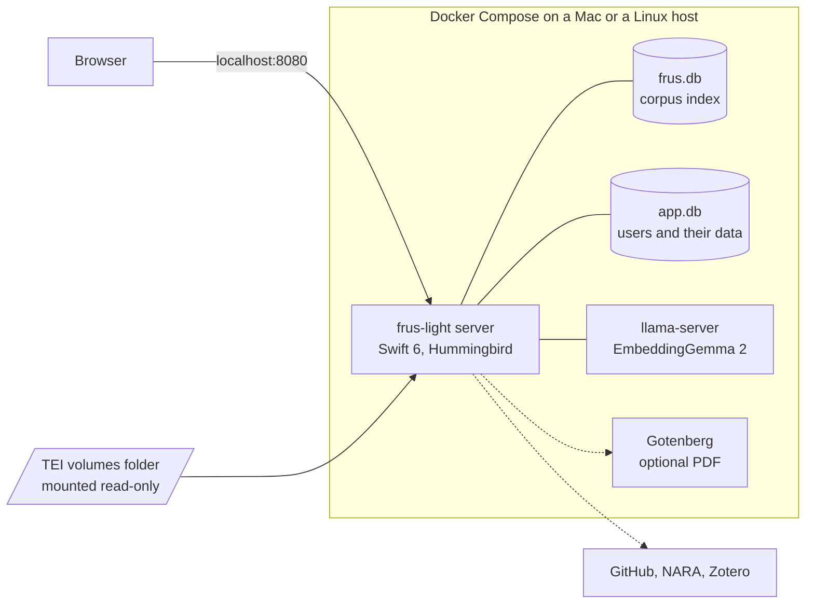

# FRUS Explorer Light

FRUS Explorer Light is a self-hosted web edition of [FRUS Explorer](https://github.com/joshbotts/FRUS-Explorer), the iOS, iPadOS and macOS app for researching the *Foreign Relations of the United States* series. One container serves the corpus, its full-text index, and each researcher's notes and highlights to any modern browser.

## Status

Phases 0 to 4 are done:

| Phase | Done |
| --- | --- |
| 0. The Linux spike | 5 October 2026 |
| 1. A reader over a Mac export | 13 October |
| 2. The research layer | 29 October |
| 3. The library and the archives | 23 November |
| 4. Semantic and language | 26 November, check 9 passing at full scale |

Phase 5, hardening, is next.

**The image** is `ghcr.io/joshbotts/frus-explorer-light:edge`, for amd64 and arm64, and the first release, `1.0-1861.1`, came on 22 November. The image holds every semantic vector and the search model.

**The server compiles the Mac app's own Swift code** from a pinned submodule: `v2`'s `efd73ecb` since 24 November, at index version 75. So it serves the exports of FRUS Explorer 1.0 (1861), the App Store build.

**Where to read more:**
- [`docs/INSTALL.md`](docs/INSTALL.md), the install guide;
- [`docs/SPEC.md`](docs/SPEC.md), what the edition does;
- [`docs/PLAN.md`](docs/PLAN.md), the plan;
- [`docs/DEVLOG.md`](docs/DEVLOG.md), the record of each session.

## What it does

Every feature below runs on the app's own code, held to the app by parity tests.

- **Two ways to get the corpus:**
  - Import mode serves a Mac export read-only.
  - Standalone mode keeps a library of its own: it downloads and indexes the 553 volumes itself, side-loads a TEI file, applies the Office of the Historian's corrections, and reviews with each researcher what a correction changed.
- **Search:**
  - the app's query language, with its facets, the Query Inspector, and the timeline, concordance and collocates readings;
  - search by meaning, with EmbeddingGemma 2, run by llama.cpp in the container;
  - Search Within These Results, which layers the two;
  - Semantic matches under a keyword search that finds nothing.
- **Reading:**
  - Browse, with axes for the editors' annotations, People and the semantic map's clusters;
  - the reader, with the app's own rendering, highlights and notes;
  - Cite, with BibTeX and RIS;
  - Citation Lookup.
- **Context for a document:**
  - Related Documents, ranked by provenance, cross-references, date, subjects, meaning and wording, with Beyond your library and feedback on a match;
  - the cross-reference graph;
  - Source Explorer, with the National Archives Catalog and Look Up in NARA;
  - Send to Zotero Library.
- **Analytics and language:**
  - Corpus, Person, Cross-Reference and Archival Analytics, Chronology and About the Series;
  - the Word Cloud, with Distinctive and Collocates, counted by a tagger of the web's own, since Linux has no NaturalLanguage;
  - the semantic map, with its lasso, its two-pole axis and its export.
- **Each researcher's own research:**
  - tags, highlights, notes and summaries;
  - saved searches, working corpora and volume scopes;
  - projects, with Project Home and the research trail;
  - collections, with their HTML, Word, BibTeX, RIS and PDF exports;
  - Archives Visits and their packet;
  - the Mac's JSON export, both ways.
- **Running it:**
  - local accounts, or sign-in through a trusted proxy;
  - serving at a host's root or under a path;
  - user data in SQLite or PostgreSQL, with a daily backup and `frus-light restore`;
  - Administration: status, jobs, users, backups, keys, the library and the semantic data;
  - PDF through the optional Gotenberg profile;
  - releases cut by hand.
- **Parity, checked in CI** on three fixture volumes: the same index rows, search results, document HTML, citation lookups and Source Explorer records as the Mac, and the same embeddings and nearest neighbours. Phase 3's and phase 4's sign-offs also checked them on the full corpus ([`docs/SPEC.md`](docs/SPEC.md#verification), checks 2, 7, 8 and 9).

## Known gaps

SPEC gives the detail of each.

- **Pieces of the app the web leaves out:**
  - Browse's own list of a volume's persons;
  - Summarize Again, which is Apple Intelligence;
  - a few parts of search by meaning, the analytics, the Word Cloud, the semantic map and Archives Visits.
- **The Word Cloud has no People, Places or Organizations lenses.** They need a tagger that recognizes names, which is phase 5's ([FRUS-Explorer#1972](https://github.com/joshbotts/FRUS-Explorer/issues/1972)).
- **Some sentences are the kit's, written for a device:** "you have not downloaded" in Beyond your library, "Downloaded" in the semantic map's export, and "on this device" in the map's export and an Archives Visit packet's coverage report.
- **The cross-reference graph** has no control for its timeline's range. A graph of more than 40 nodes labels only its central document, its clusters and the selection's neighbours.
- **NARA and Zotero have been tested only against stand-ins,** and a series' scope note is not shown ([FRUS-Explorer#1970](https://github.com/joshbotts/FRUS-Explorer/issues/1970)).
- **The note editor's two gaps** (L19, [#161](https://github.com/joshbotts/FRUS-Explorer-Web-App/pull/161)): the browser's Back, reload and close ask nothing before work is lost, and a new note starts on no project.
- **Two of the kit's calls wait for a follow-up** ([FRUS-Explorer#1902](https://github.com/joshbotts/FRUS-Explorer/pull/1902)): a document's number taken from its head, and one decode of the subject index.
- **On an Import server,** a curator's corrections wait for its next export.
- **Import mode's first comparison with its TEI folder** parses again every volume indexed before index version 75: about 4 to 5 minutes for the full corpus ([FRUS-Explorer#1909](https://github.com/joshbotts/FRUS-Explorer/issues/1909)).
- **A Standalone server seeded from an export** keeps a volume it holds no file for at the version it was indexed at, until that volume is downloaded again.
- **Open issues in the app that touch the web:**
  - a semantic map slice with no dated volume ([#1986](https://github.com/joshbotts/FRUS-Explorer/issues/1986)), which the server refuses before laying it out;
  - a duplicated visit plan's shown row ([#1989](https://github.com/joshbotts/FRUS-Explorer/issues/1989));
  - a collection's PDF printing its footnotes over each page ([#2015](https://github.com/joshbotts/FRUS-Explorer/issues/2015)), until the app's Collections overhaul;
  - four on the Zotero client's sends ([#1923](https://github.com/joshbotts/FRUS-Explorer/issues/1923) to [#1926](https://github.com/joshbotts/FRUS-Explorer/issues/1926)).
- **The `:1.0-1776` tag** names a build from 23 October, before the research layer. Follow `:1.0-1861` or `edge` instead.
- **Later phases:**
  - an analytics figure as PDF;
  - the upgrade drill, an accessibility audit and a load test (phase 5);
  - AWS (phase 6).

## Next

1. **Phase 5, hardening** ([`docs/PLAN.md`](docs/PLAN.md), once planned): the upgrade path, the backup and restore drill, an accessibility audit and a 20-user load test, with checks 11 and 12 as its exit.
2. **The web's own follow-ups:** the server's uses of #1902's two calls, and the note editor's two gaps.
3. **The app's open issues:**
   - [FRUS-Explorer#1970](https://github.com/joshbotts/FRUS-Explorer/issues/1970) to [#1978](https://github.com/joshbotts/FRUS-Explorer/issues/1978), [#1986](https://github.com/joshbotts/FRUS-Explorer/issues/1986), [#1989](https://github.com/joshbotts/FRUS-Explorer/issues/1989), [#2010](https://github.com/joshbotts/FRUS-Explorer/issues/2010) and [#2015](https://github.com/joshbotts/FRUS-Explorer/issues/2015);
   - the web takes each fix at the pin move after it merges;
   - #1974's fix asks for check 8 to run again on the full corpus ([`docs/COORDINATION.md`](docs/COORDINATION.md) §5).

## Development plan

The edition is built in phases 0 to 6, the last optional. Each is a visible slice with its own exit test, from the verification table in [`docs/SPEC.md`](docs/SPEC.md#verification).

Within a phase, work comes in sessions of one pull request each:
- **Shared code:** what the server needs from the app moves into the app's shared kits through pull requests on [`FRUS-Explorer`](https://github.com/joshbotts/FRUS-Explorer). The owner checks each on a Mac and merges it, and a pin move brings it into this build.
- **The server and the browser app:** this work runs without the Mac.

[`docs/PLAN.md`](docs/PLAN.md) lists every session with its done-when, and the owner's checkpoints.

| Phase | What it brings | Exit | Status |
| --- | --- | --- | --- |
| 0. Linux spike | The app's shared Swift kits on Linux; the indexer, search, the TEI renderer and citations in `FRUSCoreKit`; the parity harness | Checks 1–4 on three fixture volumes | Done 5 October 2026 |
| 1. Reader over an export | Import mode in Docker Compose; Browse; search; the reader; Cite | Checks 3–5 on a real export | Signed off 13 October |
| 2. Research layer | Notes, highlights, tags, projects, saved searches, collections and their exports; Citation Lookup; the Mac's JSON export both ways; backups; proxy sign-in, path serving, PostgreSQL and releases | Check 6 and a lossless JSON import | Signed off 29 October |
| 3. Library and archives | Standalone mode and corrections; Source Explorer, NARA and Zotero; the cross-reference graph and analytics; PDF; local accounts | Checks 2, 7 and 8 on the full corpus | Signed off 23 November |
| 4. Semantic and language | Search by meaning and Search Within These Results; Related's semantic axis; the map and Browse's clusters; the web's tagger, live word clouds, Distinctive and Collocates; Archives Visits | Check 9 | Signed off 26 November |
| 5. Hardening | The upgrade path, the restore drill, an accessibility audit and a 20-user load test | Checks 11 and 12 | Next |
| 6. Managed variant, optional | One ECS task on Fargate behind a signing-in load balancer, the index from an S3 snapshot, user data replicated to S3 | SPEC's managed-variant checks | Later |

## Goals

- **Keep the research tools.** Browse, full-text search and search by meaning, the reader with highlights and notes, collections, citation tools, Source Explorer and the analytics all stay.
- **Match the Mac app's results.** On the same inputs, the web edition produces the same index rows, the same search results in the same order, and the same document HTML.
- **Serve a researcher or a small group.** One person on a laptop or a home server, or a class or team sharing one instance. It is not designed as a public, high-traffic site.
- **Deploy simply.** Docker Compose on a Mac or a Linux host first; a managed deployment on AWS may follow in phase 6.

"Light" leaves out what depends on Apple-only frameworks:
- summary generation and iCloud sync;
- widgets and Live Activities;
- Spotlight, Handoff and TipKit tips;
- Audio Graphs, which data tables replace;
- native multi-window scenes, which browser tabs replace.

Summaries imported from the app are shown with their authorship labels, and people can write their own.

## Architecture

A Swift 6 server owns two SQLite files: `frus.db`, the corpus index, and `app.db`, the users and their data, which a shared deployment may keep in PostgreSQL instead. The browser runs a TypeScript single-page app and shows document HTML that the server renders.

| Part | Technology | Role |
| --- | --- | --- |
| Server | Swift 6 on Linux, Hummingbird 2 | REST API, sessions, jobs, and the single-page app's static files |
| Shared core | The Mac app's own Swift files, compiled from a pinned `FRUS-Explorer` submodule | Indexing, search and its query language, TEI parsing and HTML, citations, Source Explorer, semantic retrieval, word clouds and Archives Visits |
| Language | `FRUSLanguage`, the web's own tagger | Words, lexical classes and lemmas, since Linux has no NaturalLanguage |
| Corpus index | SQLite FTS5 with the `porter unicode61` tokenizer | The Mac index's schema, at the pinned index version |
| User store | SQLite, with FTS5 over each user's notes and summaries, or PostgreSQL | Notes, highlights, tags, collections, projects, users and sessions |
| Web client | TypeScript, React and Vite | Every screen. The reader reuses the app's own HTML, CSS and JavaScript in a sandboxed iframe |
| In the image | llama.cpp's `llama-server` with EmbeddingGemma 2; every semantic vector | Search by meaning, Related Documents' semantic axis and the map |
| Optional | Gotenberg | PDF export |

### Design decisions

| Decision | Reason |
| --- | --- |
| The index lives on the server, and the browser is a thin client | A container has real disk and CPU, so SQLite FTS5 runs natively, and one copy of user data needs no sync engine |
| The server compiles the Mac app's own Swift files | Query parsing, source-note parsing, citation matching and TEI rendering are large and heavily tested, and a second implementation would drift |
| The index comes from a Mac export, or the server builds it from TEI | The Mac's export is version-stamped and verifiable; Standalone mode indexes on Linux with the app's own indexer |
| User data lives apart from the corpus index | The Mac index copies notes, summaries and tags into corpus rows, which a shared server cannot do |
| Summaries are shown and hand-written, never generated | Apple's on-device FoundationModels framework has no Linux equivalent |
| The reader reuses the app's rendering assets | Highlight offsets depend on that exact document structure |

## Deployment

- **Docker Compose:** one image and one Compose file on a Mac or a Linux host, listening on 127.0.0.1.
  - Everything the server keeps lives in a named volume at `/data`. SQLite's write-ahead log needs a local filesystem, and on a Mac a folder shared from macOS into Docker's virtual machine is not one.
  - A folder of TEI volumes is mounted read-only, and a Mac export is imported with `docker compose cp`.
  - CI publishes the image to GitHub Container Registry for amd64 and arm64.
- **AWS, an optional phase 6:** one ECS task on Fargate, in private subnets behind an Application Load Balancer that handles sign-in.
  - The index comes from a read-only S3 snapshot.
  - User data stays in SQLite, replicated to S3 by Litestream.
  - The estimate is about $155–170 a month.

## Documents

- [`docs/INSTALL.md`](docs/INSTALL.md): installing and running the server with Docker Compose on a Mac or a Linux host, in Import or Standalone mode.
- [`docs/SPEC.md`](docs/SPEC.md): the specification. It covers what the web edition keeps, its architecture, data and operating modes, the HTTP API, deployment, verification and the delivery plan.
- [`docs/PLAN.md`](docs/PLAN.md): the development plan. It covers the owner's setup, the rules every session follows, each phase's sessions with what they delivered, owner checkpoints and risks.
- [`docs/DEVLOG.md`](docs/DEVLOG.md): the log of every session, newest first.
- [`docs/COORDINATION.md`](docs/COORDINATION.md): how the web edition and the Mac app's repository work together, and what a pin move takes.
- [`docs/prep/`](docs/prep/README.md): the readiness notes each phase was planned from.
- The specification and the plan have living copies in shared documents, the [specification](https://claude.ai/code/artifact/b4714a33-dd0c-4205-a78f-6839a718afca) and the [plan](https://claude.ai/code/artifact/14a2723a-7662-496d-b7c4-1aa33678233e); ask the owner for access.
- The FRUS volumes come from the Office of the Historian's public [HistoryAtState/frus](https://github.com/HistoryAtState/frus) repository.

## License

Apache License 2.0; see [`LICENSE`](LICENSE). The FRUS text itself is in the public domain. The image carries EmbeddingGemma 2, under Apache 2.0, with its licence and notice.
