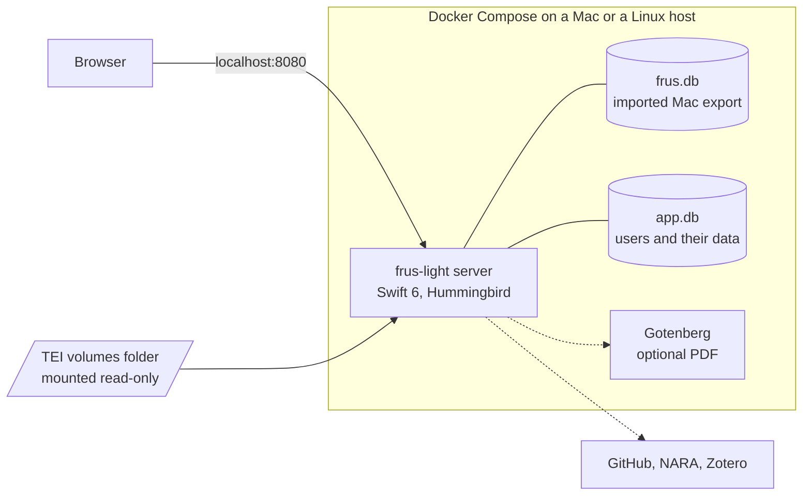

# FRUS Explorer Light

FRUS Explorer Light is a self-hosted web edition of [FRUS Explorer](https://github.com/joshbotts/FRUS-Explorer), the iOS, iPadOS and macOS app for researching the *Foreign Relations of the United States* series. One container serves the corpus, its full-text index, and each researcher's notes and highlights to any modern browser.

## Status

Phase 1 is done: a Docker Compose install that serves a FRUS Explorer research export, read-only, at `http://localhost:8080`. The owner signed it off on 13 October 2026. [`docs/INSTALL.md`](docs/INSTALL.md) is the install guide, [`docs/PLAN.md`](docs/PLAN.md) the plan and [`docs/DEVLOG.md`](docs/DEVLOG.md) the record of each session.

**What works today**, from the published image `ghcr.io/joshbotts/frus-explorer-light:edge`, for amd64 and arm64:

- Import of a Mac export copied into the `/data` volume, checked and served read-only. The server refuses an export from another index version and one that holds the owner's writing.
- Search with the app's query language, with the facets, the Query Inspector, the order by relevance or date, and the timeline and concordance readings, each saying which results it read. Each result carries its date, drawn as the app draws it, and a search you replace stops on the server.
- Browse, which lists a section's own text first, as the app does: a meeting's list of those present, say, above its minutes. The reader, with its text size and Reading Width, its links, which follow a printed page into a volume the server does not hold as 1.0 does, and the cards for people and terms. All of it is usable by keyboard and free of axe violations.
- Cite, with BibTeX and RIS, and Citation Lookup, opened by Search's Find by Citation: a citation pasted, its fields typed, or a chapter's footnotes at once, each looked up by the app's own matcher, its results labelled as the app labels them.
- Tags, the first of the research layer: the reader's Research rail tags a document, with the app's tag picker, and Settings ▸ Tags renames, merges and deletes, each by the app's rules, kept on the server.
- Highlights, as the app makes and draws them: a selection in the reader offers the four colours in a bar over the text, ⇧⌘H (Ctrl+Shift+H) highlights in yellow, and a tap on a highlight asks to remove it. The Research rail's Highlights section lists the document's highlights, each with its colour to change and Remove…. Check 6 holds the reader's text between offsets to the kit's in Chromium, on every fixture row. A server with no sign-in takes a change only from a page at its own address, with a token, as JSON; `FRUS_USER_DATA=off` makes it read-only.
- Notes and summaries: notes written with the app's formatting, kept as the Mac keeps them, in the Research rail and All Notes, and summaries shown with the app's words for who wrote them, beside the researcher's own; Settings ▸ Data exports the notes as the app's Markdown files.
- The Mac's JSON export imported into the server's research store, from Settings ▸ Data: every kind of record a file of format version 1 to 7 carries, each under its Mac id, a copy already held replaced only by a newer one, with a report of what came in, was replaced or was kept.
- Serving at the root of a host or under a path behind a reverse proxy, such as `https://example.org/frus-explorer/`, as `FRUS_PUBLIC_URL` says, with an nginx recipe for each in the install guide.
- Sign-in through that proxy, `FRUS_AUTH=header`: the proxy signs people in and names each in a header the server takes from the proxy's address alone, and each keeps research of their own, named at the top of every page, with a footer saying that whoever runs the instance can read it. The install guide's recipe checks a session with nginx and oauth2-proxy.
- Parity with the Mac app, checked in CI on three fixture volumes: the same index rows, search results and document HTML. The server compiles the app's own Swift code from a pinned submodule.
- A daily CI watch of the app's `v2` branch, which reports in one issue what the next pin move has to handle.
- Releases, cut by hand from a build that passed its smoke test and named for the FRUS Explorer build whose exports they serve, such as `1.0-1776.1`. Their notes name the image's digest and the index version, saying when it changed, and [`docs/INSTALL.md`](docs/INSTALL.md#releases) says how to follow them. The owner cuts the first.

**Known gaps**

- **Behind FRUS Explorer 1.0's last step.** The pin is 1.0 build 1776, the TestFlight build, at index version 71, with [FRUS-Explorer#1784](https://github.com/joshbotts/FRUS-Explorer/pull/1784), [#1785](https://github.com/joshbotts/FRUS-Explorer/pull/1785), [#1786](https://github.com/joshbotts/FRUS-Explorer/pull/1786), [#1788](https://github.com/joshbotts/FRUS-Explorer/pull/1788) and [#1787](https://github.com/joshbotts/FRUS-Explorer/pull/1787), the five commits after it: the server serves that build's exports. The App Store build, 1861, waits for S12d.
- **Later phases:**
  - no collections, saved searches or projects to work with on the web, though an import keeps them, no search of notes and summaries, and no daily backup of the research data yet (phase 2);
  - no local accounts, or indexing from TEI on the server (phase 3);
  - no search by meaning (phase 4);
  - no AWS deployment (phase 6).

**Next**

1. **S12d**, once the app tags `version-1.0`: the pin moves to 1.0 build 1861, the App Store build, and the owner can release `1.0-1861.1`.
2. **Phase 2**, planned in [`docs/PLAN.md`](docs/PLAN.md) as S14a–S19b: notes, highlights, tags, collections and the rest of the research layer, with a daily backup, the Mac's JSON export imported and written back, and Citation Lookup; and, for a shared deployment, sign-in through a trusted proxy, beside the releases S14g brought and the serving under a path S14f brought. S14a, the user store's schema and migrations, is done: a table for each of the app's 23 model types, held to the app's source in CI. So is S14c, the write path and tags, and S16b, a pin move that brought the server's build the kit's new code for the Mac's JSON export at version 7, the reader's highlights and Citation Lookup, and so was S15b's too. So is S15c, highlights and check 6, and S15d, notes and summaries, with the Mac's rich text kept in RTF through a codec of the web's own, held to the app's reading by golden spans; S19a, Citation Lookup, with check 7's matcher half through the API; S16c, the import of a Mac JSON export, checked on the owner's own; S16d, the export, the Mac's own file with one key of the web's; and S14e, sign-in through a trusted proxy, the last of the shared deployment's three asks. Next **S16e**, an export that holds the owner's writing, and **S17d**'s search in notes and summaries once S17c's pin move brings the kit's search of user text, with S14d, the PostgreSQL store, and S14b, the daily backup, beside them.

## Goals

- **Keep the research tools.** Browse, full-text search with the app's query language, the reader with highlights and notes, collections and their exports, citation tools, Source Explorer and analytics all stay. Search by meaning follows in a later phase.
- **Match the Mac app's results.** On the same inputs, the web edition must produce the same index rows, the same search results in the same order, and the same document HTML.
- **Serve a researcher or a small group.** One person on a laptop or a home server, or a class or team sharing one instance. It is not designed as a public, high-traffic site.
- **Deploy simply.** Docker Compose on a Mac or a Linux host first; a managed deployment on AWS follows in phase 6.

"Light" leaves out what depends on Apple-only frameworks: summary generation, iCloud sync, widgets and Live Activities, Spotlight, Handoff, TipKit tips, Audio Graphs and native multi-window scenes. Browser tabs replace windows, and data tables replace Audio Graphs. Summaries imported from the app are shown with their authorship labels, and people can write their own.

## Architecture

A Swift 6 server owns two SQLite files: `frus.db`, the corpus index, and `app.db`, the users and their data. The browser runs a TypeScript single-page app and shows document HTML that the server renders.

The diagram shows the Docker Compose install that ships first, with both databases in the `/data` volume. From phase 6, the same image also runs on AWS as one ECS task, with the index copied from S3.

| Part | Technology | Role |
| --- | --- | --- |
| Server | Swift 6 on Linux, Hummingbird 2 | REST API, sessions, jobs, and the single-page app's static files |
| Shared core | The Mac app's own Swift files, compiled from a pinned `FRUS-Explorer` submodule | Indexing, search and its query language, TEI parsing and HTML, citations, Source Explorer |
| Corpus index | SQLite FTS5 with the `porter unicode61` tokenizer | The Mac index's schema, at the pinned index version |
| User store | SQLite, with FTS5 over each user's notes and summaries | Notes, highlights, tags, collections, projects, users and sessions |
| Web client | TypeScript, React and Vite | Every screen. The reader reuses the app's own HTML, CSS and JavaScript in a sandboxed iframe |
| Optional services | `llama-server` running EmbeddingGemma; Gotenberg | Search by meaning; PDF export |

### Design decisions

| Decision | Reason |
| --- | --- |
| The index lives on the server, and the browser is a thin client | A container has real disk and CPU, so SQLite FTS5 runs natively, and one copy of user data needs no sync engine |
| The server compiles the Mac app's own Swift files | Query parsing, source-note parsing, citation matching and TEI rendering are large and heavily tested, and a second implementation would drift |
| The index comes from a Mac export, or the server builds it from TEI | The Mac's Export Research Database… file is version-stamped and verifiable, so serving it ships first; indexing on Linux follows |
| User data lives apart from the corpus index | The Mac index copies notes, summaries and tags into corpus rows, which a shared server cannot do |
| Summaries are shown and hand-written, never generated | Apple's on-device FoundationModels framework has no Linux equivalent |
| The reader reuses the app's rendering assets | Highlight offsets depend on that exact document structure |

## Deployment

- **Docker Compose, first:** one image and one Compose file on a Mac or a Linux host, listening on 127.0.0.1. Everything the server keeps lives in a named volume at `/data`, because SQLite's write-ahead log needs a local filesystem, and on a Mac a folder shared from macOS into Docker's virtual machine is not one. A folder of TEI volumes is mounted read-only, and a Mac export is imported with `docker compose cp`. CI publishes the image to GitHub Container Registry for amd64 and arm64.
- **AWS, in phase 6:** one ECS task on Fargate, in private subnets behind an Application Load Balancer that handles sign-in. At start the task copies a read-only snapshot of the index from S3 and opens it with SQLite's `immutable=1`. User data stays in SQLite, replicated to S3 by Litestream. A deploy stops the old task before starting the new one, trading a short outage for a single writer and no database service. The estimate is about $155–170 a month.

## Documents

- [`docs/INSTALL.md`](docs/INSTALL.md): installing the server with Docker Compose on a Mac or a Linux host, and importing a FRUS Explorer export.
- [`docs/PLAN.md`](docs/PLAN.md): the development plan. It covers the owner's setup, the rules every session follows, eleven sessions to phase 1 as a Compose install, the Compose install itself, the deferred AWS design, owner checkpoints and risks.
- [`docs/COORDINATION.md`](docs/COORDINATION.md): how the web edition and the Mac app's repository work together. App sessions follow four rules; web sessions carry the rest.
- [`docs/SPEC.md`](docs/SPEC.md): the specification. It covers what the web edition keeps, its architecture, data and operating modes, the HTTP API, deployment and runtime options, the managed-platform variant, verification and the delivery plan.
- [`docs/prep/`](docs/prep/README.md): readiness notes from a Linux dry run on 3 October, with the changes sessions 1–6 will need in the shared Swift files.
- Both files have living copies in shared documents, the [specification](https://claude.ai/code/artifact/b4714a33-dd0c-4205-a78f-6839a718afca) and the [plan](https://claude.ai/code/artifact/14a2723a-7662-496d-b7c4-1aa33678233e); ask the owner for access.
- The FRUS volumes come from the Office of the Historian's public [HistoryAtState/frus](https://github.com/HistoryAtState/frus) repository.

## License

Apache License 2.0; see [`LICENSE`](LICENSE). The FRUS text itself is in the public domain. EmbeddingGemma is never bundled with the image: an admin downloads it only after accepting the Gemma Terms of Use.
