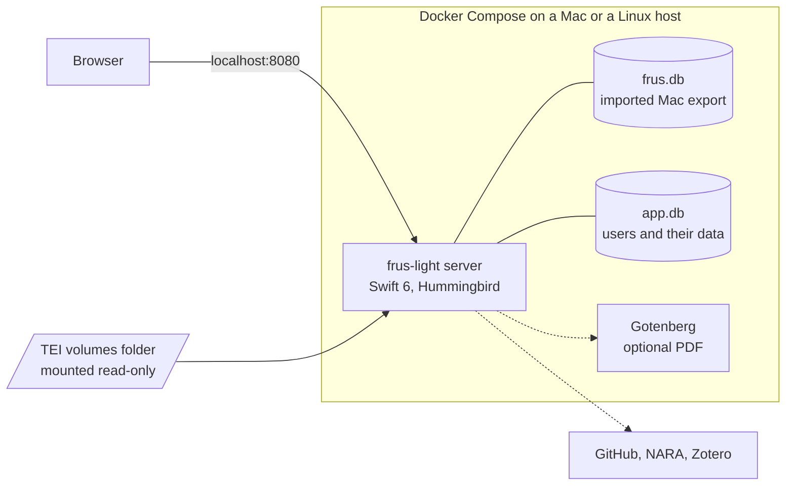

# FRUS Explorer Light

FRUS Explorer Light is a self-hosted web edition of [FRUS Explorer](https://github.com/joshbotts/FRUS-Explorer), the iOS, iPadOS and macOS app for researching the *Foreign Relations of the United States* series. One container serves the corpus, its full-text index, and each researcher's notes and highlights to any modern browser.

## Status

Phases 0 to 2 are done. Phase 1, a Docker Compose install that serves a FRUS Explorer research export at `http://localhost:8080`, was signed off on 13 October 2026, and phase 2, each researcher's notes, highlights, collections and the rest of the research layer, on 29 October. [`docs/INSTALL.md`](docs/INSTALL.md) is the install guide, [`docs/PLAN.md`](docs/PLAN.md) the plan and [`docs/DEVLOG.md`](docs/DEVLOG.md) the record of each session.

**What works today**, from the published image `ghcr.io/joshbotts/frus-explorer-light:edge`, for amd64 and arm64.

*The corpus:*

- Import of a Mac export copied into the `/data` volume, checked and served read-only. The server refuses an export from another index version. One that holds the owner's writing has it kept in the user's research data, marked as from a research database, and removed from the served copy; a read-only server refuses it.
- Search with the app's query language, with the facets, the Query Inspector, the order by relevance or date, and the timeline and concordance readings, each saying which results it read. Each result carries its date, drawn as the app draws it, and a search you replace stops on the server.
- Browse, which lists a section's own text first, as the app does: a meeting's list of those present, say, above its minutes. The reader, with its text size and Reading Width, its links, which follow a printed page into a volume the server does not hold as 1.0 does, and the cards for people and terms. All of it is usable by keyboard and free of axe violations.
- Cite, with BibTeX and RIS, and Citation Lookup, opened by Search's Find by Citation: a citation pasted, its fields typed, or a chapter's footnotes at once, each looked up by the app's own matcher, its results labelled as the app labels them.

*The research layer,* each researcher's own, kept on the server:

- Tags: the reader's Research rail tags a document, with the app's tag picker, and Settings ▸ Tags renames, merges and deletes, each by the app's rules.
- Highlights, as the app makes and draws them: a selection in the reader offers the four colours in a bar over the text, ⇧⌘H (Ctrl+Shift+H) highlights in yellow, and a tap on a highlight asks to remove it. The Research rail's Highlights section lists the document's highlights, each with its colour to change and Remove…. Check 6 holds the reader's text between offsets to the kit's in Chromium, on every fixture row. A server with no sign-in takes a change only from a page at its own address, with a token, as JSON; `FRUS_USER_DATA=off` makes it read-only.
- Notes and summaries: notes written with the app's formatting, kept as the Mac keeps them, in the Research rail and All Notes, and summaries shown with the app's words for who wrote them, beside the researcher's own; Settings ▸ Data exports the notes as the app's Markdown files.
- Search over the researcher's own writing, as the app's search window does it: Search in chooses the documents, the notes and the summaries, My Tags filters by the user's tags, counted over the results, and each result carries its tags. The facets, the Query Inspector and the readings count the same match, and each user searches their own alone.
- Saved searches with the Mac's "+N since last run", working corpora captured from a search and browsed and searched inside, volume scopes, and Checklist Mode, kept in the browser for the session.
- Projects, with the one each user works in and Project Home; the research trail of documents visited, searches run and exports, with its switch and Session Log; the method appendix as Markdown and CSV; and the Mac's synced preferences, the citation style among them.
- Collections and their editor: sections three deep, documents, note blocks in the app's rich text, excerpts frozen from the reader's selection, the five apparatus blocks, the inspector and section defaults, the presets and the order by date. A live preview sits beside the contents, and the HTML, Word, BibTeX and RIS exports are each the kit's to the byte, checked for quotations first and kept in the history. A collection's `.fruscollection` file goes both ways, and one the web wrote opens whole in the Mac app; a smart collection follows a saved search, with Create Static Snapshot.
- The Research page, the app's Research tab: every document the researcher has annotated, by collection, tag and highlight colour, as the app's own code gathers them, with Contains Notes, All Notes and History.
- The Mac's JSON export imported into the server's research store, from Settings ▸ Data: every kind of record a file of format version 1 to 7 carries, each under its Mac id, a copy already held replaced only by a newer one, with a report of what came in, was replaced or was kept. The same screen exports the researcher's data as the Mac's own file, with one key of the web's, which imports again unchanged.

*Running it:*

- Serving at the root of a host or under a path behind a reverse proxy, such as `https://example.org/frus-explorer/`, as `FRUS_PUBLIC_URL` says, with an nginx recipe for each in the install guide.
- Sign-in through that proxy, `FRUS_AUTH=header`: the proxy signs people in and names each in a header the server takes from the proxy's address alone, and each keeps research of their own, named at the top of every page, with a footer saying that whoever runs the instance can read it. The install guide's recipe checks a session with nginx and oauth2-proxy.
- The research store in `app.db`, the Compose install's, or in PostgreSQL, for a shared deployment that chooses one with `FRUS_USER_STORE`, every store method held alike on both by one conformance suite in CI.
- A daily backup of the research store, at 03:00 in the container's time zone or soon after a Mac that slept through it wakes, none when nothing changed, seven kept in the volume and seven more in `./backups` on the host; `frus-light restore` puts one back, and `GET /api/v1/admin/backup` gives the newest with a manifest of versions. The owner's restore drill found their research again.
- Parity with the Mac app, checked in CI on three fixture volumes: the same index rows, search results and document HTML. The server compiles the app's own Swift code from a pinned submodule.
- A daily CI watch of the app's `v2` branch, which reports in one issue what the next pin move has to handle.
- Releases, cut by hand from a build that passed its smoke test and named for the FRUS Explorer build whose exports they serve, such as `1.0-1776.1`. Their notes name the image's digest and the index version, saying when it changed, and [`docs/INSTALL.md`](docs/INSTALL.md#releases) says how to follow them. The first waits for phase 5; until then, follow `edge`.

**Known gaps**

- **Behind FRUS Explorer 1.0's last step.** The pin is 1.0 build 1776, the TestFlight build, at index version 71, with the 26 commits after it, among them this project's [FRUS-Explorer#1784](https://github.com/joshbotts/FRUS-Explorer/pull/1784) to [#1790](https://github.com/joshbotts/FRUS-Explorer/pull/1790), [#1805](https://github.com/joshbotts/FRUS-Explorer/pull/1805) to [#1807](https://github.com/joshbotts/FRUS-Explorer/pull/1807), [#1809](https://github.com/joshbotts/FRUS-Explorer/pull/1809) to [#1811](https://github.com/joshbotts/FRUS-Explorer/pull/1811), [#1813](https://github.com/joshbotts/FRUS-Explorer/pull/1813) and [#1814](https://github.com/joshbotts/FRUS-Explorer/pull/1814): the server serves that build's exports. The App Store build, 1861, waits for S12d.
- **Two parts of phase 2's screens wait for a pull request each:** Project Home's focus subjects, their editor, a lead's line and a visit's head; and Add Documents' Citations and Tags. The kit has made the code they call public since #1813 and #1814.
- **No release yet.** The first comes with phase 5. `:1.0-1776` still names a build from 23 October, before the research layer, so follow `edge`.
- **Later phases:**
  - no local accounts, indexing from TEI on the server, Source Explorer, NARA and Zotero, analytics, a collection's PDF, or the review of a document an update changed (phase 3);
  - no search by meaning, live word clouds or Archives Visits packets (phase 4);
  - no upgrade drill, accessibility audit or load test yet (phase 5);
  - no AWS deployment (phase 6).

**Next**

1. **The two follow-ups,** each a pull request of its own: Project Home's focus subjects, their editor, a lead's line and a visit's head, through `VolumeSubjectProfiles`, `ProjectFocusSuggestions`, `documentSnippets(forKeys:maxLength:)` and `extractHeader(from:)`; and Add Documents' Citations and Tags, through `CollectionCitationLineResolver` and `CollectionGeneratedBlocks.tagDocumentRefs`.
2. **S12d**, once the app tags `version-1.0`: the pin moves to 1.0 build 1861, the App Store build, and `edge` serves its exports.
3. **Phase 3's plan:** its rows, read from the app's code at the pin as phase 2's were on 23 October, for Standalone indexing, Source Explorer and the archives, analytics, PDF, and local accounts.

## Development plan

The edition is built in phases 0 to 6, the last optional, each a visible slice with its own exit test from the verification table in [`docs/SPEC.md`](docs/SPEC.md#verification). Within a phase, work comes in sessions of one pull request each, on two tracks. On the core track, code the server needs from the app moves into the app's shared `FRUSCoreKit` by pull requests on [`FRUS-Explorer`](https://github.com/joshbotts/FRUS-Explorer), which the owner checks on a Mac and merges, and a pin move brings each into this build. The server and browser-app track runs without the Mac. [`docs/PLAN.md`](docs/PLAN.md) lists every session with its done-when, and the owner's checkpoints.

| Phase | What it brings | Exit | Status |
| --- | --- | --- | --- |
| 0. Linux spike | The app's shared Swift kits on Linux; the indexer, search, the TEI renderer and citations moved into `FRUSCoreKit`, which the app and the server both compile; the parity harness and its golden files; the server's skeleton and image | Checks 1–4 on three fixture volumes: the kits' own tests, and index, search and renderer parity | Done 5 October 2026 (S0–S6) |
| 1. Reader over an export | Import mode in Docker Compose; Browse; search with the query language, the inspector, facets, timeline and concordance; the reader; Cite with BibTeX and RIS; one user on localhost | Checks 3–5 on a real export: search and renderer parity, and import acceptance | Signed off 13 October (S7–S10); its remaining features and FRUS Explorer 1.0 by 23 October (S11–S13) |
| 2. Research layer | Notes, highlights, tags, summaries, projects, saved searches, corpora, scopes, the history and its method appendix; collections with their preview and exports; Citation Lookup; the Mac's JSON export both ways; a daily backup and its restore. For a shared deployment: sign-in through a trusted proxy, serving under a path, releases cut by hand, and a PostgreSQL store | Check 6, highlights the same text on the web as on the Mac; a Mac JSON export imports every type it carries without loss | Signed off 29 October (S14–S19) |
| 3. Library and archives | Standalone mode: downloading, indexing and removing volumes on the server, corrections and the review of changed text; Source Explorer, NARA and Zotero, the cross-reference graph, analytics and About the Series; PDF through Gotenberg; local accounts | Checks 2, 7 and 8 on the full corpus: index, citation and Source Explorer parity | Next, to be planned |
| 4. Semantic and language | Search by meaning with EmbeddingGemma, the semantic Related signal and the map; a Linux lemmatizer, live word clouds and collocates; Archives Visits packets | Check 9: semantic parity | Later |
| 5. Hardening | The first release, the upgrade path, the backup and restore drill, an accessibility audit and a 20-user load test | Checks 11 and 12: the browser suite and performance on the full corpus | Later |
| 6. Managed variant, optional | One ECS task on Fargate behind a load balancer that signs people in, the index copied from an S3 snapshot, user data replicated to S3 | The managed variant's acceptance checks in SPEC | Later |

## Goals

- **Keep the research tools.** Browse, full-text search with the app's query language, the reader with highlights and notes, collections and their exports, citation tools, Source Explorer and analytics all stay. Search by meaning follows in a later phase.
- **Match the Mac app's results.** On the same inputs, the web edition must produce the same index rows, the same search results in the same order, and the same document HTML.
- **Serve a researcher or a small group.** One person on a laptop or a home server, or a class or team sharing one instance. It is not designed as a public, high-traffic site.
- **Deploy simply.** Docker Compose on a Mac or a Linux host first; a managed deployment on AWS follows in phase 6.

"Light" leaves out what depends on Apple-only frameworks: summary generation, iCloud sync, widgets and Live Activities, Spotlight, Handoff, TipKit tips, Audio Graphs and native multi-window scenes. Browser tabs replace windows, and data tables replace Audio Graphs. Summaries imported from the app are shown with their authorship labels, and people can write their own.

## Architecture

A Swift 6 server owns two SQLite files: `frus.db`, the corpus index, and `app.db`, the users and their data, which a shared deployment may keep in PostgreSQL instead. The browser runs a TypeScript single-page app and shows document HTML that the server renders.

The diagram shows the Docker Compose install that ships first, with both databases in the `/data` volume. From phase 6, the same image also runs on AWS as one ECS task, with the index copied from S3.

| Part | Technology | Role |
| --- | --- | --- |
| Server | Swift 6 on Linux, Hummingbird 2 | REST API, sessions, jobs, and the single-page app's static files |
| Shared core | The Mac app's own Swift files, compiled from a pinned `FRUS-Explorer` submodule | Indexing, search and its query language, TEI parsing and HTML, citations, Source Explorer |
| Corpus index | SQLite FTS5 with the `porter unicode61` tokenizer | The Mac index's schema, at the pinned index version |
| User store | SQLite, with FTS5 over each user's notes and summaries | Notes, highlights, tags, collections, projects, users and sessions |
| Web client | TypeScript, React and Vite | Every screen. The reader reuses the app's own HTML, CSS and JavaScript in a sandboxed iframe |
| Optional services | `llama-server` running EmbeddingGemma; Gotenberg | Search by meaning; PDF export |

### Design decisions

| Decision | Reason |
| --- | --- |
| The index lives on the server, and the browser is a thin client | A container has real disk and CPU, so SQLite FTS5 runs natively, and one copy of user data needs no sync engine |
| The server compiles the Mac app's own Swift files | Query parsing, source-note parsing, citation matching and TEI rendering are large and heavily tested, and a second implementation would drift |
| The index comes from a Mac export, or the server builds it from TEI | The Mac's Export Research Database… file is version-stamped and verifiable, so serving it ships first; indexing on Linux follows |
| User data lives apart from the corpus index | The Mac index copies notes, summaries and tags into corpus rows, which a shared server cannot do |
| Summaries are shown and hand-written, never generated | Apple's on-device FoundationModels framework has no Linux equivalent |
| The reader reuses the app's rendering assets | Highlight offsets depend on that exact document structure |

## Deployment

- **Docker Compose, first:** one image and one Compose file on a Mac or a Linux host, listening on 127.0.0.1. Everything the server keeps lives in a named volume at `/data`, because SQLite's write-ahead log needs a local filesystem, and on a Mac a folder shared from macOS into Docker's virtual machine is not one. A folder of TEI volumes is mounted read-only, and a Mac export is imported with `docker compose cp`. CI publishes the image to GitHub Container Registry for amd64 and arm64.
- **AWS, in phase 6:** one ECS task on Fargate, in private subnets behind an Application Load Balancer that handles sign-in. At start the task copies a read-only snapshot of the index from S3 and opens it with SQLite's `immutable=1`. User data stays in SQLite, replicated to S3 by Litestream. A deploy stops the old task before starting the new one, trading a short outage for a single writer and no database service. The estimate is about $155–170 a month.

## Documents

- [`docs/INSTALL.md`](docs/INSTALL.md): installing the server with Docker Compose on a Mac or a Linux host, and importing a FRUS Explorer export.
- [`docs/PLAN.md`](docs/PLAN.md): the development plan. It covers the owner's setup, the rules every session follows, the sessions of phases 0 to 2 with what each delivered, the Compose install itself, the deferred AWS design, owner checkpoints and risks.
- [`docs/COORDINATION.md`](docs/COORDINATION.md): how the web edition and the Mac app's repository work together. App sessions follow four rules; web sessions carry the rest.
- [`docs/SPEC.md`](docs/SPEC.md): the specification. It covers what the web edition keeps, its architecture, data and operating modes, the HTTP API, deployment and runtime options, the managed-platform variant, verification and the delivery plan.
- [`docs/prep/`](docs/prep/README.md): readiness notes from a Linux dry run on 3 October, with the changes sessions 1–6 will need in the shared Swift files.
- Both files have living copies in shared documents, the [specification](https://claude.ai/code/artifact/b4714a33-dd0c-4205-a78f-6839a718afca) and the [plan](https://claude.ai/code/artifact/14a2723a-7662-496d-b7c4-1aa33678233e); ask the owner for access.
- The FRUS volumes come from the Office of the Historian's public [HistoryAtState/frus](https://github.com/HistoryAtState/frus) repository.

## License

Apache License 2.0; see [`LICENSE`](LICENSE). The FRUS text itself is in the public domain. EmbeddingGemma is never bundled with the image: an admin downloads it only after accepting the Gemma Terms of Use.
