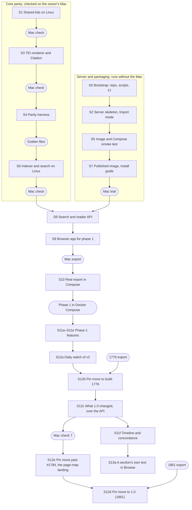

# FRUS Explorer Light — Development Plan

28 September 2026 · Josh Botts

## Summary

Work starts in `joshbotts/FRUS-Explorer-Web-App` and ships a Docker Compose install first: one image that runs on a Mac or a Linux host with `docker compose up`. The AWS deployment moves to phase 6, as the spec first planned, and its design stays recorded below, so that phase can start without re-deciding it.

| Decision | Choice |
| --- | --- |
| First offering | Docker Compose on a Mac or a Linux host, one user on localhost |
| Image | Built in CI and published to GitHub Container Registry, for amd64 and arm64 |
| User store | SQLite in the `/data` volume, backed up nightly from phase 2 |
| AWS | Deferred to phase 6: one ECS task on Fargate in private subnets, with snapshot mode and Litestream |

What this changes from the previous plan:

- **Phase 1 ships as a Compose install.** Import mode serves a Mac export from the `/data` volume, and the reader uses TEI files mounted read-only.
- **Sign-in waits for phase 3.** Phase 1 listens on 127.0.0.1 with no accounts, as the spec's phase 1 does. Local accounts arrive with multi-user support.
- **No cloud account is needed before phase 6.** CI publishes the image with the repository's own token, so there is no AWS setup, Terraform or NAT gateway until then.

The first deployable milestone is phase 1 in Compose: a real Mac export, searchable and readable at `http://localhost:8080` after `docker compose up`. Work proceeds in cloud sessions, each sized to one pull request with green CI, in two tracks: core parity, which needs the owner's Mac to verify, and server plus packaging, which does not.

## Before the first session

The owner makes these one-time settings before session 0. None takes more than a few minutes.

**GitHub**

- [x] Use `joshbotts/FRUS-Explorer-Web-App` for the web edition. It holds the README, this plan and the specification.
- [x] Make the web repository public. On GitHub Free, branch protection and native arm64 runners are offered only for public repositories, and their Actions minutes are free.
- [ ] Select two repositories when starting each session: `FRUS-Explorer-Web-App`, where the work lands, and `FRUS-Explorer`, for the upstream pull requests phase 0 needs. A session's repositories are fixed when it starts.
- [ ] Confirm the Claude GitHub App is installed on both, from [claude.ai/connect-github](https://claude.ai/connect-github).
- [x] After S0's first CI run, protect `main` on the web repository: changes arrive by pull request, with no required approvals, since you merge your own, and CI's `swift` job is a required check. After S5, `compose` is required too. GitHub offers a check only after it has run once. `FRUS-Explorer` is public, so CI can fetch it as a submodule without a token.
- [x] Before S7, let GitHub Actions publish packages. `image.yml` asks for `packages: write`; if your account restricts workflow permissions, allow it.

**Cloud environment** (the cloud environment menu in the session's title bar, then Edit)

- [ ] Setup script: paste the script below. It starts Docker, pulls the Swift 6.4 image, and installs the SQLite headers.
- [ ] Network access: nothing to add. The AWS phase will need `registry.terraform.io`.
- [ ] Secrets: none. CI publishes the image with the repository's own token.

```bash
#!/usr/bin/env bash
# Setup script for FRUS-Explorer-Web-App cloud sessions.
set -euo pipefail

# The image ships dockerd but does not start it.
if ! docker info >/dev/null 2>&1; then
  nohup dockerd >/var/log/dockerd.log 2>&1 &
  for _ in $(seq 1 30); do docker info >/dev/null 2>&1 && break; sleep 1; done
fi
docker pull -q swift:6.4-noble

# SQLite headers and CLI, for FTS5 work outside Docker.
apt-get update -qq
apt-get install -y -qq libsqlite3-dev sqlite3
```

Each step was run in this session on 28 September. The session had 4 vCPUs, 15 GB of memory and about 30 GB of free disk. Docker 29.3.1, with Compose 5.1.1 and Buildx 0.31.1, was installed but not running; Swift was absent, and Node 22.22.2 was present. Containers reach the network only with `--network host` and the session's proxy variables, which session 0 wraps in a script.

**Mac** (the owner's machine)

- [x] Install a container runtime that runs Compose files: Docker Desktop, Podman Desktop or Colima. Docker Desktop needs a paid subscription in larger organisations, so check what yours allows.
- [ ] After session 0 pins the submodule, build FRUS Explorer in Xcode 27 from the pinned commit, which `git submodule status` names. Make the golden files after S4 and the export before S10 with this build. Golden files from other code test the wrong thing, and the server rejects an export from another index version. When the pin moves, rebuild, make a new three-volume export with that build as the top of `scripts/make-golden` describes, emptying the library with Erase Everything… first, since a build at the same index version does not re-index what an earlier build indexed, and refresh the golden files with `scripts/make-golden --export <file>` in the pull request that moves the pin: its `swift` check fails on golden files made from other app sources or resources.
- [x] Download three small fixture volumes in the Mac app, before session 4: `frus1894Nicaragua` (1.27 MB), `frus1961-63v06` (1.65 MB) and `frus1969-76ve09p1` (1.89 MB). They span three eras and both print and electronic-only volumes. The Mac's copies are byte-identical to HistoryAtState/frus commit `8e5da08`.

`scripts/mac-check` checks these items, plus macOS 26 or later and Xcode 27, and marks anything due later. It changes nothing. If macOS asks, let Terminal access data from other apps.

## Repository layout and session rules

The web repository compiles the Mac app's shared Swift files straight from a pinned `FRUS-Explorer` submodule, so parity comes from the build rather than from copying. Both halves of that were tested here. A target whose path points into the nested checkout compiled SourceNoteKit and passed its tests on Linux. A `CSQLite` system module linked SQLite 3.45.1 with FTS5. On 3 October, at `34a5120`, a dry run of the whole S0 package passed SourceNoteKit's 292 tests, CrossRefKit's 10 and GeneratorKit's 7, and the FTS5 check, in `swift:6.4-noble` with no warnings. `docs/prep/` records what that run found for later sessions.

```text
FRUS-Explorer-Web-App/
├── CLAUDE.md                  session rules, kept short
├── compose.yaml               the Docker Compose install
├── docs/PLAN.md               this plan and its checklist
├── docs/SPEC.md               the specification
├── docs/INSTALL.md            install, import, upgrade and backup, from session 7
├── docs/DEVLOG.md             one entry per session
├── docs/prep/                 readiness notes and Linux change lists for S1–S6
├── Package.swift              the server, plus Linux builds of the shared kits
├── upstream/FRUS-Explorer/    git submodule, pinned to a merged commit
├── Sources/CSQLite/           system module for SQLite on Linux
├── Sources/FRUSLightCore/     web-only logic: import, overlay, user store
├── Sources/FRUSLightServer/   Hummingbird 2 executable
├── Tests/                     unit tests and the parity harness
├── fixtures/tei/              the three fixture volumes, about 4.8 MB
├── fixtures/parity/           the check-3 query list and its rules
├── fixtures/golden/           Mac-generated golden outputs, as JSON and HTML
├── web/                       the TypeScript SPA (React, Vite)
├── docker/Dockerfile          multi-stage image
├── scripts/swift              runs swift in swift:6.4-noble with the session proxy
├── scripts/doctor             checks the session's prerequisites
├── scripts/mac-check          checks the owner's Mac against this plan
├── scripts/make-golden        writes the golden files on the owner's Mac
├── tools/mac-golden/          Mac-only: runs the app's own code for the golden files
└── .github/workflows/         ci and image; terraform and deploy arrive in phase 6
```

These rules go into `CLAUDE.md` in session 0:

1. Start with `scripts/doctor`. Build and test only through `scripts/swift`, `npm --prefix web` and `docker compose`.
2. One session, one pull request, on the branch the session is given. Push before the session ends, and never push to `main`.
3. A session ends with CI green on its pull request and an entry in `docs/DEVLOG.md` that records what it delivered and names the next task.
4. Shared behaviour is compiled from the submodule, never reimplemented. A fix to a shared file is a pull request on `FRUS-Explorer`, labelled for Mac verification; a session never merges it.
5. The submodule pin moves only to a merged `FRUS-Explorer` commit, in a pull request of its own.
6. Never commit Mac exports, TEI beyond `fixtures/`, EmbeddingGemma, credentials, `.build/` or `node_modules/`.
7. Sessions never publish images. CI publishes from `main`.

| Workflow | Runs on | Does |
| --- | --- | --- |
| `ci.yml` | Every pull request | Swift build and test in `swift:6.4-noble`; SPA lint, test and build; the image build and a Compose smoke test |
| `image.yml` | `main` | Builds amd64 and arm64 images natively and pushes them to GitHub Container Registry under the commit's tag; after a Compose smoke test on both, moves `edge` to that build |

## Session plan

Eleven sessions take the project to phase 1 as a Compose install; S8 has since become three. They alternate between two tracks, so work continues while the owner verifies on the Mac.



S0 comes first, and the core track starts after it. The tracks join at session 8, whose search and reader endpoints need both the Linux indexer and the server. Each row below is one pull request. S8 became three rows on 6 October, and S9 two the same day: S9a meets S9's done-when first, and S9b completes the phase-1 SPA. S9c, the pin move past S9b's upstream pull requests, followed on 7 October. A pin move to build 50 (`c6f7b2cb`, index version 69), outside these sessions, followed on 13 October: the owner made S10's exports from that build. S11a–S11c, added on 13 October after the owner signed phase 1 off, bring the phase-1 features SPEC lists that S10's checks did not need. S11c became two rows the same day, as S8 and S9 had: S11c brings Cite, the lists' titles and the reader's landing, and S11d the search features, which became two rows on 14 October: S11d brings the facets, and S11e the rest. S11e became two rows the same day: S11e brings the Query Inspector and the date order, and S11f the timeline and concordance readings. On 22 October, [issue #37](https://github.com/joshbotts/FRUS-Explorer-Web-App/issues/37) found the app's `v2` 85 commits past the pin, at its 1.0 release candidate (`build-51`, index version 71), with no web session having seen them: the daily watch was never added. Four rows catch up: S12a adds the watch, S12b moves the pin to `build-51` (1.0, build 1776), S12c brings what 1.0 changed that the web edition serves, and S12d moves the pin to `version-1.0` (build 1861) once it is tagged, before or after S12c. S11f follows S12c, so its readings are built on 1.0's search. S12a and S12b were done on 22 October: S12b moved the pin to `f0479037`, with golden files from the owner's 1776 export. S12c was done on 23 October at that pin: it serves a result's date and the reader's Reading Width, stops a search its client abandons, and opened [FRUS-Explorer#1784](https://github.com/joshbotts/FRUS-Explorer/pull/1784), which moves the page-map landing into the kit. The owner merged it the same day as `af41efa4`, and S12e, a pin move of its own, served the landing that day, before `version-1.0` was tagged, so S12d moves the pin on from `af41efa4`. S11f was done the same day at that pin: the timeline and the concordance over the API and in the browser app, computed with kit code #1664 had made public, so it needed no upstream pull request. Two rows were added the same day for what remained before a release, run in parallel: S13a, Browse's rows for a section's own text, and S13b, the speed of exact-word search. S13a was done that day at the same pin: which row is a section's own text is the kit's rule, so it too needed no upstream pull request.

| Session | Track | Delivers | Done when |
| --- | --- | --- | --- |
| S0 | Both | The scaffold: the submodule pinned to `34a5120` on `FRUS-Explorer`'s `v2` branch, which matches the owner's Mac build and export (index version 65); `Package.swift` with the Linux-ready kits and `CSQLite`; both scripts, `CLAUDE.md`, the log and `ci.yml`; the fixtures, with their SHA-256 sums | CI runs every test in SourceNoteKit, CrossRefKit and GeneratorKit at the pin, none skipped (292, 10 and 7 at `34a5120`), plus an FTS5 check, and passes |
| S1 | Core | An upstream pull request with Linux guards: `FoundationXML` in TEIHeaderKit, swift-crypto in SemanticVectorsKit, and `CSQLite` plus a logging shim in FTS5Store | All six portable kits build on Linux and their tests pass: the spec's check 1 |
| S2 | Server | The Hummingbird 2 server: configuration, `/healthz`, `/readyz` and `/api/v1/status`; Import mode, which validates a Mac export and opens it with `immutable=1`; the spec's five v1 interfaces | Tests import a synthetic export they build, and walk `/readyz` through every step |
| S3 | Core | `FRUSCoreKit`, part 1, an upstream pull request: the TEI parser, AST, render conversion and HTML serializer, the citation formatter, parser and models, and `PageSpanResolver`, compiled from the app's own files. The reader's path is the kit's public API (`ReaderLookups`, the converter's `init(readerOf:lookups:brokenRefs:)` and the serializer's `reader`), and the app's reader calls it too. The kit's suites run in Xcode and under `swift test`. After the merge, the pin-move pull request adds the kit to CI | The renderer turns the three fixture volumes into HTML on Linux through the kit's public API, byte-identical to the golden files, and check 7's formatter and parser half passes |
| S4 | Core | The parity harness: `frus-parity`, which summarizes any `frus.db` (row counts and a content hash per table, ordered by natural key); the query list; `tools/mac-golden`, which runs the app's own code on the Mac to write the golden files; and the tests for checks 2–4 | The tests run against golden files as soon as the owner commits them |
| S5 | Server | `docker/Dockerfile`, `compose.yaml` with the optional Gotenberg service, and a Compose smoke test in `ci.yml` | CI runs `docker compose up` on a synthetic export and gets 200 from `/readyz` |
| S6 | Core | `FRUSCoreKit`, part 2, in two upstream pull requests: A, `IndexingPipeline` and `SearchService` on Linux; then B, the citation matcher, block splitter and `PageRangeStore`, which need them. One pin move follows both | Checks 2–4 pass on the three fixture volumes, with indexing speed and memory recorded: phase 0's exit. Check 7's matcher and splitter half passes: 70 of CitationMatchingEngineTests' 74 (the other four need `AppState`, the WebKit link handler or the app's views' source, and stay Xcode's), CitationBlockSplitterTests (18) and the manifest-backed formatter test |
| S7 | Server | `image.yml`, publishing amd64 and arm64 images, and `docs/INSTALL.md` for a Mac and a Linux host | The owner installs from the published image by following the guide |
| S8a | Both | An upstream pull request ([FRUS-Explorer#1575](https://github.com/joshbotts/FRUS-Explorer/pull/1575), merged 6 October as `101e17d7`): the kit opens an exported index read-only and immutable, names a host's figure addresses, and holds the reader's page. Beside it, web groundwork at the old pin: the server links FRUSCoreKit through `FRUSLightAPI`; the app's data files are in the image (`FRUS_RESOURCES_DIR`); errors are problem details; `/volumes` lists the catalogue; the reader serves a document's body from the TEI; and a decoder turns a search's query string into the kit's `SearchParameters` | Check 4 passes through the reader's route, and all 482 parity queries decode into the Mac's `SearchParameters` |
| S8b | Core | The pin move to `101e17d7`, with golden files from a new three-volume export, and tests of the read-only open on the fixture index | The golden HTML and expressions change only in provenance, and the read-only open answers as the writable index does |
| S8c | Both | Search, browse and the reader's full page over the imported index, opened read-only, with figures and the reader's host script | Check 3 passes through the API, on the real Import path |
| S9a | Both | The SPA's foundation, served by the server with its own policy: `scripts/npm`, React 19 with TanStack Router and Query in `web/`, the shell, Search, the reader and the Cite rail; the citation endpoint, from the kit's formatter; the image's client stage; and the browser suite in CI's compose job | Playwright on Chromium searches, opens a document and copies a citation |
| S9b | Both | The rest of the phase-1 SPA: Browse (the catalogue and a volume's reading order), the reader's links (`doc/` navigates, `person/` and `gloss/` open cards, `brokenref/` the Unresolved Reference sheet), a full keyboard path and an axe check in the browser suite | Playwright browses to a volume, opens a document, follows a link inside it and opens a person card, by keyboard alone, with no axe violations |
| S9c | Both | The pin move to `f384d2d5` (#1578, #1579), with golden files from a new three-volume export; the server reads links with the kit's `readerLink(from:)`, lands page links through `PageRangeStore`, and gives the person card its count through `PersonMentionStore`, both opened immutably; the axe allowance emptied | The golden HTML and expressions change only in provenance; page links and counts through the API match the app's own stores over the fixture index; nothing on the page fails axe, the reader's frame included |
| S10 | Both | The owner's real export imported into Compose, with a TEI folder mounted read-only, as chosen before S7 | Checks 3–5 pass on the real export: phase 1's exit |
| S11a | Core | Two upstream pull requests of phase-1 features: [FRUS-Explorer#1664](https://github.com/joshbotts/FRUS-Explorer/pull/1664) (merged 13 October as `9feff971`), the concordance, the facets with the facet panel's narrowing and selection, the Query Inspector's model and the result list's date order; and [FRUS-Explorer#1666](https://github.com/joshbotts/FRUS-Explorer/pull/1666) (merged 13 October as `757c6d29`), the BibTeX, RIS and Zotero exporters, the TEI's publication year, display titles, the header display, the reader's footnote landing and the volume address. The app calls the moved code too | Both open, each quoting both app builds, the full iOS unit run and `swift test`, and both build and pass on Linux over this repository's `main` |
| S11b | Core | The pin move past both, with golden files remade from a three-volume export: the 13 October one, which the owner chose to reuse | The golden HTML and expressions change only in provenance |
| S11c | Both | The Cite and reader features over the API and in the browser app: BibTeX and RIS in Cite, with the year the TEI header states; display titles in lists; the footnote landing with the app's own script; and a whole volume outside the catalogue opening its page on history.state.gov. With them, CI counts skips in Swift Testing's results file rather than its log | Each feature answers through the API as the moved kit code does, and Playwright uses each on Chromium with no axe violations |
| S11d | Both | The facets over the API and in the browser app: each section of a search's whole match, with include, exclude and Apply for years and volumes, a click that narrows for people, type and subject, and the filters they set | The same as S11c's |
| S11e | Both | The Query Inspector over the API and in the browser app, with each term's counts and the term that matched nothing, and the date order | The same as S11c's |
| S12a | Server | The daily watch of the app's `v2` that COORDINATION §5 assigns to web sessions: a scheduled workflow, with a manual trigger, that builds and tests the shared kits and this package at `v2`'s head on Linux, compares the index version, the FTS generation, `IndexingResources.indexResourceNames` and the kit's `CREATE TABLE` statements with the pin, and opens one web issue, or updates the open one, with what is new and the commits since the pin. It never moves the pin and never fails `main`'s checks | A manual run at `v2`'s head opens an issue naming index version 71 and `cited-page-map.json`, and a second run updates that issue rather than opening another |
| S12b | Both | The pin move to `build-51` (`f0479037`), the app's 1.0 TestFlight build (1776), past the 18 pull requests on shared code and bundled data that issue #37 lists, so that CI publishes `:1.0-1776`. It brings: index version 71 in `Compatibility.swift`, `docs/INSTALL.md` and SPEC; `cited-page-map.json` and the other changed resources in the image, which `ServerResources` takes from `indexResourceNames`; the web tests that name build 50's facts, which a dry run at `build-51` found with no Linux repair needed (`docs/prep/README.md`, The 1.0 pin move); the golden rows' count wherever the records give it, since the three fixture volumes now give 393 rows, not 392 (#1746); the snippet rule for a row whose only match is in its own fields, which carries no `<b>` (#1736); any pinned reader page head re-taken with `--reader-measure` (#1699); the export-schema fixture confirmed against the 1776 export, or replaced; release tags in `image.yml`, `:<version>-<build>` read from the pinned `project.yml`'s `MARKETING_VERSION` and `CURRENT_PROJECT_VERSION` (`1.0` and `1776` at `build-51`); and SPEC's bundled-data and licensing lines for EmbeddingGemma 2, under Apache 2.0, with the Gemma Terms file gone (#1674) | CI passes at the new pin, every kit suite counted and no skip outside the allow-list; checks 2–4 pass against golden files remade from the owner's 1776 three-volume export, and every change in them from the last set is one an upstream pull request names; after the merge, `image.yml` publishes `:1.0-1776` beside `edge` |
| S12c | Both | What 1.0 changed that the web edition serves, over the API and in the browser app, each as the app shows it: a result's date range and precision (`SearchResult.dateISOMax`, `datePrecision`, `drawnDate`, #1746); the reader's Reading Width (`ReaderMeasure`, #1699) beside appearance and text size; a replaced search stopping its statements through the kit's one progress handler (`SearchStatementStop`, #1698) when its request is gone; and the pages and rows that 1.0's index changed (cross-volume page references under rule C, #1747; a section's row dated by its documents, #1746). A page link into a volume the server does not hold, which the app lands on the document the bundled page map names (#1778), is app code (`CitedPageMapStore` and the URL handler), so S12c opens the upstream pull request that moves it into the kit, under rule 4, and the web edition serves it after the pin move that follows its merge | The same as S11c's, and the upstream pull request open with its Mac check listed |
| S12e | Both | The pin move to `af41efa4`, the merge of [FRUS-Explorer#1784](https://github.com/joshbotts/FRUS-Explorer/pull/1784), one commit past `build-51` with the same build and index version, and the page-map landing it makes possible (#1778): the link route asks the kit's `PageLink` where a link to a printed page goes, with the volumes the served index holds as the device's, the served `PageRangeStore` and the bundled `cited-page-map.json`, and `WholeVolumeLink` where a link that opens a volume goes. The browser app opens the document `PageLink` names as a cross-reference's, or the volume's page in Browse, which names the page in the words of the app's `FollowedPageLink.notice`, made the server's | CI passes at the new pin, every kit suite counted and only the named skip; checks 2–4 pass against the golden files, remade from the 1776 three-volume export by the owner's choice (COORDINATION §5); the landing answers through the API as the kit's `PageLink` decides, and Playwright follows a page link into a volume the server does not hold on Chromium with no axe violations |
| S12d | Both | The pin move from `af41efa4` to `version-1.0`, the App Store build (1861), once the app's repository tags it, so that CI publishes `:1.0-1861`. The app's submission step restores the build number, and anything else 1.0 changes in shared code since `build-51` is read as issue #37 read the 85 commits. S12e served the page-map landing first, at `af41efa4` | CI passes at the new pin; checks 2–4 pass against golden files remade from the owner's 1861 three-volume export, or from the 1776 export by the owner's choice if the indexing path is unchanged (COORDINATION §5); after the merge, `image.yml` publishes `:1.0-1861` |
| S11f | Both | The timeline and concordance readings over the API and in the browser app, each naming the set it counted. It follows S12c, at the 1.0 pin | The same as S11c's |
| S13a | Both | Browse's rows for a section's own text, over the API and in the browser app, as the app's Browse lists them ([joshbotts/FRUS-Explorer#1536](https://github.com/joshbotts/FRUS-Explorer/issues/1536)): the text a section prints outside the documents and sections it holds, such as a meeting's list of those present, first in the section, above both, named **Read** and the section's title over the app's sentence, and opening in the reader. Which row it is, is the kit's `VolumeSection.ownTextEntry(among:)` over the index's rows, for a section that holds documents or only sections, with the rows 1.0 added for a heading's footnote (#1746); any part of the rule that is app code moves into the kit first, by an upstream pull request | The same as S11c's: the rows answer through the API as the kit gives them, and Playwright browses to one by keyboard on Chromium with no axe violations. No fixture volume has such a row, so the kit's own fixtures for them are indexed and imported as an export, and every section of the full 1776 export is checked through the API |

Before writing the S1, S2, S3 and S4 prompts, read `docs/prep/README.md`. A dry run on 3 October found what each of those sessions needs beyond this table, and recorded the Linux changes for S1, S3 and S6.

After phase 1, sessions follow the spec's phases 2–5. Phase 2 adds user data and its nightly backup. Phase 3 adds Standalone indexing, local accounts and a reverse-proxy recipe for sharing beyond localhost. AWS returns as phase 6.

## Docker Compose install

Phase 1 ships as one image and one Compose file. Everything the server keeps lives in a named volume at `/data`, and a folder of TEI volumes is mounted read-only. Session 5 built both; the repository's `compose.yaml` is the working version of the sketch below. It adds hardening and settings, and puts Gotenberg behind a `pdf` profile, off by default.

```yaml
services:
  frus:
    image: ghcr.io/joshbotts/frus-explorer-light:edge
    ports:
      - "127.0.0.1:8080:8080"
    volumes:
      - frus-data:/data
      # TEI volumes, read-only: ./tei by default, or FRUS_TEI_DIR
      - "${FRUS_TEI_DIR:-./tei}:/data/volumes:ro"
    environment:
      FRUS_MODE: import
      FRUS_AUTH: none
      FRUS_PUBLIC_URL: http://localhost:8080
      FRUS_PDF_URL: http://pdf:3000
    restart: unless-stopped

  pdf:                             # optional; remove it to hide PDF export
    image: gotenberg/gotenberg:8
    restart: unless-stopped

volumes:
  frus-data: {}
```

Importing a Mac export takes three steps:

1. On the Mac, use Settings ▸ Data & Recovery ▸ Export Research Database…. The full corpus is about 2.8 GB, measured on 3 October.
2. Copy the file into the volume with `docker compose cp <export file> frus:/data/import/`.
3. The server runs the Import checks, moves the file into place and opens it read-only. `/readyz` reports each step.

- **`/data` stays a named volume.** On a Mac, Docker runs Linux in a virtual machine, and a folder shared from macOS is not a local filesystem to it, while SQLite's WAL needs one. Only the TEI folder is a bind mount, and it is read-only.
- **FRUS Explorer's TEI folder needs Docker Desktop's permission.** Session 5 found that Docker Desktop is refused the app's folder under `~/Library/Containers`, because macOS keeps other apps out of an app's container. A clone of HistoryAtState/frus works: its `volumes/` folder holds the same TEI XML the app downloads, though not the figure images the app fetches from static.history.state.gov. Allowing Docker Desktop to read FRUS Explorer's data in System Settings fixes this, and gives the figure images too; `docs/INSTALL.md` uses that on a Mac and the clone on Linux.
- **The port listens on 127.0.0.1**, so nothing else on the network can reach it. Sharing beyond localhost waits for phase 3's local accounts, behind a TLS reverse proxy such as Caddy.
- **Upgrades** are `docker compose pull` and then `docker compose up -d`. The index already sits in the volume, so a restart copies nothing. The server refuses an index whose version it does not support; export again from the Mac. `edge` tracks `main`; from the first release, tags name the app's version and build, such as `:1.0-1861`.
- **Backups** start in phase 2, when user data exists: a nightly SQLite backup of `app.db` to `/data/backups`.
- **Disk:** a full export is about 2.8 GB. A re-import holds the export, its checked copy, the live index and the previous one, so allow about 15 GB free.
- **Memory:** importing and serving the full corpus used about 130 MB in session 7's rehearsal, well under the spec's 4 GB estimate. The reader keeps the four volumes it parsed last: reading across the 16 largest volumes, eight times over, levelled off at about 170 MB (S8a). Search, from S8c, will need more. Indexing, which Standalone mode will do, peaked at 136 MiB over a 24-volume sample at S6's pin move (SPEC, Sizing).
- **Apple silicon:** the published image includes arm64, so it runs natively.

There is no hosting cost; the install runs on hardware the owner already has.

## Deferred: AWS deployment (phase 6)

AWS moves to phase 6, after hardening, as the spec first planned. The decisions below stand, so the phase can start without re-deciding them: one ECS task on Fargate, stop-before-start deploys, private subnets with one NAT gateway, snapshot mode and Litestream.

| Piece | Setting |
| --- | --- |
| Network | A VPC across two Availability Zones. The task runs in private subnets with no public IP, so only the load balancer is reachable from the internet, and the service passes Security Hub's ECS.2 check. Outbound traffic leaves through one NAT gateway with a fixed Elastic IP. An S3 gateway endpoint carries snapshot copies and image layers, so they skip the NAT gateway's per-gigabyte charge |
| S3 | One bucket with `snapshots/`, `tei/`, `litestream/` and `backups/`. Versioning on, public access blocked, SSE-S3 encryption, noncurrent versions expired after 30 days |
| ECR | One repository: immutable tags, scan on push, the last 20 images kept |
| Task definition | Fargate on Linux x86-64; 2 vCPU and 8 GB to start, since the spec's sizing is an estimate; 50 GiB of ephemeral storage; `stopTimeout` 120; logs to CloudWatch |
| Service | `desiredCount` 1, `minimumHealthyPercent` 0 and `maximumPercent` 100; the deployment circuit breaker with rollback; a health-check grace period set from a measured cold start |
| Load balancer | HTTPS with an ACM certificate, HTTP redirected to HTTPS, health checks on `/readyz`, and sign-in |
| DNS | A Route 53 alias record for the domain |
| IAM | Execution role: pull from ECR and write logs. Task role: read `snapshots/` and `tei/`, and read and write `litestream/` and `backups/`. GitHub roles: plan, read-only; deploy, which pushes images, updates the service and passes the two task roles |
| Alarms | Fewer than one running task, unhealthy targets, and a rising rate of 5xx responses |

The phase takes five sessions, and the owner acts between them:

1. **A1, Terraform:** `infra/terraform` and `terraform.yml` for the pieces above; `validate` in the session and `plan` in CI.
2. **A2, first deploy:** the published image on Fargate, and a cold-start test with a 9.3 GB synthetic snapshot that sets the grace period.
3. **A3, snapshot mode:** the server copies a snapshot from S3 at start, and `frus-light publish` checks a Mac export, checkpoints it, switches it to rollback journal mode, hashes it, uploads it under a new `snapshots/<id>/` prefix and replaces `current.json` with a conditional write.
4. **A4, sign-in:** the load balancer authenticates through Amazon Cognito or the owner's organisation's OIDC provider. The server runs with `FRUS_AUTH=header` and trusts `x-amzn-oidc-identity` only after verifying the ES256 signature on `x-amzn-oidc-data` and that the load balancer signed it.
5. **A5, Litestream:** Litestream 0.5.17 in the image, run by the server under its writer lease, replicating `app.db` to `litestream/`.

Before A1 the owner chooses the account and region; creates a versioned Terraform state bucket, which locks with `use_lockfile = true`; adds GitHub's OIDC provider with a read-only plan role and a deploy role trusted only for a `production` environment on `main`; registers a domain in Route 53; and sets a budget alert. The environment then needs `registry.terraform.io` allowed and Terraform added to the setup script.

A deploy stops the old task, allowing it up to 120 seconds, starts the new one, copies the snapshot and restores `app.db`, so the outage is one cold start: about one to three minutes by the spec's estimate.

| Item | Approximate monthly cost |
| --- | --- |
| Fargate task, 2 vCPU and 8 GB, always on | $85 |
| Ephemeral storage beyond the free 20 GiB | $3 |
| NAT gateway, one, with the traffic it carries | $33–36 |
| Application Load Balancer | $20–25 |
| Public IPv4 addresses: two for the load balancer, one for the NAT gateway | $11 |
| S3, about 15 GB including old versions | Under $1 |
| Route 53 zone and queries | About $1 |
| CloudWatch logs and alarms | $2–5 |
| **Total** | **About $155–170** |

These are us-east-1 list prices from memory; AWS pricing pages were unreachable from this session, so check them in the AWS Pricing Calculator. Three risks carry into the phase: a government account may restrict regions or Cognito; Litestream 0.5 changed its replica format, so a replica is only as good as its last restore; and one NAT gateway depends on one Availability Zone, which a second gateway at about $33 a month removes.

## Owner checkpoints

Fourteen steps need the owner, because a cloud session has no Mac and no Xcode. Sessions keep working on the other track while each one waits.

| Checkpoint | When | What the owner does | Status |
| --- | --- | --- | --- |
| Settings | Before S0 | The GitHub and environment items under Before the first session, and a container runtime on the Mac | To do |
| Mac check 1 | After S1 | Check out the upstream pull request in `FRUS-Explorer`, in a clone at a real path (not `/tmp`). Build both schemes in Xcode, run the unit tests and `swift test`, which alone runs the kits' own suites, and merge if they pass. The pull request lists the commands | Done |
| Mac check 2 | After S3 | Check out the upstream pull request in a clone at a real path. Clean builds of both schemes; the full iOS unit run, signed, with the same skips as on `v2`; `swift test`, with the `FRUSCoreKitTests` count the pull request states; and a normalized symbol diff of the two Mac debug libraries that shows only the names the pull request expects. Merge if they pass. The pull request lists the commands and the expected results | Done |
| Golden files | After S4, and after each pin move (S3's, S6's, S8b's, S9c's, build 50's, S11b's, S12b's, S12e's, S12d's) | In the pinned build of the Mac app, make a library holding exactly the three fixture volumes, for example under a second macOS user, or emptied with Erase Everything…. Export its research database, run `scripts/make-golden --export` on the export, and commit `fixtures/golden/`. S4 made the golden files that need only the app's source. Done on 4 October from a build of `af8bedab`, on 5 October from a build of `f69b4a0a` for S6's pin move, on 6 October from a build of `101e17d7` for S8b's, on 7 October from a build of `f384d2d5` for S9c's, on 13 October from build 50 for its pin move, and on 22 October from build 1776 (`build-51`) for S12b's; a later pin move needs a new export when the app build or the indexing path changes; S11b's, at build 50 with neither changed, reused the fifth on the owner's word, and S12e's, at build 1776 with neither changed, the 1776 export | Done |
| Mac check 3 | After each of S6's two pull requests | The same as Mac check 2: for A, the indexer and search; for B, the citation lookup. Each pull request lists the commands and the expected results | Done: A ([FRUS-Explorer#1573](https://github.com/joshbotts/FRUS-Explorer/pull/1573), merged 5 October as `2d216f4c`) and B ([FRUS-Explorer#1574](https://github.com/joshbotts/FRUS-Explorer/pull/1574), merged 5 October as `f69b4a0a`) |
| Mac check 4 | After S8a's upstream pull request | The same as Mac check 2, for the read-only open and the reader's page, plus the web repository's `tools/mac-golden` at the branch's head | Done: [FRUS-Explorer#1575](https://github.com/joshbotts/FRUS-Explorer/pull/1575), merged 6 October as `101e17d7` |
| Mac check 5 | After S9b's two upstream pull requests | The same as Mac check 2, for the reader's AA palette, and for the link parse and the stores' immutable opens | Done: [FRUS-Explorer#1578](https://github.com/joshbotts/FRUS-Explorer/pull/1578) merged 7 October as `4fc04a60`, and [#1579](https://github.com/joshbotts/FRUS-Explorer/pull/1579) as `f384d2d5` |
| Mac trial | After S7 | Install from the published image by following `docs/INSTALL.md`, and report anything the guide gets wrong | Done |
| Mac export | Before S10 | Export the full research database from the pinned build, about 2.8 GB, for the Compose install to import | Done 13 October, from build 50: one export without the owner's writing (2.86 GB), and one with it for check 5 |
| Phase 1 sign-off | After S10 | Use the site, and confirm checks 3–5 on the real export | Done 13 October: the owner used the S10 site and asked for the phase-1 features next |
| Mac check 6 | After S11a's two upstream pull requests | The same as Mac check 2, for the search features and for the citations, titles and footnote landing. Each pull request lists the commands and the expected results | Done: [FRUS-Explorer#1664](https://github.com/joshbotts/FRUS-Explorer/pull/1664) merged 13 October as `9feff971`, and [FRUS-Explorer#1666](https://github.com/joshbotts/FRUS-Explorer/pull/1666) as `757c6d29` |
| The watch's first run | After S12a merges | Actions → upstream-watch → Run workflow, on `main`, with ref `v2` and dry run off: it creates the `upstream-watch` label and opens the watch issue, which the daily runs then update. S12a's dry run at `v2`'s head reported index version 71, `cited-page-map.json` and every kit suite passing | To do |
| 1776 export | For S12b | From a build of `build-51` (1.0, 1776): the three-volume export for the golden files, made after Erase Everything… with the volumes added in the order frus1894Nicaragua, frus1961-63v06, frus1969-76ve09p1; and, after S12b merges and `edge` serves index version 71, a full export for the owner's own install, which refuses build 50's | Done 22 October, before S12b: `/Users/Shared/frus-index-build1776-golden.sqlite` (the three volumes, 393 rows) and `frus-index-build1776-allvols.sqlite` (553 volumes, 321,749 documents, 2.85 GB), both stamped build 1776 at index version 71, without the owner's writing. S12b made the golden files from the first, and ran checks 3–5 on the second in a Compose install of its own |
| 1861 export | For S12d, once `version-1.0` is tagged | The same, from a build of `version-1.0` (1861): the three-volume export, unless the owner chooses to reuse the 1776 one, and a full export for the owner's install | To do |
| Mac check 7 | After S12c's upstream pull request | The same as Mac check 2, for the page-map landing's move into the kit | Done: [FRUS-Explorer#1784](https://github.com/joshbotts/FRUS-Explorer/pull/1784) merged 23 October as `af41efa4`, the branch's head byte for byte |

The Mac checks are cheap on purpose: an upstream pull request for this project changes nothing on Apple platforms, and the check proves it. S1's changes were all `#if canImport` guards, so the Apple build compiled exactly what it compiled before. S3's also moves files into `FRUSCoreKit/` and declarations out of Apple-only files, keeping every old name, so Mac check 2 adds a symbol diff, which must show only the names the pull request expects. S6's move the indexer and search the same way, so Mac check 3 takes Mac check 2's form, once for each of S6's two pull requests.

## Risks and open questions

The largest risk was session 6, done on 5 October. The indexer was one 12,724-line file inside the app target, at `34a5120`. It imported CryptoKit, OSLog, SQLite3, CoreSpotlight and, on iOS, UIKit, and SwiftData reaches it through one parameter.

| Risk | Why it matters | Mitigation |
| --- | --- | --- |
| The indexer is tied to the app | `IndexingPipeline.swift` uses five Apple modules and SwiftData, with 35 logging lines alone. The TEI directory adds WebKit, SwiftUI and UIKit in its view files, and its model files need declarations that live in those view files. A dry run compiled the indexer and search on Linux with 48 app files | Move the indexer and search into `FRUSCoreKit/` as S3 moved the renderer, keeping every old name: CryptoKit, OSLog and SQLite3 go behind `canImport`, and Spotlight and the SwiftData method stay in app extensions (`docs/prep/README.md` says how). The web package compiles the kit from the submodule. Budget S6 as two sessions, one for each upstream pull request. Done: #1573 and #1574 merged, and since the pin move to `f69b4a0a` the web CI runs the kit's tests (878 then, 884 since S8b's pin move to `101e17d7`, 894 since S9c's to `f384d2d5`, 950 since build 50's to `c6f7b2cb`, 1,061 since S11b's to `757c6d29`, 1,144 since S12b's to `f0479037`, 1,147 since S12e's to `af41efa4`) and checks 2 and 3 |
| Mac checks are the bottleneck | Seven upstream pull requests waited on the owner's Xcode run: S1's, S3's, S6's two, S8a's and S9b's two, all merged by 7 October. S11a's two, the phase-1 features, followed: [FRUS-Explorer#1664](https://github.com/joshbotts/FRUS-Explorer/pull/1664) and [FRUS-Explorer#1666](https://github.com/joshbotts/FRUS-Explorer/pull/1666), both merged on 13 October. S12c's, [FRUS-Explorer#1784](https://github.com/joshbotts/FRUS-Explorer/pull/1784), the page-map landing, merged the day it opened. Phase 2's citation API will wait the same way | Alternate the tracks, and keep each upstream change to guards and moves that change nothing on Apple platforms |
| Foundation differs on Linux | XML parsing, regular expressions, dates and Unicode can differ without an error | Golden files from the same code on macOS, and checks 2–4 before feature work |
| Session disk | About 30 GB was free here, shared by the Swift image, build caches and fixtures; the full export is 2.8 GB | Fixtures only in sessions; the full corpus runs on the owner's Mac, in S10 |
| Upstream churn | `FRUS-Explorer`'s index version went from 47 to 65 in the 30 days to 2 October, and from 65 to 69 on 11 October, the four bumps shipping together in build 50, with about eight pull requests merged a day until its public release. From 69 it went to 71 by `build-51` on 22 October, 85 commits past the pin, which no web session saw until issue #37 because the daily watch had not been added | Hold the pin until the release where possible, and move it in its own pull request; the server refuses an export whose index version it does not support. From S12a, the daily watch opens an issue for each new index version, resource, schema change or Linux break, so the gap at a pin move is known before it starts |
| arm64 builds | Most Macs run Apple silicon, and building Swift for arm64 under emulation in CI is slow | Use GitHub's native arm64 runner, free for public repositories; otherwise build arm64 only on `main`, or locally on the Mac |
| SQLite on a Mac | Docker on macOS runs Linux in a virtual machine, and a folder shared from macOS is not a local filesystem to SQLite | Keep `/data` in a named volume, and bind-mount only the read-only TEI folder |
| Container runtime licence | Docker Desktop needs a paid subscription in larger organisations | Podman Desktop and Colima run the same Compose file |

Open questions for the owner:

- Which container runtime does your organisation allow on Macs?

Answered on 3 October:

- The web repository goes public, which brings branch protection and native arm64 runners on GitHub Free.
- The published image is public too, so it pulls without signing in.
- TEI volumes: on a Mac, FRUS Explorer's own folder, once Docker Desktop is allowed to read it; on Linux, a shallow clone of HistoryAtState/frus. `docs/INSTALL.md` gives both.
- Sessions did not open pull requests on `FRUS-Explorer` while its public release was being prepared, so the core track (S1, S3, S6) waited and the server track (S2, S4, S5, S7) went ahead. The owner lifted that hold on 4 October. When S1 runs, it builds and tests the six kits against its upstream pull request's head in the session and records the result in `docs/DEVLOG.md`; after the owner's Mac check and merge, a separate pull request moves the pin and adds the kits to CI. That pull request also carries the golden files, made again at the new pin on the owner's Mac by `scripts/make-golden`.
- A session's `docs/DEVLOG.md` entry is the record that it is done (rule 3).
- S4 copies no upstream code, so renderer parity on Linux waits for S3.
- Check 3 passes when results differ only in the order of documents whose Mac scores are exactly equal. Each such group is reported.
- The golden files that depend only on the app's source are made in a session on the owner's Mac. The owner makes the two that need an export.

Answered on 4 October, for S3:

- S3's upstream pull request lands now, while `v2` is quiet, rather than after the public release.
- It is all of part 1: the TEI pipeline, the citation formatter, parser and models, `PageSpanResolver`, and the reader's path as public API, which `DocumentViewModel.load` and `HTMLTemplate.build` call. What S8 and S9 call is public too: `CrossRefDestination` and `FRUSURLScheme.resolveCrossRefTarget`, `CitationPlainText`, `CitationPunctuation`, `FRUSCanonicalURL` and `CitableDocumentNumber`. The citation matcher, the block splitter and `PageRangeStore` wait for S6, which brings SearchService and ManifestStore.
- The kit's suites are compiled twice, by Xcode and by `swift test`, with whatever needs the app inside `#if !SWIFT_PACKAGE`. They include three more parser suites, a source audit keeps the kit free of the app's names, and the source scans read `FRUSCoreKit/` wherever their rules apply.
- Mac check 2 is the one in the owner checkpoints above.
- The owner's three-volume export, for the Golden files checkpoint, waits until after S3's pin move. That move changes the source digest, so golden files made from an earlier export would go stale with it.

Answered on 4 October, for S6:

- Two upstream pull requests: A moves the indexer and search, which brings checks 2 and 3 to Linux; B, branched after A merges, moves the citation lookup, which brings check 7's matcher half. One pin move follows both, so the owner makes one new three-volume export.
- A moves all of `IndexingPipeline.swift` and the Foundation-only types it uses, and the core indexer and search suites compile twice, under Xcode and against the kit alone.
- The kit still reads neither `UserDefaults` nor `Bundle.main`. Its stamps go through a stamp-store interface that `UserDefaults` already satisfies, and its data files through providers the app passes, so nothing loads earlier than before. The boundary audit lets the kit import logging, SQLite (`CSQLite` on Linux) and FTS5Store, each behind the `canImport` that selects it.
- Mac check 3 takes Mac check 2's form, once for each pull request.
- Left to the sessions unless the owner objects: one kit call runs the passes after indexing, and the app's launch calls it too; the iOS memory-warning observer stays where it is, matched by the notification's name; only what S6's own checks need becomes public; indexing is measured on the fixtures and on a sample of 20 to 30 volumes; check 3 keeps to exact ties.

Answered on 6 October, for S8:

- Three pull requests, not one. Every kit opener wrote to the database it opened, so search over the imported index needed an upstream read-only open first. S8a is that upstream pull request, with web groundwork that needs no new upstream API; S8b moves the pin, with a new three-volume export; S8c adds the endpoints.
- S8a's upstream scope: the read-only opens, the reader's page and the host's figure addresses. The reader's scripts, the publication year, facets, the query inspector, date order, display titles and BibTeX and RIS wait for one later upstream pull request of phase-1 features, timed so its pin move comes just before the full export for S10.
- The API follows the draft, extended where the Mac needs more. A search is `GET /search` with form semantics: `+` is a space, a list repeats its name, and one empty value is the empty list. It takes the three filters the draft lacks (`yearKeys`, `includeDocumentText`, `includeFrontMatter`), its count is exact (`countBasis: "exact"`), and it keeps 7,500 results, as the Mac does. Errors are problem details with a `code`, and a refused search carries the kit's refusal as `searchError`. Document JSON is metadata, and `…/html` is the reader's page, with `part=body` for the body alone.
- Check 3 through the API runs on the real Import path: the kit's fixture index, dropped in as an unstamped copy, imported, and searched through the read-only open.

Answered on 6 October, for S9:

- Two pull requests. S9a meets S9's done-when first, and S9b completes the phase-1 SPA.
- npm runs through `scripts/npm`, in Docker where Node is missing, as Swift runs through `scripts/swift`.
- A citation takes its publication year from the manifest, which agrees with the TEI's for all 553 volumes. The citation endpoint uses the kit's formatter, with no upstream pull request.
- **S9b's axe check:**
  - the app's own markup has no violations at any screen;
  - inside the reader's frame, only the kit's known failures are allowed, `color-contrast` and `link-in-text-block`, from its light palette and from links marked by colour alone;
  - S9b opens the upstream pull request that fixes them, [joshbotts/FRUS-Explorer#1578](https://github.com/joshbotts/FRUS-Explorer/pull/1578). The check fails once a pin move past it leaves the list unneeded. Done in S9c: the list is empty.
- **S9b's links** are resolved on the server, by kit code, after a parse of the link that mirrors the app's dispatcher. S9b opens an upstream pull request that moves the parse into the kit, [joshbotts/FRUS-Explorer#1579](https://github.com/joshbotts/FRUS-Explorer/pull/1579). Done in S9c: the server reads each link with the kit's `FRUSURLScheme.readerLink(from:)`, and its copy of the parse is gone.
- **Page references, and the person card's mention count,** wait for immutable opens of the kit's `PageRangeStore` and `PersonMentionStore`, in that same upstream pull request. Every connection stays immutable. Done in S9c, without the card's Find all mentions, which needs a person filter in Search.
- **Browse is the kit's alone:**
  - the catalogue in the manifest's order, narrowed by title, subseries and what the server indexes;
  - a volume's sections, from the index or else its TEI, and a section's documents.

  The app's arrangements (Title, Published, Era, Length), its front-matter split and its document counts wait for an upstream move into the kit.

Answered on 13 October, for S10:

- S10 runs on the owner's two exports from build 50, made on 13 October, before the phase-1 features' upstream pull request, which follows it. If that pull request's pin move changes the index version, the owner exports again.
- Check 5 searches the stripped export for all of the owner's writing in the export made with it: a snippet of every summary and note, and every tag name long enough to be distinctive, printing counts only. The owner chose that over one planted string.
- S10 runs in a Compose project of its own, on port 8081, beside the owner's install, which it leaves as it was.

Answered on 13 October, for S11:

- The owner used the S10 site and signed phase 1 off on its exit, checks 3–5 on the real export, and asked for the phase-1 features next.
- The features' upstream work is two pull requests, not one: [FRUS-Explorer#1664](https://github.com/joshbotts/FRUS-Explorer/pull/1664) for search, merged on 13 October as `9feff971`, and [FRUS-Explorer#1666](https://github.com/joshbotts/FRUS-Explorer/pull/1666) for the citations, the titles and the reader. One pin move, S11b, follows both, with a new three-volume export, so the owner exports once.
- Each moves the code the web edition needs into the kit, or makes it public, and the app calls the moved code, so nothing is copied: the facet panel computes a section through `SearchService.resultSetFacets(parameters:request:documentKeys:)`, both view models sort through `SearchSortOrder.sorted(_:)`, and both apps read the publication year through `TEIPublicationYear`.
- Left to S11f: the captions that say which set a reading counted, which the app keeps in `ResultSetScope` beside a model type, and the timeline's chart. The web edition words its own captions, in the Mac's wording where a control is the same. S11e takes the one rule of `ResultSetScope` the facets already need: the three largest volumes' share is not given of a match the search keeps only part of.
- Unchanged unless the owner asks: the date order breaks no tie beyond BM25, and each app keeps its own fallback for a volume whose TEI header states no year.
- S11b's golden files come from the 13 October three-volume export, on the owner's word: the new pin is still build 50, and nothing on the indexing path changed since `c6f7b2cb`, so a new export would index the same rows.
- The features over the API and in the browser app are four pull requests: S11c, Cite, the lists' titles, the reader's landing and a volume outside the catalogue; S11d, the facets; S11e, the Query Inspector and the date order; and S11f, the timeline and concordance readings. On the owner's word, S11c also changes CI's skip check, after a run on `main` lost about 240 lines of its log on 13 October and failed with every test passing.

Revised on 22 October, for S12, from [issue #37](https://github.com/joshbotts/FRUS-Explorer-Web-App/issues/37):

- The owner asked for the plan to catch up with the app before feature work goes on, so S11f waits for S12a–S12c, and S12d follows when `version-1.0` is tagged.
- **The watch comes first.** It is the one item of COORDINATION §5 never done, and its absence is how 85 commits went unseen. It needs no Mac and no export, so it runs while the owner waits for 1.0.
- **The pin goes to `build-51` first, then to `version-1.0`,** on the owner's word, so the web edition has a release image for each of 1.0's two builds, `:1.0-1776` and `:1.0-1861`, and the owner makes an export from each. S12b's work at `build-51` is what the dry run sized; S12d is the short move once `version-1.0` is tagged.
- **What 1.0 changes with no web code** comes with the pin: keyword snippets that start at the match and anchor on the rarest term (#1736, #1770), parser 6.8's rendering (#1770), document gates compiled by key (#1715), the Subject-Numeric file rule (#1743) and the person rollup at version 12 (#1707, #1709). Each shows in check 3's results or the index summary, which S12b remakes.
- **Left for later phases:** `IndexingStage.failed` (#1737) and the person rollup's rebuild matter to Standalone indexing, in phase 3; `ScoreCalibration` and EmbeddingGemma 2's shards (#1673, #1674) to Meaning search, in phase 4, whose licence reading is the app's `Planning/semantic-vectors/EmbeddingGemma-2-Spike-2026-10-14.md` §1; `SearchService.matchKeys(parameters:)` (#1718) to working corpora, in phase 2. CrossRefKit's two new `RefDestination` cases (#1744) touch only its tests here, since the reader reads links with FRUSCoreKit's `FRUSURLScheme`.
- **Still before a release,** after S11f: Browse's own-text rows, which S12c's dated section rows may serve, and the speed of exact-word search.

Answered by S12c on 23 October, within its row:

- **The Reading Width is the app's iPad and Mac ladder,** Narrow, Standard and Wide at 70, 87 and 120ch, Standard by default, on any browser. The kit leaves the measure to its host and the ladder is app code (`ReadingWidth`), so the server mirrors its three numbers, as it mirrors the person card's choice of count; a parity test reads them back from the app's source at the pin, so a pin move that changes one fails. A browser has no idiom to pick the phone's ladder by, and a column narrower than its measure is filled, as an iPad's narrow window fills it.
- **A request whose client closes its side of the connection is over:** a search's work is cancelled, and the kit's progress handler stops its statement. Hummingbird allows half-closure and cancels nothing itself, so each connection's pipeline watches for the input closing. The results a date order keeps are stopped once no request waits for them, as the Mac stops a replaced search; a facet section runs to its end and is kept, since nothing stops the kit's facet pass on the Mac either.
- **The page-map landing comes with the pin move past [FRUS-Explorer#1784](https://github.com/joshbotts/FRUS-Explorer/pull/1784),** merged on 23 October as `af41efa4`: S12d's, or one of its own if the landing is wanted before `version-1.0` is tagged. S12e was that pin move, the same day.

Answered by S12e on 23 October, within its row:

- **The served index's volumes are the device's.** `PageLink` asks whether a volume is on the device, and the server answers whether its index holds it, since the page ranges it reads are the index's. A page of a volume it holds lands as before, from the page ranges, and from the map where they name nothing; a page of any other volume lands on the document the map names, or opens the volume. Over the fixtures, the map names a document for 19 of the 31 links into volumes the server does not hold, 17 of which the index stores against it under rule C, and the other 12 open the volume.
- **The volume's page names the page on the visit the link made,** as the app's `FollowedPageLink` does: the browser app keeps the page in that visit's history entry, so Back and Forward to it name the page again and a later visit does not. The app's words say the volume "isn't downloaded"; the server's say it isn't on this server, or, for a volume whose TEI is here and which the server has not indexed, that the server has not indexed it. The app never opens a downloaded volume for a page link, since its page index answers; the server opens such a volume, whose sections its TEI gives.
- **Where a link that opens a volume goes is the kit's,** `WholeVolumeLink`, now public: the API says `browse` or `web` in `wholeVolumeLink`, and the browser app follows it, where it used to decide from the volume's catalogue entry itself.

Answered by S11f on 23 October, within its row:

- **The timeline counts what a search keeps, by the kit's Years facet.** The Mac's timeline groups the results its window keeps, 7,500 at most, by the first four characters of each one's date (`DocumentTimelineView`, app code). The kit's Years facet keys a document by the same characters, and its year filter matches them (`substr(date_iso, 1, 4)`), so the server asks `resultSetFacets(parameters:request:documentKeys:)` over the keys of what the search keeps, and nothing moves upstream. A parity test holds every parity query's timeline to the app's grouping, and the sets both readings read to the app's source at the pin.
- **The concordance reads the page on screen,** as the kit's route and the Mac's window do, not the whole match the draft's path describes, for which the server would fetch the text of 7,500 documents. Each of the kit's `KWICSort` orders comes with the lines, so Align by asks nothing again, as the Mac's sorts the lines it holds.
- **The captions are the Mac's words** (`ResultSetScope`), with the singulars its concordance's count and notes lack. The kit keeps its bound on one document's lines internal (`KWICBuilder.maxLinesPerDocument`), so the answer gives the bound as read from what the kit built: a document it cut short gave exactly that many lines.
- **Neither reading counts the match,** which `/search` counts. The timeline reads the results the search keeps, as the date order does, which stop when no request waits for them, and the concordance reads the page the list shows: an exact-word search, slow over the whole corpus, then makes the server wait no longer than the reading needs, and a reading abandoned stops.
- **The reading, the timeline's mode and the concordance's order are in the search's address,** so Back from a document shows the search as it was, as the Mac's window stays behind a document it opens.
- Collocates wait for phase 4, as SPEC has them.

Answered by S13a on 23 October, within its row:

- **The rule is the kit's, so no upstream pull request.** Which row is a section's own text is `VolumeSection.ownTextEntry(among:)`, public in FRUSCoreKit since #1640 (index version 68), and both of the app's Browse views ask it over the volume's rows they already load (`BrowserViewModel.loadDocuments`, and the Mac's `CorpusSectionDocumentView`). The rows 1.0 added for a heading's footnote, and a section row's date, are the kit's parse and index (#1746), and the reader's order is the kit's `mergeReadingSequence`. The views' own part is putting the row first and two localized strings, "Read %@" with the section's title and the sentence under it, which the browser app words as the app does, as it words Documents (n). Nothing waits for a pin move, so nothing rides with S12d.
- **The row shows no date in Browse,** as the app's has none. A section's row is dated by its documents for Search (#1746), whose rows already draw `drawnDate` (S12c).
- **The rows are the index's,** so a volume the server has not indexed lists none, as the app lists nothing before indexing, though the reader opens a section's own text from the TEI.
- **A section with such a row opens its own page from the volume's contents,** as one with documents does, since the app opens every section's page: a section that holds only prose sections had linked to the reader, or been named alone.
- **Tested over the kit's own fixtures,** since no fixture volume has a row of a section's own text: `SectionOwnTextTests`' and `IndexVersion70Tests`' volumes, copied into `fixtures/own-text` and held to their literals at the pin, indexed by FRUSCoreKit and imported as an export, where every section's answer is the kit's: 14 rows of 19 sections that could have one. Four of the first volume's rows, with its outline, are in the synthetic export the browser suite imports. Over the owner's full 1776 export, in a Compose install of its own, `frus-parity own-text` read every one of the 25,115 sections of the 553 volumes through the API: 4,896 rows, 4,615 in sections that hold documents and 281 in sections that hold only sections, all the kit's, each opening in the reader between the entries the kit's order puts around it.

Answered by the owner on 22 October:

- **A release image is tagged with the app's version and build together,** the version and build of the app whose exports it serves: `:1.0-1776` for the TestFlight build and `:1.0-1861` for the App Store build. The owner asked for `1.0/1776`, but a tag cannot hold a slash, which Docker reads as part of the image's path, so a hyphen joins the two. `edge` and the `sha-` tags stay as they are. `image.yml` gains the release tags in S12b, and `docs/INSTALL.md` and SPEC name them. A release tag moves with `edge` while the pin holds its build, so a fix on `main` reaches `:1.0-1776` too, and stays on the last such build once the pin moves on; `scripts/release-tag` reads it from the pinned `project.yml`, and refuses targets that disagree.

## Session 0 kickoff prompt

Start a cloud session with both repositories selected, and paste this as its first message.

```text
This is session 0 of FRUS Explorer Light, the self-hosted web edition of FRUS Explorer.
Repositories: joshbotts/FRUS-Explorer-Web-App, where you work, and joshbotts/FRUS-Explorer, read-only this session.

Read first: docs/PLAN.md, the development plan, and docs/SPEC.md, the specification. Their living copies are shared documents:
- Plan: https://claude.ai/code/artifact/14a2723a-7662-496d-b7c4-1aa33678233e
- Specification: https://claude.ai/code/artifact/b4714a33-dd0c-4205-a78f-6839a718afca
If a shared document and its file disagree, tell me before you act on either. If you cannot open the shared documents, work from the files and say so in docs/DEVLOG.md.

Goal: the scaffold, with CI green. Do not change FRUS-Explorer in this session.

1. Check prerequisites: Docker running with the Compose plugin, and the swift:6.4-noble image present. If the environment's setup script did not run, run its steps yourself and tell me which failed.
2. Add FRUS-Explorer as a git submodule at upstream/FRUS-Explorer, with the URL https://github.com/joshbotts/FRUS-Explorer.git, pinned to commit 34a5120507a4d7d2095217e29200229f0cda5c6a on its v2 branch. That commit matches the owner's Mac build and research export (index version 65). Check out the whole submodule: a SourceNoteKit test reads a file from FRUSExplorer/Resources.
3. Write scripts/swift, which runs swift inside swift:6.4-noble with the repository mounted, --network host, and the session's proxy variables and CA bundle when they are set. The image has no SQLite headers, so scripts/swift must provide libsqlite3-dev inside the container, through a small derived image or an apt step. Keep its build output apart from a Mac's own, for example with --scratch-path .build/linux. Write scripts/doctor, which checks everything in step 1, initialises the submodule if it is empty, and confirms it sits at the pin.
4. Write Package.swift (swift-tools-version 6.0): a CSQLite system library target; SourceNoteKit, CrossRefKit and GeneratorKit and their test targets, compiled from the submodule's own directories with the settings upstream's Package.swift gives them (Swift 6 language mode; SourceNoteKit excludes eval-baseline.txt and eval-report.txt); and an FRUSLightServer executable that prints its version. Add a .gitignore for .build/.
5. Add an FTS5 test. Compile FTS5Store/FTS5Types.swift from the submodule as a target of its own, excluding the directory's other files, and create frus_documents with FTS5Schema.frusDocuments.createTableSQL. It is an external-content table, so also create its content table, document_cache, and insert two rows into both. Assert that a stemmed prefix inside a NEAR group matches. FTS5's porter tokenizer stems a prefix term as if it were a whole word, so NEAR(negoti* treaty, 2) must match "negotiating treaties", and NEAR(negotiat* treaty, 2) must not: "negotiat" stays as it is, and no stored term begins with it.
6. Add .github/workflows/ci.yml: check out with submodules, then run swift build and swift test in a swift:6.4-noble container with libsqlite3-dev installed, the same way scripts/swift does. Print the test count per target, for example with swift test list | cut -d. -f1 | sort | uniq -c.
7. Write CLAUDE.md with the seven session rules from docs/PLAN.md, plus one line: upstream/FRUS-Explorer/CLAUDE.md is the Mac app's guide, and it governs only pull requests on that repository. Write docs/DEVLOG.md with this session's entry.
8. Add the three fixture volumes to fixtures/tei/ from HistoryAtState/frus at commit 8e5da08c1d99bbcdf69c34cef8c15dff91f95cf9 (volumes/<id>.xml): frus1894Nicaragua, frus1961-63v06 and frus1969-76ve09p1. They are the same bytes the owner's Mac app downloaded. Record the commit in fixtures/tei/SOURCE and the SHA-256 sums in fixtures/tei/SHA256SUMS, and check them against:
   c36aa079477928672a8f9cb98b37757a428452824ce15500db62e0636dd2c4cc  frus1894Nicaragua.xml
   48d571c05cad26e51d645c7a5fe7d5ea8b1d42e3f9a2c78ae97bf59a0e5c6f3f  frus1961-63v06.xml
   6f88c7c3078d374797db1cbf2ec2999e92c489170d4ce5df0cdcc5c22a612df8  frus1969-76ve09p1.xml

Done when CI passes on your pull request, running every test in SourceNoteKitTests, CrossRefKitTests and GeneratorKitTests at the pin, none skipped (292, 10 and 7 at 34a5120), plus the FTS5 test, with the count per target in its log. End by naming S1 as the next session in docs/DEVLOG.md.
```
