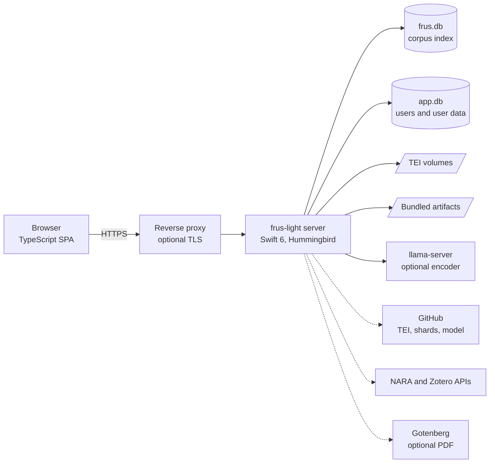
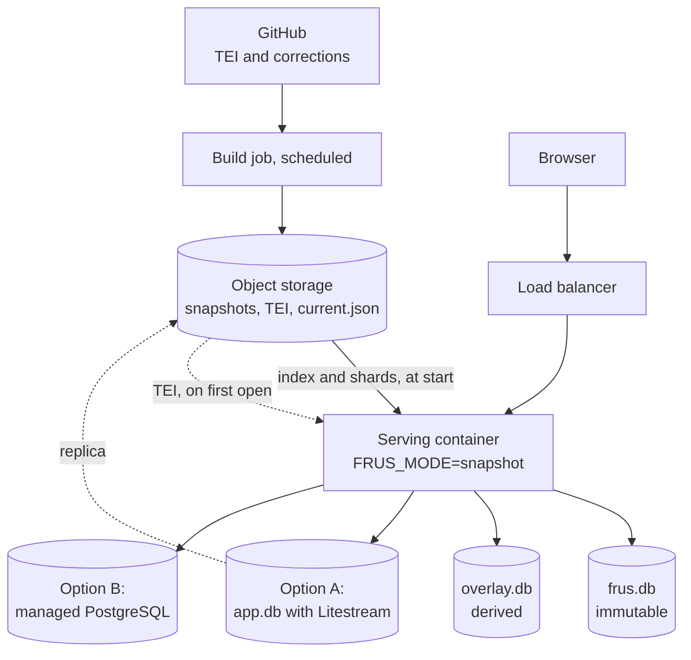

# FRUS Explorer Light — Web Edition Specification

2026-09-23 · Josh Botts

## Summary

FRUS Explorer Light is a self-hosted web edition of FRUS Explorer, shipped as one Docker image. It serves the FRUS corpus, its full-text index and each researcher's annotations to any modern browser. It keeps every feature that does not need on-device summarization, iCloud, or another Apple-only framework.

This specification was written against commit `c076203` (build 48, index format version 54). Six decisions shape it:

| # | Decision | Reason |
| --- | --- | --- |
| D1 | The index lives on the server; the browser is a thin client. | A container has real disk and CPU, so SQLite FTS5 runs natively. The server holds the one copy of user data, so no sync engine is needed. |
| D2 | The server is Swift 6 on Linux and compiles the same source files as the Mac app. | Query parsing, source-note parsing, citation matching and TEI rendering are large, subtle and heavily tested. A second implementation would drift. |
| D3 | Two data modes: **Import** serves a Mac "Export Research Database…" file; **Standalone** downloads and indexes TEI itself. | The Mac export already exists, is WAL-safe, version-stamped and verifiable. Import mode needs no Linux indexer, so it ships first. |
| D4 | User data lives in its own SQLite file, never in the corpus index. | The Mac index mirrors notes, summaries and tag ids into corpus rows. A shared server cannot. |
| D5 | Summaries are displayed and hand-written, never generated. | `FoundationModels` has no Linux equivalent, and generation is out of scope. Imported summaries keep their authorship labels. |
| D6 | The UI is a TypeScript single-page app; the reader reuses the app's own HTML, CSS and JavaScript. | The Mac reader already renders TEI to HTML in a web view, and highlight offsets depend on that exact DOM. |

**What "Light" removes:** summary generation, iCloud sync, widgets and Live Activities, Spotlight, Handoff, TipKit tips, Audio Graphs and native multi-window scenes. Browser tabs replace windows, and data tables replace Audio Graphs. Everything else stays, some of it in later phases.

**Who it serves:** one researcher on a laptop or home server, or a small group or class sharing one instance. It is not designed as a public, high-traffic site.

**Managed platforms:** AWS Fargate, Google Cloud Run and Azure Container Apps need a changed design. It is worked out under Managed platform variant, as an optional phase 6.

**Relation to earlier work:** `Planning/Completed/Cross-Platform-Porting-Assessment.md` (30 June 2026) recommended a browser-side core using SQLite-WASM, OPFS and PowerSync. A self-hosted server removes two of its three hard problems, sync and browser storage. This scope removes the third, summarization. Its 4–11 person-month web estimate predates the app target growing from 85,034 to about 238,000 lines.

## Review of the current app

FRUS Explorer is a SwiftUI app for iOS, iPadOS and macOS: 478 Swift files and about 238,000 lines in `FRUSExplorer/`. `Package.swift` adds 37 library targets, 30 generator executables and 36 test suites. Its Apple coupling is concentrated; most research logic already imports only Foundation.

iOS has five tabs: Browse, Search, Research, Collections and Settings (`App/MainTabView.swift`). macOS pairs a main document window with about two dozen tool-window types declared in `App/FRUSExplorerApp.swift`.

### Surfaces

| Surface | What it does today | Apple-only dependency |
| --- | --- | --- |
| Browse | Corpus → subseries → volume → chapter → document. Axes for All Volumes, Administrations, Editors, Archives, 171 language clusters, working corpora and scopes. People browser; Topic Index of 491 subjects | none beyond SwiftUI |
| Library | Download from GitHub, sideload XML, check for corrections, After an Update review, storage bar, compact, semantic vectors, search model | BackgroundTasks; ActivityKit for indexing progress |
| Search | FTS5/BM25 keyword search with phrases, boolean, exclusion, grouping, prefix, `NEAR` and `=exact`. Query Inspector, filters, facets, four readings, checklist mode, saved searches, working corpora, search by meaning | NaturalLanguage for collocates; the meaning encoder is llama.cpp, not Apple |
| Reader | TEI rendered to HTML: printed footnote labels, page breaks, person and glossary links, cross-references, muted broken references, find, previous/next | WebKit hosts it; the HTML is portable |
| Annotations | Four-color highlights, rich-text notes, tags, floating selection bar, classification corrections, stale-highlight review | SwiftData, CloudKit |
| Research rail | Cite, Word Cloud, Sources, Graph, Related, On the Map, Share; Topics, Summary, Notes, Tags, Collections sections | NaturalLanguage for the per-document cloud |
| Related Documents | Eight weighted signals, "why related" chips, a Beyond your library count | NaturalLanguage for "shares:" chips |
| Cross-reference graph | Timeline and network layouts, 1–3 hops, complete inbound citations from a bundled index, archival-citation nodes | SwiftUI Canvas |
| Research and projects | Research window, Project Home with Suggested Next leads, research trail, method appendix | SwiftData, CloudKit |
| Collections | Nested sections, rich prose, excerpts, five generated apparatus blocks, presets, headnotes, smart collections, preview, excerpt check. Exports PDF, HTML, Word, BibTeX, RIS, `.fruscollection`; Zotero send | CoreGraphics and CoreText for PDF; FoundationModels for headnote drafts |
| Citation | Three styles, BibTeX and RIS, Citation Lookup (paste, batch, structured) | none |
| Source Explorer | Resolution by provenance type, digitized scans, NARA series facts, HMS/MLR entries, free-text lookup, archival neighbors, volume Sources outline, collection authority | Keychain for the NARA key |
| Archives Visits | Research plans with targets, tiers and an exportable packet with inquiry drafts | PDF via Apple drawing APIs |
| Analytics | Corpus, Word Cloud, Person, Cross-Reference, Archival, Semantic map, Chronology; figure and CSV export with a method block | Swift Charts; Metal for the map; NaturalLanguage for clouds; Audio Graphs |
| About the Series | Four offline dashboards and the Research Guide | Swift Charts |
| Summaries | On-device summaries, prompts, batch runs, promote to note | FoundationModels |
| Settings and system | Tags, scopes, corpora, word-cloud tuning, session logging, connections, JSON, Markdown and database export, diagnostics, recovery | CloudKit, iCloud key-value store, Keychain |
| OS integration | Widgets, Live Activities, Spotlight, Handoff, tips, share sheet, embedded browser | WidgetKit, ActivityKit, CoreSpotlight, TipKit |

### Framework census

Files importing each module in the app target at `c076203`:

| Module | Files | What it gates, and its web replacement |
| --- | --- | --- |
| SwiftUI | 198 | every screen — rebuilt in the browser |
| SwiftData | 147 | user data — server-side SQLite |
| AppKit / UIKit | 16 / 12 | platform UI glue — rebuilt |
| CryptoKit | 13 | hashing — swift-crypto on Linux |
| CoreGraphics / CoreText | 12 / 2 | PDF and figure drawing — headless Chromium |
| Charts | 11 | analytics charts — JavaScript charts |
| TipKit | 7 | discovery tips — dropped |
| WebKit | 6 | reader host — the browser itself |
| SQLite3 | 5 | the index — system libsqlite3 |
| CloudKit | 3 | sync — dropped |
| FoundationModels | 3 | summaries — dropped |
| CoreSpotlight | 3 | Spotlight — dropped |
| Security | 3 | Keychain — encrypted server secrets |
| Metal / MetalKit | 1 / 2 | semantic map — WebGL |
| BackgroundTasks, ActivityKit, UserNotifications | 2, 2, 1 | background work — server jobs |
| llama | 2 | query encoder — llama.cpp on Linux |

WidgetKit appears only in the widget extension. NaturalLanguage appears only in `WordCloudKit`, the one shared kit with no Linux path.

### The portable core

- 109 files and 40,605 lines in the logic directories import no UI or Apple-only framework. The directories are Search, TEI, Citation, SourceExplorer, CrossReference, Semantic, RelatedDocuments, Chronology, Collections, Export, Zotero, TripPacket and Provenance.
- That count excludes `Search/IndexingPipeline.swift` (11,568 lines). It needs its `CoreSpotlight` and `OSLog` imports guarded, as its `UIKit` import already is.
- `SourceNoteKit`, `TEIHeaderKit`, `CrossRefKit` and `GeneratorKit` import only Foundation. `FTS5Store` adds `SQLite3` and `OSLog`; `SemanticVectorsKit` adds `CryptoKit`.
- The Word exporter is Foundation-only and writes its own stored-mode ZIP. The PDF exporter draws with CoreGraphics and is not portable.
- Known Linux gaps, found by reading rather than compiling: `XMLParser` needs `FoundationXML`, `OSLog` needs a shim, `SQLite3` needs a system-library target, and `CryptoKit` maps to swift-crypto.

## Feature disposition

The web edition keeps the search, reader, annotation, collection, citation, archival and analytics features. It adapts the parts Apple frameworks draw or compute, and drops only summary generation, iCloud sync and OS integrations.

**Keep** means the same logic behind a new web UI. **Adapt** means a replacement technology with the same result. **Drop** means no web equivalent. Phases refer to the delivery plan below.

| Feature | Disposition | Web behaviour | Phase |
| --- | --- | --- | --- |
| Browse axes, volume and chapter pages, People, Topic Index | Keep | Same axes and coverage lines, from the index and bundled data | 1 |
| Keyword search: syntax, Query Inspector, filters, facets | Keep | The shared query compiler runs on the server; the browser sends raw text | 1 |
| List, timeline and concordance readings | Keep | Same "which set was counted" captions | 1 |
| Checklist mode | Keep | Browser memory, per session, as on the Mac | 2 |
| Saved searches, working corpora, volume scopes | Keep | Per-user rows; "+N since last run" badge | 2 |
| Collocates reading | Adapt | Needs a lemmatizer to replace NLTagger; disabled with a stated reason until then | 4 |
| Search by meaning | Keep (optional) | llama.cpp in the container; the admin downloads EmbeddingGemma 2 on request, as the Mac's user opts in to it | 4 |
| Reader: footnotes, page labels, cross-references, broken references, find | Keep | Shared Swift renderer; the app's CSS and JavaScript in an iframe | 1 |
| Highlights, notes, tags, floating selection bar | Keep | Same offset engine; rich text kept as the Mac's RTF, read and written by the web's codec | 2 |
| Classification and person-identity corrections | Adapt | Instance-level, curator role, because they rewrite shared index rows. Phase 2 holds the Mac's override records, already applied in the export it serves; making them on the web comes with phase 3's curator role | 2–3 |
| Stale-highlight review after volume updates | Keep | Same `renderingVersion` check and review sheet | 3 |
| Related Documents | Keep | Seven signals in phase 3; semantic signal and "shares:" chips in phase 4 | 3–4 |
| Cross-reference graph | Adapt | Cytoscape.js with timeline and network layouts | 3 |
| Research page, Project Home, leads, history, method appendix | Keep | Per user; leads from the shared Related engine | 2–3 |
| Collections: editor, apparatus, presets, smart collections, excerpt check | Keep | Preview is the HTML export, as on the Mac | 2 |
| Collection export: HTML, Word, BibTeX, RIS, `.fruscollection` | Keep | Shared Swift exporters | 2 |
| Collection and packet export: PDF | Adapt | HTML printed by headless Chromium (Gotenberg sidecar) | 3 |
| Headnotes | Adapt | User-written only; imported AI headnotes keep their attribution | 2 |
| Summary-only body depth, Briefing packet preset | Adapt | Use existing summaries; disabled with a reason where none exist | 2 |
| Zotero send | Keep | Server calls the Zotero Web API v3 with the user's key | 3 |
| Citation formatting and Citation Lookup | Keep | Shared formatter and matcher | 1–2 |
| Source Explorer, archival neighbors, collection authority | Keep | Bundled indexes offline; NARA calls proxied with a server-held key | 3 |
| Archives Visits and packet | Keep | Text and Markdown export; PDF via Chromium | 4 |
| Corpus, Person, Cross-Reference and Archival Analytics; Chronology; About the Series | Adapt | JavaScript charts over server-computed data; CSV method blocks from shared Swift | 3 |
| Word Cloud | Adapt | Bundled clouds for corpus, subseries and volume first; live scopes and Distinctive mode need the lemmatizer | 3–4 |
| People, Places, Organizations cloud lenses | Adapt | Named-entity model or TEI name markup; may be deferred | 5 |
| Semantic map | Adapt | WebGL scatter of 314,571 points; lasso creates a working corpus | 4 |
| Chart figures | Adapt | SVG and PNG in the browser, PDF via Chromium, method caption kept | 3 |
| Imported and user-written summaries | Keep | Displayed with authorship; searchable under "Summaries" | 2 |
| Summary generation, prompts, batch runs, Summarize Again, headnote Generate | Drop | FoundationModels only | — |
| iCloud sync, sync status, Fix iCloud Sync, iCloud Schema check, Sync Settings Across Devices | Drop | The server is the single store | — |
| iCloud Keychain | Adapt | Encrypted server-side secrets | 2 |
| Multi-window scenes | Adapt | Every tool window becomes a URL; "new window" opens a tab | 1 |
| Widgets, Live Activities, Spotlight, Handoff, share sheet, AirDrop, embedded browser | Drop | Copy-link and the Web Share API cover sharing | — |
| TipKit tips, Audio Graphs | Adapt | One-time dismissible hints; a data table beside every chart | 2–3 |
| Recovery ladder | Adapt | Admin actions: reindex, reset index, erase one user's data | 3 |
| Semantic Match Feedback | Keep | Stored per user, exportable | 4 |
| JSON, Markdown notes, method appendix and research database exports | Keep | Same formats and stamps | 2–3 |

## Architecture

One container runs a Swift 6 HTTP server that owns two SQLite files, the corpus index and the user store, plus the TEI files and bundled artifacts. The browser runs a TypeScript single-page app and displays document HTML that the server renders.



Solid arrows stay on the host. Dotted arrows leave it, and all are optional in Import mode with mounted TEI files.

### Components

| Component | Technology | Responsibility |
| --- | --- | --- |
| HTTP server | Swift 6 on Linux, Hummingbird 2 (SwiftNIO) | REST API, sessions, static SPA, job control |
| `FRUSCoreKit` (new) | SPM library; Foundation plus FoundationXML | IndexingPipeline, SearchService and the FTS5 query compiler, TEI parser and HTML serializer, citation, Source Explorer resolvers, Related Documents engine, exporters. The same files the app compiles |
| Existing kits | FTS5Store, SourceNoteKit, TEIHeaderKit, SemanticVectorsKit, CrossRefKit | Compiled for Linux, unchanged apart from import guards |
| Corpus index | SQLite ≥ 3.45 with FTS5, WAL | Schema identical to the Mac index at the pinned version |
| User store | SQLite, WAL | Tables for the 23 Mac model types, plus users, sessions, jobs and secrets; per-user FTS5 over notes and summaries |
| Job runner | In-process actor with a persisted queue | Downloads, indexing, shard fetch, imports, exports, reindex |
| Encoder | `llama-server` from llama.cpp, started by the server as a child process | Query embeddings on CPU, bound to 127.0.0.1 |
| PDF service | Gotenberg 8 (Chromium), separate optional container | Collection, packet and figure PDFs |
| Web client | TypeScript, React 19, Vite, TanStack Router and Query | Every screen |
| Charts, graphs, map, clouds | Vega-Lite; Cytoscape.js; deck.gl on WebGL2; d3-cloud | Analytics; citation and person networks; the 314,571-point map; word clouds |
| Rich text | Tiptap (ProseMirror) | Notes, prose blocks, collection introductions |

### Why Swift on the server

- The logic that defines results is Swift today. `FTS5InlineQueryParser.swift` alone is 2,551 lines of query rules, and `IndexingPipeline.swift` is 11,568.
- The repo already compiles shared kits into both the app and SPM. The server extends that rule: one declaration, read and written through.
- The existing test suites become the server's tests. A TypeScript port would need new ones and would still drift on edge cases the manual documents.
- The cost: fewer web developers know server-side Swift, and Linux Foundation gaps must be closed first, in phase 0.

### Reader rendering

1. The SPA requests `/api/v1/volumes/{volumeId}/documents/{documentId}/html`.
2. The server parses the volume's TEI with `FRUSDocumentParser`, keeps the parse, applies the index's effective classification as the app's reader does, and writes the page with the kit's `ReaderPage.build`, which the app's `HTMLTemplate.build` forwards to, and `FRUSRenderNodeHTMLSerializer.reader(figureURL:)`, which names figure images by the server's own address.
3. The page loads in an iframe sandboxed with `allow-scripts` alone, with the server's `/reader/host.js`. The page comes from the server's origin, so its policy's `'self'` admits the host script, but the sandbox gives the frame an opaque origin: it cannot read the SPA's storage or cookies, and the SPA takes its messages by their source, the frame's window, since their origin is `null`. It also carries the app's footnote landing, the kit's `FootnoteLanding` script. Before it, in the order the app injects them at document end, the page loads the app's three reader scripts from the kit, `kOffsetEngineJS`, `kHighlightsJS` and `kSelectionJS` (`FRUSCoreKit/TEI/ReaderAnnotationScripts.swift`, since joshbotts/FRUS-Explorer#1788), served byte for byte as the server's own files, `/reader/frus-offset-engine.js`, `/reader/frus-highlights.js` and `/reader/frus-selection.js`, each deferred so it runs once the body has parsed (PLAN's S15c). The copies in `FRUSExplorer/Resources` are not served: `frus-highlights.js` has drifted from `kHighlightsJS` (it lacks the `highlightTapped` click handler), `frus-offset-engine.js` differs in formatting only, and a test keeps `frus-selection.js` identical. `frus-print.css` belongs to collection exports, and the reader does not load it: it would print each footnote twice.
4. One delegated click handler, in `/reader/host.js`, intercepts the reader's `frusexplorer://` links (`person/{ref}`, `gloss/{ref}`, `doc/{target}[/{vol}]` and `brokenref/{target}`) and posts each to the parent page. The parent asks the server what the link leads to (`…/link`), and the server answers with kit code: `FRUSURLScheme.readerLink(from:)` reads the link as the app's dispatcher does, the reader's lookups give a person or a term, the bundled broken-refs index an unresolved reference, `FRUSURLScheme.resolveCrossRefTarget` a cross-reference, `PageLink` where a link to a printed page goes and `WholeVolumeLink` where a link that opens a volume goes (joshbotts/FRUS-Explorer#1784), and, over the served index, `PageRangeStore` the document on a printed page and `PersonMentionStore` a person's counts. Only the choice between those counts, the rollup's across the corpus else the volume's, mirrors app code, the app's `DocumentViewModel.loadPersonMentionCount`. A cross-reference opens its document, going forward in the history, and so does a page link that `PageLink` sends to a document. One it sends to the volume, since no document on the page can be named without it, opens the volume's page in Browse, which names the page the link was to, as the app's volume page names `FollowedPageLink`: on that visit, and on Back and Forward to it, but not on a later one. Each page loads in a new frame, since changing a frame's address would add entries to the history inside it. A link to a note in another document lands on the note's entry in the list of footnotes, through the frame's URL fragment. For a note in the same document nothing navigates, as the app reveals a note in place. Either way the parent then asks the host script to land on the note, and the host runs the app's own landing, `FootnoteLanding.script(keyExpression:)`, as the app's reader runs it once a page has loaded: the entry scrolls into view and is washed for 2.4 seconds. The note then takes focus, so the next Tab continues from it. It is landed on once for each arrival, by a link or by Back and Forward: a page loaded again for another text size, reading width or appearance leaves focus on the control that asked for it, and the frame's URL fragment keeps the note in view. A person, a term or an unresolved reference opens a modal card, which hands focus back to the link when it closes. The host script also ignores a middle click on a reader link, and lets Space activate an unresolved reference, which the kit marks as a button.
5. The three WebKit message handlers (`selectionChanged`, `selectionScrolled`, `highlightTapped`) are stand-ins in `/reader/host.js` that become `postMessage` calls. The parent page draws the floating selection bar. It sends the document's highlights, which the host draws with the kit's `FRUSHighlights.render` after each load and each change, as the app's reader evaluates it, first trying each with the kit's `buildRanges`, so that one the kit cannot draw does not keep the others from the page. Once a colour is chosen the host collapses the selection to its end. Since the frame's keys never reach the parent, it passes on three: ⇧⌘H (Ctrl+Shift+H), the app's shortcut for Highlight Selection ▸ Yellow, and Alt+F10, the web's own key for the bar, each with the selection the kit's bridge places; and Escape, which puts the bar away. A tap the kit reports is not passed on when its click came from the keyboard, which gives the kit's hit test no point to read, or from a reader link, which is followed instead.
6. Light and dark palettes, text size and the column's measure are the kit's `ReaderPage.cssVariables(appearance:textSize:measure:)`, which `ReaderPage.build` writes into the page; the app's reader passes its measure through `HTMLTemplate.build(model:colorScheme:textSize:measure:)`, and its `FRUSTheme.cssVariables(colorScheme:textSize:)` forwards with the default, 70ch. The measure is the Reading Width's (joshbotts/FRUS-Explorer#1699): Narrow, Standard or Wide, 70, 87 or 120ch, the steps the app's Settings ▸ Display offers on an iPad and the Mac, Standard by default. The kit leaves the measure to its host and the ladder is app code (`ReadingWidth`), so the server mirrors it, and a parity test reads the app's rungs from its source. A browser reads on that ladder on any device, as an iPad keeps its own in a narrow window: a column narrower than the measure is filled.

### Process and concurrency

- One server process. SQLite WAL gives concurrent readers and one writer per file.
- Indexing runs in a bounded worker pool (`FRUS_INDEX_WORKERS`, default 2) and never blocks reads. A volume's rows appear when its transaction commits.
- The browser never opens SQLite; everything goes through the API.
- A request whose client closes its side of the connection is over: each connection's pipeline notices the input closing, as Hummingbird allows half-closure, and a search's work is cancelled, so the kit stops its statement at the progress handler's next call (`SearchStatementStop`). The browser app abandons a search it replaces, which closes its connection. Session 10 found the server still computing searches whose clients had given up on them.
- Target load: 1–20 concurrent users on 2–4 vCPU.

## Data

Everything the web edition serves comes from four sources: the Office of the Historian's TEI volumes, the project's semantic-vector repository, the optional EmbeddingGemma 2 weights, and the 46 files (54 MB) the app already bundles in `FRUSExplorer/Resources/`.

### External data

| Data | Source | Size | Terms | Needed for |
| --- | --- | --- | --- | --- |
| TEI volumes (553) | `raw.githubusercontent.com/HistoryAtState/frus/master/volumes/{filename}`; file listing and SHAs from `api.github.com/repos/HistoryAtState/frus/contents/volumes` | 3,338,778,538 bytes | public domain | reading in both modes; indexing in Standalone |
| Semantic shards (553) | `raw.githubusercontent.com/joshbotts/frus-semantic-vectors/main/generations/89481b18/shards`, the generation the bundled tier's provenance digest names | 162.4 MB; about 294 KB each | project data | semantic related-documents signal; meaning-search rerank |
| Query encoder | `github.com/joshbotts/frus-semantic-vectors/releases/download/encoder-2/embeddinggemma-2-Q8_0.gguf`, ggml-org's GGUF of EmbeddingGemma 2, unmodified | 309,855,456 bytes; SHA-256 in the app's `NOTICE` | Apache 2.0 | meaning search only |

The manifest lists 553 volumes: 550 published and 3 partially published. A full index holds about 322,000 documents at index version 71, 321,749 in the owner's 1776 export; the semantic map places 314,616, in 140 clusters.

### Bundled artifacts

The image carries `FRUSExplorer/Resources/` from the same commit as the server source. Several artifacts are pinned against each other by digest, so code and data must never come from different builds.

| Group | Files (size) | Used by |
| --- | --- | --- |
| Catalog | `manifest.json` (783 KB), `volume-tag-taxonomy.json` (100 KB), `administrations.json` (6 KB), `tei-rendering-config.json` (3 KB) | Browse, scopes, administration presets |
| Reader and search | `broken-refs-index.json` (23 KB), `document-subject-index.json` (6.05 MB), `volume-subject-profiles-index.json` (224 KB) | muted dead links, subject facets, Top subjects, Topic Index |
| People | `person-authority-index.json` (2.54 MB), `pocom-index.json` (531 KB) | People browser, VIAF and Wikidata links, careers, the pre-1906 addressee rule |
| Archival | `central-files-index.json` (3.61 MB), `presidential-library-catalog.json` (3.27 MB), `collection-authority.json` (1.93 MB), `volume-sources-index.json` (1.09 MB), `collection-usage-index.json` (644 KB), `accession-series-index.json` (619 KB), `external-citation-index.json` (605 KB), `roll-scans-index.json` (278 KB), `provenance-flow-index.json` (260 KB), `digitized-ranges-index.json` (194 KB), `subject-numeric-labels.json` (161 KB), `source-provenance-index.json` (138 KB), `lot-claimants-index.json` (132 KB), `curated-library-resolutions.json` (127 KB), `series-facts-index.json` (122 KB), `decimal-class-labels.json` (60 KB), `curated-lot-resolutions.json` (8 KB) | Source Explorer, Archival Analytics, the Archival Sourcing dashboard, Archives Visits |
| Citation graph | `resolved-edge-index.json` (1.11 MB), `cited-page-map.json` (536 KB) | complete inbound citations; cross-volume page references, which the indexer reads and the reader's page links follow |
| Series dashboards | `administration-profiles-index.json` (172 KB) | About the Series |
| Semantic | `semantic-vectors-binary.bin` (20.47 MB), `semantic-map.bin` (1.89 MB), `semantic-vectors-index.json` (73 KB), `semantic-shards-manifest.json` (66 KB), `semantic-map-index.json` (20 KB) | map, related documents, meaning search |
| Word cloud | `cloud-vectors-volumes.json` (1.29 MB), `keyness-baseline.json` (1.25 MB), `cloud-vectors-core.json` (261 KB), `word-cloud-lexicons.json`, `word-cloud-stopwords.json` | bundled clouds and keyness |
| Reader assets | `frus-offset-engine.js`, `frus-highlights.js`, `frus-selection.js`, `frus-print.css` | none: the reader iframe loads the kit's three scripts, which these copy, and `frus-print.css` is collection exports' |

Not used on the web: `LaunchScreen.storyboard`, `Assets.xcassets` apart from icons, and `PrivacyInfo.xcprivacy`.

### Storage for a full corpus

- TEI XML: 3.34 GB.
- Index: about 9.3 GB, using the app's own 2.8× overhead factor (`StorageReport.indexOverheadFactor`). The manual says 9–10 GB.
- Shards 162 MB, encoder 229 MB, bundled data 52 MB.
- Compaction and import swaps need room for a second copy of the index. Stripping an export of the owner's writing (Import procedure, step 3) needs about twice the copy's size more while it runs: for `VACUUM`'s copy of the index, which the server keeps in `/data/tmp`, not the tmpfs `/tmp`, and for the journal beside the copy. The server asks for three times the export's size before it copies one.

### Regenerating artifacts

The generators in `Package.swift` stay Mac-side tools. The web edition consumes their outputs and never regenerates them at runtime. One exception comes in phase 4: a Linux lemmatizer needs its own keyness baseline and cloud vectors. Those are built once per release and shipped under a new tokenizer identity.

## Operating modes

Each installation runs in one of two modes. **Import** serves an index exported by the Mac app and needs no Linux indexer. **Standalone** downloads and indexes TEI itself. Both need the TEI files for reading, because the index holds flattened text, not the edition.

| | Import | Standalone |
| --- | --- | --- |
| Setup | On the Mac: Settings ▸ Data & Recovery ▸ Export Research Database…; copy the file into `/data/import` | Set `FRUS_MODE=standalone`; choose volumes in the admin screen |
| Index built by | the Mac app | the server's Linux build of `IndexingPipeline` |
| TEI files | Mounted read-only from the Mac's `Volumes/` folder (preferred), or fetched from GitHub without indexing | Fetched from GitHub, or uploaded as a sideload |
| Coverage | whatever the Mac had indexed | any subset of the 553 volumes |
| Adding volumes | export again from the Mac | download and index in place |
| Index version | must equal the server's pinned version | always the server's |
| Time to first search | copy and verify only, no indexing | hours for the full corpus; not yet measured on Linux |
| Ships in | phase 1 | phase 3 |

### What the Mac export already guarantees

`IndexDatabaseExporter` (in `Export/ResearchDataExporter.swift`) does most of what a safe import needs:

- It copies with `sqlite3_backup`, never a file copy, so writes still in the `-wal` file come along.
- "Include My Notes, Summaries, and Tags" is off by default. Off, it nulls `summary_text`, `note_text` and `user_tag_ids`, deletes `user_tags`, runs `VACUUM`, and rebuilds both FTS tables.
- It stamps `research_provenance` with `exported_at`, `my_writing_included`, `app_version`, `app_build`, both index versions, both FTS schema versions and `semantic_provenance_digest`.
- It adds three views: `research_documents`, `research_cross_references` and `research_suppressed_volumes`.
- It verifies with `PRAGMA quick_check` and FTS5 `integrity-check` at rank 1 on both FTS tables.

### Import procedure

1. Open the file read-only. Repeat `quick_check` and the rank-1 `integrity-check` on `frus_documents` and `user_content`.
2. Read `research_provenance`. Require both index versions to equal the server's `SUPPORTED_INDEX_VERSION`, and both FTS schema versions to equal 4. A hand-made `.backup` copy has no stamp; accept it only when every `document_revisions.index_version` equals the pinned version.
3. If `my_writing_included` is 1, move that writing into the importing user's store, then strip the copy with the Mac's own sequence (PLAN's S16e; Import and export paths says how). The writing is read from the copy, the copy is stripped and checked, and only then is the writing written into the store, just before the copy is installed, so a file refused at any step changes nothing. A server with `FRUS_USER_DATA=off` refuses such an export, as phase 1 did. The import's report says what moved and recommends the JSON export instead: the index keeps one concatenated note block and only the newest summary per document.
4. Write `frus.db.new` beside the live index, verify it, and rename it into place. Keep the previous file as `frus.db.prev` for rollback.
5. Locate each volume's TEI file. Recompute each document's `content_hash` and `body_hash` as the indexer does, and compare them with `document_revisions`. A mismatch means the TEI changed after the Mac indexed it; list those documents for review, as the Mac's After an Update screen does.

### Rules for both modes

- One index holds one index version. Upgrading a Standalone server re-indexes from cached XML with no re-download, as the Mac does.
- Import mode refuses an index of a different version, with a message naming both versions. The version moved from 49 to 54 between 4 and 23 September 2026, so the Mac and the server must be upgraded together.
- A Standalone server may be seeded from an import at the same version. That skips hours of indexing, and the server indexes further volumes itself.
- `FRUS_OFFLINE=true` runs Import mode with mounted TEI and no outbound traffic at all.

## Search index and database schema

The corpus index keeps the Mac schema exactly: same tables, columns, tokenizer and version stamps. A Mac export is therefore a valid web index, and a web index can be exported back in the Mac's stamped format. User data moves to a separate store.

### Corpus index (`/data/index/frus.db`)

| Group | Objects | Web edition notes |
| --- | --- | --- |
| Corpus text | `document_cache` (key: `volume_id`, `document_id`); `frus_documents` (FTS5, external content, `porter unicode61`; indexes `header`, `dateline`, `source_note`, `body_text`); `frus_documents_vocab` (`fts5vocab`, row mode) | unchanged |
| User mirror, Mac only | `user_content` (FTS5 over `summary_text`, `note_text`); `user_tags`; `document_cache.summary_text`, `note_text`, `user_tag_ids` | kept for schema compatibility, always empty on the web |
| Derived structure | `document_dates`, `cross_references`, `page_ranges`, `persons`, `person_mentions`, `person_list_sources`, `person_rollup`, `person_rollup_member`, `person_cluster_candidate`, `terms`, `volume_structures`, `document_revisions` | unchanged; `document_revisions` drives update review |
| Archival provenance | `document_sources`, `external_citations`, `volume_sources` | unchanged |
| Subjects | `document_subjects`, `document_subject_refs`, `document_subject_volumes` | integer positions resolved through `document-subject-index.json` |
| Export only | `research_provenance`; views `research_documents`, `research_cross_references`, `research_suppressed_volumes` | written by the Mac exporter; the web exporter writes the same |

The table definitions live in `FRUSCoreKit/Search/IndexingPipeline.swift` (`setupDatabase(_:)`, lines 8010–8665 at 1c18b51e, 7759–8414 at 2767a128 and 503a730b, 7680–8335 at f0479037 and af41efa4, and 6968–7623 at c6f7b2cb and at 757c6d29, the same text, as at 34a5120 but for one partial index, `idx_document_cache_user_tag_ids`, added on 9 October with no index version (#1614)); the FTS5 definitions come from `FTS5Store/FTS5Types.swift`. `Docs/Agentic-Analysis-Guide.md` §4 documents every column and its traps.

### Verified on this review's host

The Mac's `document_cache`, `frus_documents`, `frus_documents_vocab`, `user_content` and insert-trigger definitions ran unmodified on Ubuntu 24.04's stock SQLite 3.45.1. A stemmed prefix plus `NEAR` query matched, `fts5vocab` returned stems, and both `rebuild` and rank-1 `integrity-check` succeeded. A real 9 GB Mac export has not yet been tested.

### Compatibility contract

1. `SUPPORTED_INDEX_VERSION` is a build constant equal to `IndexingPipeline.currentDateIndexVersion` at the image's commit: 65 at 34a5120, at f69b4a0a, at 101e17d7 and at f384d2d5, 69 at c6f7b2cb and 757c6d29, app build 50, and 71 at f0479037, af41efa4, 2767a128, 503a730b and 1c18b51e, app 1.0 (build 1776). The server serves no other version.
2. The FTS schema generation is 4, stored in `PRAGMA user_version` (`FTS5Connection.currentSchemaGeneration`).
3. Identity is `(volume_id, document_id)`. `document_cache.rowid` is never persisted, exposed or compared across copies; `VACUUM` may renumber it.
4. Copies use the SQLite backup API. A WAL database is never copied with `cp`.
5. The tokenizer stays the built-in `porter unicode61`. No custom tokenizer or SQL function may enter the corpus schema, or Mac exports stop being portable.
6. The image pins its SQLite version (3.45 or later, FTS5 enabled) and reports it at `/api/v1/status`.
7. Outside indexing and import jobs, the server writes only two things to the index: curator corrections to `document_cache.is_editorial_note`, and the person rollup. The Mac writes the same two. Import mode serves its index immutably and writes neither: through phase 2 the server holds the Mac's override records, whose corrections the export it serves already carries, and phase 3, with its curator role, decides how a correction made on the web reaches a served index.

### User store (`/data/app/app.db`)

- One table per Mac model type, plus `users` and `schema_migrations`, and later `sessions`, `api_tokens`, `jobs` and `secrets`. Each user table has a `user_id`; the two override types' tables are instance-wide. A row keeps the Mac's id as its key, after `user_id` in a user table, so it keeps its identity through an import and an export, and two users may each hold a row with the same Mac id, as two imports of one file would make. `SyncedPreferences` has no id, and a user has one row of it. Phase 2's first migration, migration 2 (PLAN's S14a), makes all 23 tables, the types whose screens come later included, with a column for each stored property but the six relationships, which the ids beside them hold: 243 columns for the 249 properties, named in snake case (`volumeIdA` is `volume_id_a`).
- `UserStoreSchema` describes the tables. A test holds it to the app's source at the pin: to `frusModelTypes`; to `CloudKitSchemaInventory.installedIdentifiers`, which the app's own test derives from the live schema and which lists every stored property; to the stored properties each model class declares, read from the class itself, since the app's repository has no CI to hold the inventory to it; and to each property's declared type. So a pin move that adds a model or a stored property fails until a migration follows.
- Values in the 23 tables: a date is ISO 8601 text in UTC with milliseconds (`2026-10-24T03:15:00.000Z`), which keeps the whole seconds the Mac's JSON export writes; a `Bool` is 0 or 1; a `UUID` is its `uuidString`. Arrays and `Codable` values are JSON text, and so is `Data` the app writes with `JSONEncoder`, `parametersData` among them, kept as the bytes it wrote, with that encoder's own strategies. RTF, and the payload `stateData` reserves, stay bytes: a note's `rich_text` holds the RTF as the Mac wrote it until the body is edited on the web, which writes the codec's (S15d).
- A relationship is held by the id the Mac keeps beside it: an entry's `collection` by its `collection_id`, a plan's documents and targets by their `plan_id`. Only `user_id` refers to another table, to `users`, and a user's rows go with the user, their `user_search` rows by a trigger: the Mac's own references are ids that can outlive what they name, as a tag deleted on another device can, so the store keeps them as the Mac does, and the app's rules, run on the server, keep them consistent.
- A PostgreSQL store, option B's below, implements the same protocol from phase 2 and passes the same suite in CI; the Compose install keeps `app.db`.
- `user_search` is an FTS5 table over each user's note and summary text, one row per user and document, with the two indexed columns of the Mac's `user_content`, `summary_text` and `note_text`. `user_id`, `document_id` and `volume_id` are unindexed, and the tokenizer is the same `porter unicode61`.
- Search attaches `app.db` read-only and runs the user-text half against `user_search`, joined on `(volume_id, document_id)` rather than `rowid`. Tag filters use an `EXISTS` over the user's tag assignments.
- This is the one deliberate divergence from the Mac's SQL. It needs an adapter in the shared `searchDocuments`, an upstream pull request of phase 2's (PLAN's S17a), and its effect on ranking is listed under risks.

## Feature specifications

Each surface below states what the web edition must do. Behaviour matches the Mac app unless the text says otherwise. Every count on screen carries its denominator, as the app's "honest numbers" rule requires.

### Shell and navigation

- Five top-level routes mirror the iOS tabs: `/browse`, `/search`, `/research`, `/collections` and `/settings`. Admins also see `/admin`. `/` opens `/browse`, the first tab. Browse's volume and section pages are `/browse/{volumeId}` and `/browse/{volumeId}/{sectionId}`. Settings' panes are `/settings/{pane}`, and `/settings` opens the first; Tags, `/settings/tags`, is the first, from PLAN's S14c, and Data, `/settings/data`, the second, from S15d. From S15d `/research` opens All Notes, `/research/notes`, until S19b's Research page, and the header links it between Search and Settings.
- Each Mac tool window becomes a route: `/doc/{volumeId}/{documentId}`, `/graph`, `/sources`, `/related`, `/map`, `/chronology`, `/analytics/{kind}`, `/people`, `/topics`, `/visits`, `/lookup` and `/guide`.
- A document opened from a tool page goes to the reader tab that launched the tool, found through `BroadcastChannel`, or else opens a new tab. This mirrors the Mac rule that documents open where the tool was launched.
- Desktop layout: sidebar, content, and the Research rail beside the text from 900 px wide; narrower, the rail becomes an overlay. Phone layout: a bottom tab bar.
- A command palette (Ctrl/⌘-K) replaces the Mac menu bar. In-document shortcuts keep their Mac meanings where browsers allow.

### Browse

- Axes: All Volumes (by Title, Published, Era or Length), Administrations, Editors, Archives (provenance types, collections, central-file classes), Clusters (140 in EmbeddingGemma 2's map, from build 1776), Subseries, Working Corpora and My Scopes.
- Volume page: front matter and chapters, Top subjects from bundled data, and a summary strip once indexed. Side-loaded and Partial badges. A page link that opened it, because no document on the page can be named without the volume, is named first, in the words of the app's `FollowedPageLink.notice`, made the server's: the volume is not on this server, or its TEI is and the server has not indexed it.
- Section page: the text the section prints outside the documents and sections it holds comes first, above them, as the app's Browse lists it (joshbotts/FRUS-Explorer#1536): a meeting's list of those present, a treaty's signature and ratification dates, a footnote on the section's heading. The row is the one the kit's `VolumeSection.ownTextEntry(among:)` finds among the index's rows for the volume, as both of the app's Browse views find it, so a section that holds only sections can have one, and a leaf, a list or a section with no id of its own never does. It is named **Read** and the section's title, over the app's sentence, "The text this section prints outside the documents and sections it holds.", and opens the row in the reader, where the kit's reading order puts it first in its section. A volume the server has not indexed lists none, as the app lists nothing before indexing, and the volume's contents open a section with such a row on its page, as they open one with documents.
- People: reconciled identities with role, active years, mention counts, VIAF and Wikidata links, POCOM careers, and Merge and Separate for curators.
- Topics: all 491 detected subjects, each showing series-wide reach beside "indexed on this server".
- Every list states its coverage, for example "142 of 267 documents indexed on this server".

### Search

- The browser sends the raw query and filters. The server compiles them with the shared `FTS5InlineQueryParser`; the client never builds FTS5 syntax.
- All syntax in manual §7.2: plain terms, phrases in four quotation styles, AND/OR/NOT, `-` exclusion, grouping up to 32 levels, prefix `*`, `NEAR(…, n)` and `=exact`.
- The Query Inspector shows the compiled expression, each term's index form, corpus counts from `fts5vocab`, the EXACT, EXCLUDED and NOT APPLIED tags, and "narrower than typed". As on the Mac, its strip follows the text as it is typed, before the search is made: the expression, or the one line that says why there is none, then, on request, each term's tags and counts, and its count in the reader's scope when asked for.
- A zero-result search runs each term alone and names the one that matched nothing, in the Mac's words.
- Filters are tokens: volume or subseries, volume scopes, detected topics, date range, tags, person, project, document type and front matter. "Search in" chips choose Documents, Notes and Summaries.
- Facets compute per section, on demand, over the whole match: year, volume, person, type, provenance and subject. Include, exclude and Apply work as on the Mac: years and volumes stage rows to include or exclude, then Apply them together; a person, a type or a subject narrows the search on a click; provenance only describes. A narrowing by year, person or subject shows as a token that clears it, and one by type sets the Document type filter; the panel says what it describes, as the Mac's does.
- A result draws its dateline, or for one that prints none, such as a section's own row, which the index dates by the documents it holds, the day or span the index dates it by, in the kit's words (`SearchResult.drawnDate`, `SearchResultDate`), as the Mac's window does (joshbotts/FRUS-Explorer#1746).
- A search the reader replaces stops, as the Mac's does (joshbotts/FRUS-Explorer#1698): the browser app abandons its request, the server cancels the work of a request whose client has closed its connection, and the kit's progress handler stops the statement under way. So do the Query Inspector's counts, and the results a date order keeps once no request waits for them; a facet section, which nothing stops on the Mac either, runs to its end and is kept.
- Readings: List (10, 20, 50 or 100 per page; relevance or date sort), Timeline, Concordance, and Collocates from phase 4, chosen as the Mac's Reading picker chooses them, with its tooltip: "The concordance covers this page; the others cover the whole retained set." Each names the set it counted, in the Mac's words (`ResultSetScope`, app code, which the browser app words as the Mac's does). The date order sorts the 7,500 results a search keeps, oldest or most recent first with undated documents last, as the Mac's does, and the order outlasts a new search.
  - The Timeline counts by year the results a search keeps, as the Mac's plots its window's results (`DocumentTimelineView`): a chart with a column for each year, from the first to the last, whose counts are all in a table beneath it, or a list of each year's documents in the results' order, as the Mac's Chart and List. The results with no date are left out and counted. The years and counts are the kit's Years facet over those results (`SearchService.resultSetFacets(parameters:request:documentKeys:)`), which keys a document by its date's first four characters, as the Mac's timeline groups it; when the search reaches the 7,500 results it keeps, the Mac's caption says the shape is the ranking's: "These are the highest-scoring matches, not a sample across time — this shape is theirs, not the whole match’s." The timeline covers every result kept, so it has no pages.
  - The Concordance lines up every occurrence of the search's terms in the page of results on screen, as the Mac's does (`SearchService.concordance(for:parameters:radius:)`): one line an occurrence, its term in a column between its left and right contexts, 60 characters a side, in a monospaced face, wider than a narrow screen, which scrolls it, as the Mac's does. Align by orders the lines by the kit's `KWICSort`: left context (the Mac's first), right context, date or volume. Its count names the page when the search has more than one ("214 occurrences in the 20 documents on this page"), and it says what it could not show: occurrences past the kit's 200 lines a document, and documents whose match gave no line, as a phrase, a prefix or an exact word can.
  - The reading, the timeline's mode and the concordance's order are kept in the search's address, so Back to a search from a document it opened shows it as it was, as the Mac's window stays as it was.
- The Mac keeps 7,500 results of a search and counts every match exactly. The API does the same: its count is exact, and a page reaches no further than the 7,500th result.
- Checklist mode, saved searches with "+N since last run", and Save as Working Corpus behave as on the Mac.
- Meaning mode (phase 4) intersects and discloses filters, and lists matches in volumes not on the server separately.

### Reader and Research rail

- The server renders; the iframe shows the app's HTML in light and dark themes at the app's four text sizes, Small to Extra Large, and its three Reading Widths, Narrow, Standard and Wide, chosen beside Text Size.
- `person/{ref}` opens a person card and `gloss/{ref}` a glossary entry. `doc/{target}` navigates, landing on a footnote when the target names one, with the app's landing script, and on the document a printed page holds where the kit's `PageLink` names one, else on its volume in Browse. `brokenref/{target}` opens the Unresolved Reference sheet.
- Footnote popovers show the volume's printed labels. The source note's ▤ mark opens Source Explorer.
- Previous and next follow the volume's reading order. Browser print uses `frus-print.css`.
- The selection bar offers four highlight colors, Excerpt, Look Up and Note, in the kit's order (`SelectionVerb.allInOrder`). Colors and Excerpt need a selection in the document's text (`needsDocumentOffsets`): inside a footnote the Mac disables them and iOS leaves them out. The web shows only the verbs it has: from PLAN's S15c the colours, from S15d Note after them, Excerpt with S18d and Look Up with Source Explorer in phase 3. A footnote's selection has a bar holding Note alone; the host answers Alt+F10 only over a selection in the text, so that bar has no keyboard path of its own, and the rail's Add Note makes the same note. The bar is named Selection, the web's own.
- Note, as the app's, opens a new note on the document, with no quote of the selection and no link to a highlight. After a highlight is made the rail offers Add Note to Highlight, as the app's does, until it is chosen or the document changes; its note links the highlight (`noteId`). The note editor is a dialog, New Research Note or Edit Note, with the app's sections and words: the note's body, with the Formatting switch the app keeps per device (on the web, per browser), its Tags, its Projects and the document's Generated Summaries, each with Insert into note and Remove from note; and Delete, Discard and Save. Bold, italic, underline, a text colour and a link, by the app's buttons and ⌘B, ⌘I and ⌘U, and ⌘K for the link, the web's own. A save sends the body only when it was edited, so the stored RTF is kept byte for byte otherwise, as the app keeps it; an edit with Formatting off drops the formatting, as the app's first plain keystroke does.
- Highlights, from S15c, are made and drawn as in the app. A colour over a selection in the text makes one over its offsets; over text another holds it makes another. ⇧⌘H, or Ctrl+Shift+H, makes a yellow one, as the app's Highlight Selection ▸ Yellow does. A tap on one asks Remove Highlight, with the app's sentence and its Remove and Cancel. A stale one is drawn in the kit's amber and answers no tap. The web's own: Alt+F10 moves focus into the bar, where the arrow keys move between the colours; the selection collapses to its end once a colour is chosen, as the app's iPhone and iPad reader clears it; and a click on a reader link inside a highlight follows the link and does not ask.
- Rail tiles: Cite, Word Cloud, Sources, Graph, Related, On the Map and Share. Sections: Topics, Summary (display and author), Notes, Tags and Collections; and on the web, between Notes and Tags, Highlights (from S15c), the web's own. Summary and Notes, from S15d, are open until closed, as the app's are. Summary shows one summary at a time, newest first by the app's `ranksAbove`, with the app's history control over up to 20, its first 80 characters when the section is closed, and a label the web maps onto the app's words, the web's own: AI summary for one the Mac generated, AI · edited and Yours from the headnote chip's words; a prompt's name beside it when the researcher's prompts hold it. Write a Summary makes the researcher's own, which alone they can edit or delete. Notes lists the document's notes, newest first, each its text or Empty note and the time since it changed, then Add Note. It lists the document's highlights as the app's review sheet does, by where each starts and in its words: the highlight's words, or Highlighted passage for one that stored none, and its line for one made against an earlier version of the text. Each row can take another colour, which the app has no way to do, and has Remove…, which asks as a tap does. It is the keyboard's way to remove one: the app's review sheet removes a stale highlight, but the app has no keyboard way to remove one that is not stale. The ⓘ panel carries classification correction for curators.
- From PLAN's S14c the reader's toolbar opens Cite or the Research rail, one at a time, each named in the reader's address (`rail=cite`, `rail=research`). The Research rail is offered only by a server that keeps user data. Its Tags section is closed until it is opened, and then as it was left, as the app's is; its header counts the document's tags. It shows each tag the document carries, with the × that takes it off, and Add Tag, which opens the tag picker as the app's document-mode sheet works: New Tag makes a tag, switches it on and lists it first with a New badge; Your Tags has a switch for each tag; Done gives the document exactly the tags switched on; Cancel deletes the tags made in the picker, as the app's does.
- A banner and review sheet appear when a document's text changed after it was annotated.

### Research, projects and history

- The Research page lists every annotated document, grouped by collection, tag or highlight color, with Contains Notes, All Notes and Changed by an update.
- All Notes, from S15d, lists every note as the app's does (`NotesPaneSnapshot`, which S17b moves into the kit): newest first; filtered by project (All projects, Not in a project, or one), by tag and by text over the body, the volume and the document; each row its first line, cut at 90 characters, the document and its projects and tags, and its date. Above the rows, the web's own, a count in the words of the app's retired sheet header (`NotesPaneSnapshot.showingCount`): Showing N of M notes, or M notes. Each row opens the note, and has a Delete… that asks, where the app has a context menu, the web's own. Settings ▸ Data exports every note as one ZIP of the kit's Markdown files, the app's per-note files, the web's own way of handing over what the app shares one by one.
- A project holds a research question, focus tags and subjects, attached collections, Recent Activity and Suggested Next leads. Each user has one active project.
- History lists documents visited, searches run with scope and count, and exports. A per-user switch stops recording.
- The method appendix exports as Markdown and CSV with `count_basis`, in the Mac's format.

### Collections

- Editor: sections nested three deep, prose blocks, frozen excerpts, and five apparatus blocks (Bibliography, Chronology, Sources & Archives, Persons Index, Thematic Index).
- Per-document inspector and section defaults. Presets: Teaching reader, Source dossier and Scholarly edition; Briefing packet only where summaries exist.
- Sort by date across the collection or within sections. Smart collections resolve from a saved search at export; Create Static Snapshot freezes one.
- The live preview is the HTML export, showing the first 20 documents with Render All.
- Exports: HTML, Word, BibTeX, RIS, `.fruscollection`, PDF through Gotenberg, and Zotero send. The excerpt check runs before every export and warns without blocking.

### Citation

- Styles: history.state.gov, Chicago and Turabian. BibTeX `@incollection` and RIS; copy citation and canonical URL.
- Citation Lookup, from PLAN's S19a, at `/lookup`, which Search's Find by Citation opens, as the Mac's Search window opens the app's: its three modes, Paste Citation, Structured Entry and Batch, split on note numbers, through the kit's form (`CitationLookupFields`), matcher (`CitationMatchingEngine`), splitter (`CitationBlockSplitter`) and runner (`BatchCitationRunner`), over the served index and the published catalogue. Paste Citation fills the Parsed Fields from each paste alone, as the kit derives them, the fields empty until the server has read the paste, and a field the reader edits stands until the next paste; Return in the text looks it up, and every Look Up asks the server, as the app's asks its matcher. Structured Entry is the fields, which it keeps on the way back to Paste Citation when the text is unchanged, as the app's form does. Batch shows no fields: it lists each note with its outcome in the app's words, under the kit's summary, worst first with Needs work first, on at first, or as pasted, and a note whose one answer names a document opens it. Each result carries the kit's label (`ConfidenceLabels`): six kinds when this specification was first written, and eight at `503a730b`, as the app's manual tables them, over seven strategies (`MatchStrategy`), each drawn in the app's colour and symbol for its strategy. A result in a volume the served index does not hold offers the volume's page in Browse, where the app offers Download Volume. The form is kept for the tab's session, so a document opened from a result, and Back, find it as it was, as the app's window stays open beside the documents it opens; the mode picker keeps the focus as its arrows change the mode, where the app moves it to the mode's first field.
- A side-loaded volume's citation carries the Mac's "cannot confirm it is published" note.

### Source Explorer and Archives Visits

- Resolution by provenance type from bundled indexes, with no key: decimal files, post-1963 central files, pre-1910 rolls, Paris Peace Conference, named series, repositories outside NARA, CIA, foreign archives and previously published sources.
- Lot files and unresolved presidential-library citations call the NARA Catalog API v2 through the server with an `x-api-key` header. Answers are cached, and the key never reaches the browser.
- Also: digitized scans, NARA series facts, HMS/MLR entries, renamed repositories, free-text Look Up with Detected in This Passage, and classification chips.
- Archival neighbors scoped to This volume, This subseries or All volumes; the volume Sources outline; the collection authority record with Related Collections, Pointed at, Cited Over Time and Divided at NARA.
- Archives Visits: plans with Targets and Documents views, tiers, notes and include flags. The packet exports as text, Markdown or PDF, always with its coverage report.

### Analytics and About the Series

- Charts render in the browser with Vega-Lite from server-computed series. Every chart has a table view, which replaces Audio Graphs.
- Corpus Analytics: decade, year, month, day, subseries and volume groupings; stacked color by volume; raw counts or % of documents; Documents or Occurrences with the Mac's disabling rules; scope, year range and administration presets; drill to Search.
- Person Analytics: most-mentioned, trajectories for up to five people, relationship dynamics and the co-mention network.
- Cross-Reference Analytics: most-referenced, degree distribution, volume heat matrix and PageRank landmarks.
- Archival Analytics: Collections from bundled data, which works with nothing indexed, plus Network, Flows and Your Library.
- Chronology: a date range, auto-coarsening sections, a distribution chart and the 5,000-document list cap.
- About the Series: Production & Timeliness, Geographic Emphasis, Archival Sourcing and Administration Profiles, all from bundled data.
- Exports: PNG and SVG from the browser, PDF via Gotenberg, and CSV with the `#`-commented method block written by the shared Swift code.

### Semantic features (phase 4)

- Map: 314,571 points from `semantic-map.bin` in a deck.gl scatter, colored by region, era, on-server or provenance. Lasso to a working corpus, two-pole axis, nearest in language.
- Related Documents adds the semantic signal and the "Beyond your library" count once shards are present.
- Meaning search embeds the query with EmbeddingGemma 2 through `llama-server`, then runs the shared Hamming-800 → int8 funnel in `SemanticVectorsKit`.

### Word clouds (phases 3–4)

- Phase 3 shows the bundled clouds for the corpus, each subseries and each volume, in Frequency mode.
- Phase 4 adds a Linux lemmatizer and a baseline regenerated under a new tokenizer id. That enables live scopes, Distinctive mode, collocates and "shares:" chips.
- The app's refusal rule carries over: a baseline from a different tokenizer is never compared.

### Settings and administration

- Per user: display, search defaults, word-cloud tuning and hidden words, citation style, tags, scopes and corpora, session logging, Zotero key, personal NARA key, and data import and export.
- Settings ▸ Tags (PLAN's S14c) is the app's Tags pane: a row for each tag, by name, which opens the tag's editor, and New Tag… after them, which makes a tag named New Tag and opens it to be named. The editor renames a tag, its name trimmed and never empty; Merge into Another Tag… opens Merge Tag, as the app's does; Delete Tag asks first, with the sentence the app's editor says of it. The app's count of each tag's notes and documents beside its row (`ResearchItemCounts.tally`) comes with the kit's move of it (PLAN's S17b), and the reader's own order of the tags with the synced preferences (S17f).
- Settings ▸ Data (PLAN's S15d) exports the notes as Markdown, from S16d as the app's export sheet lays it out: Contents, a table of what an export carries, its eighteen rows in the sheet's order and words, tags with their assignments in one, counted by `GET /me/export/contents` as the pane opens and after an import; Include AI-Generated Summaries, off, with the sheet's count of every summary; and Export as JSON, which fetches the server's file, says that it is preparing it, and saves it, with the switch on every summary in it, or says why it could not, in the words of the app's row. Contents writes each count as the sheet does, no digit grouped, and the switch's footer as its localized string does, grouped. The sheet's database export is the Mac's own, and its method appendix comes with S17f. From S16c the pane imports a Mac JSON export, the web's own, since the app imports none: Import a JSON Export takes a file the reader chooses, sends it as it is to `POST /me/import`, says while its job waits and runs, and then gives its report: a table of each kind of record, in the order and the words of the app's export sheet's Contents, the parts it counts in one row (tags and their assignments, a collection's entries, a visit's documents and targets) each in its own, with what the file held, what came in, what replaced an older copy and what was kept; the kinds the file's version cannot carry, named; and a line for each record repeated in the file or set aside, each note whose formatting the codec keeps, each headnote draft, each summary with no authorship, each entry kept inert, and each smart collection whose saved search it lacks, in the app's sentence. A refusal or a failed job says why, and that nothing was kept; a status the server can no longer give, as after it restarts, says that the import cannot be followed and that importing the file again changes nothing it brought.
- Admin: library (download, index, sideload, remove, check for corrections, compact), mode and import, semantic assets and encoder consent, users and roles, secrets, jobs, backups and status.

### Accessibility and language

- WCAG 2.2 AA, keyboard access to every action, and `prefers-reduced-motion` respected.
- English only, as the app is. UI strings are generated from the app's 4,807 `String(localized:)` keys, so the web never retypes app copy.

## User data without CloudKit

All user data lives in one server-side SQLite file, `app.db`. The server holds the only copy, so there is no sync, no conflict resolution and no offline replica. Mac data arrives through the app's own export files.

### Tenancy and roles

| Mode | Setting | Behaviour |
| --- | --- | --- |
| Single user | `FRUS_AUTH=none` (default) | No login; binds to 127.0.0.1; all data belongs to one user. `FRUS_USER_DATA=off` keeps an instance others can reach read-only |
| Local accounts | `FRUS_AUTH=local` | Username and password hashed with Argon2id; session cookie |
| Trusted proxy | `FRUS_AUTH=header` | An authenticating reverse proxy sets `X-Forwarded-User`, or the header `FRUS_AUTH_HEADER` names; only `FRUS_TRUSTED_PROXIES` may set it, and a request from any other peer is refused, whatever it names, but `/healthz` and `/readyz`. A user is made the first time the header names them, with that name as their id |

The trusted proxy arrived in phase 2 (PLAN's S14e), for a deployment behind its own single sign-on, and is phase 2's only multi-user mode; local accounts arrive in phase 3, and the AWS load balancer's signed headers, a form of the same mode, in phase 6. Under `FRUS_AUTH=none` every write is guarded by the request's `Host` and `Origin` and a CSRF token, as signed-in requests are, since any page in the browser can reach a server on 127.0.0.1 (HTTP API, The user's data). From PLAN's S14c, every request under `/api/v1/me` acts for a user the server resolves in one step, `owner` under `FRUS_AUTH=none`; S14e's sign-in through the proxy changes that step alone, and phase 3's local accounts will. Behind the proxy, the corpus, the reader and the browser app need no user, so a request from the proxy that names no one reads them, and nothing under `/api/v1/me`: the reader's frame is sandboxed, so a browser sends its requests for the reader's scripts and figures with no cookie it keeps for the site alone, and a proxy that checks a session forwards those two without one, as the install guide's recipe does. The proxy replaces any header a browser sends, and removes it where it names no one. Import mode's export made with the owner's writing keeps that writing for the store's single user, `owner` (PLAN's S16e), whom no one signed in through the proxy is unless the proxy names them so; a shared instance takes each person's research through the JSON import instead.

Roles: **reader** keeps their own data. **Curator** can also make classification and person-identity corrections, which change the shared index. **Admin** can also manage the library, jobs, secrets and users. In single-user mode the one user holds all three roles; behind a trusted proxy, the users `FRUS_ADMIN_USERS` names hold all three, and everyone else is a reader.

### Mapping the 23 Mac model types

| Mac model | Web table | Scope | Notes |
| --- | --- | --- | --- |
| `ResearchNote` | `notes` | user | Plain `bodyText` stays canonical; `richText` stays RTF, read and written by the web's codec. A document's note block from a research database is a note whose id is named for its document (S16e) |
| `DocumentHighlight` | `highlights` | user | Offsets, `selectedText` and `renderingVersion` kept verbatim |
| `UserTag`, `DocumentTagAssignment` | `tags`, `tag_assignments` | user | |
| `Collection`, `CollectionEntry` | `collections`, `collection_entries` | user | Introduction and prose stay RTF, read and written by S15d's codec |
| `Project`, `ProjectLeadEntry` | `projects`, `project_leads` | user | Leads can be recomputed |
| `SavedSearch` | `saved_searches` | user | `parametersData` decoded to JSON |
| `WorkingCorpus`, `CustomVolumeScope` | `working_corpora`, `volume_scopes` | user | |
| `ReadingHistoryEntry`, `SearchHistoryEntry`, `ExportHistoryEntry` | `trail_reading`, `trail_search`, `trail_export` | user | |
| `ArchiveVisitPlan`, `ArchiveVisitDocument`, `ArchiveVisitTarget` | `visit_plans`, `visit_documents`, `visit_targets` | user | |
| `GeneratedSummary` | `summaries` | user | AI-written and imported rows are read-only; users may add their own, marked as theirs: `userWritten`, not a draft, under the web's prompt id `0EB00000-0000-4000-8000-000000000001`, never the app's headnote id. A summary from a research database carries the web's prompt id `0EB00000-0000-4000-8000-000000000002`, and may be deleted but not changed (S16e) |
| `SummarizationPrompt` | `prompts` | user | Kept to name a summary's prompt; nothing runs it |
| `AnnotationReview` | `annotation_reviews` | user | |
| `SyncedPreferences` | `preferences` | user | Word-cloud tuning, citation style, default mode, logging switch, list order; one row per user, as the Mac keeps the earliest |
| `PersonClusterOverride` | `person_overrides` | instance | Applied to the index's person rollup; curator only. Phase 2 holds the Mac's, already in its export |
| `DocumentClassificationOverride` | `classification_overrides` | instance | Written into `document_cache.is_editorial_note`; curator only. Phase 2 holds the Mac's, already in its export |

Keychain secrets, the NARA and Zotero keys, move to an encrypted `secrets` table, per user or instance-wide, from phase 3, where the first of them is used.

### Import and export paths

| Path | Direction | Format | Carries |
| --- | --- | --- | --- |
| Mac Export as JSON | Mac → web | `ResearchDataEnvelope`, `formatVersion` 7 or earlier | At 6: notes, tags, tag assignments, highlights, collections, custom prompts, projects, summaries (opt-in), the three history trails, archive visits. At 7 (PLAN's S16a): all 23 types, whole |
| `.fruscollection` | both ways | `formatVersion` 2, `minimumReaderVersion` 1 | One collection's source; notes only when included; prose as RTF |
| Research database with writing | Mac → web | SQLite, through Import mode | Only the newest summary and one note block per document, plus the tags each carries and every tag's name, moved into the importing user's store, the summaries and note blocks marked as from a research database (PLAN's S16e); a last resort |
| Web export | web → file | The same JSON envelope at the version the kit writes, 7 from S16a, with the web's own under one added key, `frusExplorerLight` (PLAN's S16d) | Everything the web holds, the summaries with the app's switch |
| Markdown notes, method appendix | web → file | As the Mac writes them; the notes as one ZIP of the app's per-note files (S15d) | Notes; the search trail |

Two limits:

- At `formatVersion` 6 the Mac JSON carries 15 of the 23 model types. It omits saved searches, working corpora, volume scopes, both override types, annotation reviews, project leads and synced preferences. A smart collection's `savedSearchId` therefore dangles after import; the importer keeps the collection with its link, as the app keeps one whose search was deleted, and its report names it. Within the types it carries, 6 also drops a note's rich text, a project's focus tags and lead weights, a summary's headnote flag, and a collection's front matter, settings and structure: each entry keeps only its document, so a heading, a prose block or an apparatus block arrives as an entry with none, and an excerpt as the document it quotes. Version 7 carries all of it.
- The Mac has no JSON importer; the exporter's own comment says import is out of scope. Until one exists, web-to-Mac transfer is limited to `.fruscollection`. The owner chose on 23 October to write none in phase 2; the web's export, from S16d, is the app's own envelope, so one could read it.

How the web imports a Mac JSON export (PLAN's S16c; the route is HTTP API, The user's data):

- The file is decoded with the kit's `ResearchDataEnvelope` and its tolerant decoder, `makeDecoder()`, so any version from 1 to 7 is read as the kit reads it, a type or a field the version cannot carry as none.
- Each record goes into its table under the importing user, keyed by its Mac id, in one transaction: a file imports whole or not at all. An import adds and replaces, and deletes nothing, since an export carries no deletions: a record deleted on the Mac after an earlier import stays here until it is deleted here.
- A record the store holds is replaced only by a newer copy: newer by its time of change, `lastModified`, or when it has none the time it was made; for a type with no time of change, by the time it was made (a highlight, a tag assignment, both corrections) or of what it records (the trails' visits, searches and exports, a review, a lead's computation, the settings' update). A copy as new or older leaves the store's as it is. A copy replaces only the fields its file's version carries: a field an older file cannot carry keeps the store's value, and in a new row takes the initial value the app's model gives the property, which a test holds to the app's source. A record a file holds twice under one id, as a Mac's store can until it collapses such copies, is written once, the newer copy, and counted as repeated.
- Summaries come as the Mac exported them: `authorship` none in a file before version 5, which every reader takes as `aiGenerated`; and in a file before version 7, which has no headnote flag, a collection's headnote draft known by the prompt id every draft the app makes carries, `0EAD0000-0000-4000-8000-000000000001`. The export carries no standard prompt, whose ids each device mints, so a summary made with one shows no prompt's name.
- A note's RTF is written as it came, byte for byte; the report counts the notes that carry formatting and, read by the codec, those whose formatting it cannot offer, which open as plain text until their body is edited here.
- A smart collection keeps its `savedSearchId` whether or not the file carries the search, as the app keeps a link whose search was deleted, and reads it with the same sentence; the report names each collection whose search the user does not hold. A later import that brings the search links it again.
- A version-6 entry with no document, which version 6 writes for a section heading, a note block or an apparatus block without saying which, is kept with the kind `unrecognized`, which the app reads as its `.unrecognized`: an inert row, which resolve and export skip.
- The store keeps one set of synced settings for a user, the earliest made, as the app's coordinator keeps the earliest of several; the others are set aside. The two corrections are the instance's, and only a curator imports them; for anyone else they are set aside.
- After the rows, the user's rows of `user_search` are made again from all their notes and summaries.
- The transaction holds the store while it writes, so the user's other reads wait for it; the store reads each table's rows once, to find a record by its id, and makes `user_search` again from one read of the notes and one of the summaries, so the wait is short. A request that needs only the user, `GET /me` and an import's status among them, does not wait: under `FRUS_AUTH=none` the server reads the single user once, and behind a trusted proxy each user once while it runs, though a user's first request, which makes them, waits for a write under way.

How Import mode takes a research database exported with the owner's writing (PLAN's S16e):

- The writing is read from the server's copy as the Mac's index keeps it: by document, the newest summary that is not a headnote draft (`summary_text`), every note joined, oldest first, by a blank line (`note_text`), and the ids of its tags (`user_tag_ids`); and every tag's id and name (`user_tags`). A text that is blank once trimmed is none. A stamp that says it holds the writing but gives no `exported_at` is refused.
- The copy is then stripped with the kit's statements, `ResearchDatabaseStrip.steps` (S16a), in their order, the readiness detail naming each in the kit's words, on a connection with SQLite's `secure_delete` on. The kit's order rebuilds both full-text indexes after `VACUUM`, which may renumber the rows they index, so the pages the rebuild of `user_content` frees, which held the words of the notes and summaries, stay in the file unless SQLite writes zeros over them: Ubuntu's SQLite does by default, and macOS's, whose default is `FAST`, does not. The copy is stamped `my_writing_included = 0`, as the Mac stamps a copy it strips, a copy that still holds writing is refused, and step 1's checks run on the stripped copy.
- The writing is written into the importing user's store in one transaction, through a JSON import's row writer, keyed by id. The index keeps no record's own times, so each takes the export's `exported_at`, and a research database replaces only what an earlier one brought and the reader has not changed here since: a document's note block, made at its export's time, which a change here stamps later, and its summary, which no one changes here; each only when it is newer and different. It never replaces a tag, whose name here may be the reader's rename or a JSON import's, with its own times: it adds the tags the user lacks, under the Mac's ids, as the JSON export carries them, and each document's tags as assignments, one for each document and tag. A note block is a plain note. A summary is a general one with no authorship, which every reader takes as an AI summary, as every summary the Mac's index keeps is the model's, and with no time it was made, which the index does not keep: so the document's own summaries, a JSON import's, rank above it, as the app ranks one with none.
- **The mark** is in values the app's model already has, so the store gains no column, and it goes wherever the record goes, through an export and an import: a summary from a research database carries the web's own prompt id, `0EB00000-0000-4000-8000-000000000002`, which no prompt row holds, as the app knows a collection's headnote draft by its prompt and the web its reader's own summaries by theirs; a note block's id is a name-based UUID (version 5, in the web's own namespace) of its document, so a later export's block replaces it rather than standing beside it. The API gives both as `fromResearchDatabase`, and the browser app says "From a research database" in the note's row and in the summary's header. The reader may delete either, as a JSON import of the same library brings the notes and summaries again under the Mac's ids, and may change a note block but not a summary.
- What the user holds already is not written again: a note block that the user's other notes on the document, joined as the index joins them, already are, or the block an earlier export brought, unchanged; a summary whose text one of theirs on the document has; a tag they hold; an assignment of a tag the document carries. Each is counted as kept. So an export imported again changes nothing, and one made after a JSON import of the same library adds only what the JSON did not bring.
- The report, in `/api/v1/status`'s `lastImport` and the server's log, counts what moved in the words of the app's export sheet, its Research Notes and its Tags & Assignments, counted together as the sheet counts them, and the generated summaries its switch names, each as new here, replacing an older copy, or kept; says that the note blocks and summaries are marked; and recommends the JSON export with Include AI-Generated Summaries. `lastImport.writing` gives each of the four kinds' counts.

How the web exports (PLAN's S16d; the routes are HTTP API, The user's data):

- The file is the kit's `ResearchDataEnvelope` at its format version, 7, written by its encoder, `makeEncoder()`: pretty-printed, its keys sorted, its dates ISO 8601 at the whole second, as the Mac's Export as JSON writes it. Each record is the app's exporter's (`ResearchDataExporter.makeEnvelope`), every field version 7 carries: a note's highlights the ids of those whose `noteId` names it, in their order; a summary with no authorship, from a file before version 5, written as `aiGenerated`, as the exporter writes every reader's reading; a lead's score that is no finite number as 0; a saved search's watermark and a plan's tiers and toggles read as the app's getters read them; the researcher's own prompts, never a standard one.
- Its order is the exporter's: what it fetches unsorted (notes, tags and their assignments, highlights, collections, prompts, projects, summaries) in the order the store took the rows, which stands for SwiftData's; the trail by its times, a plan by its name with Foundation's localized standard comparison, `SortDescriptor`'s for a string, then by when it was made, its documents and targets by their keys, a collection's entries by their place, the eight types of version 7 by when each was made, a review by when it was made and a lead by when it first surfaced, a time that is none first; each tie in the store's order. So an imported Mac file comes back in its own order.
- Include AI-Generated Summaries is the app's switch, off unless asked: with it, every summary, the researcher's own and a collection's headnote drafts among them; without it, none, as on the Mac. The instance's two corrections are a curator's to carry, as a curator's to import.
- The header names the project the export is made under, as the Mac's names its active project: its name and research question, none for no project or an id that names none. The browser app has no active project until S17f, so it exports in the Mac's Global Context.
- One key more, `frusExplorerLight`, the web's own, which the kit's decoder passes over, so a Mac importer would: `formatVersion` (1), and whether the file carries the summaries (`includesGeneratedSummaries`) and the corrections (`includesCorrections`), which an empty array in the Mac's file cannot say. The store keeps no field the envelope cannot carry: its columns are the app's model's (S14a), and the three the app's export leaves out, a summary's source hash and the state of a visit's documents and of its targets, no path here writes, and a saved search's other columns are made from its parameters. A parity test changes every other column of a row in turn, a child's parent to another the store holds, and finds the file changed by each, a prompt made standard by leaving it, and the file unchanged by those; and it holds every table of the store to the export or to the three that hold no one's research: the users, the migrations and `user_search`.
- What a file of the kit's version brought, the export gives back: imported into an empty store, a Mac file comes out as the file, with the web's key beside it, but for what the import keeps of it, one set of synced settings and each record the file repeats under one id once, the newer copy, and in the exporter's order, which a Mac file already is; an export imported into another store leaves it holding what the first holds, and its export is the first's, byte for byte. A time the web wrote is cut to its second, so the export imported where it was made keeps every record as it is.
- A collection's entry, or a plan's document or target, whose parent the store does not hold has no place in the file, as in the app's, which reaches a child only through its parent; no path here leaves one, and Contents counts what the file carries.
- The store is read at one moment, in one read of its tables; a row the export cannot write as the kit's record, an id that is no UUID or a time the store does not write, which only a damaged store holds, refuses the export, naming its table, its row and its column, never what it holds.

### Rich text

- The Mac stores note and prose formatting as RTF `Data` and keeps plain text beside it for search and export. Its editor offers bold, italic, underline, a text colour and links, and no lists.
- The web keeps the same RTF, never HTML. Between the browser and the server, formatting travels as runs: stretches of the plain text, each with its bold, italic, underline, colour (`RRGGBB`) and link, as the app's `ProseFormattedSpan` reads them. The runs' text is the plain text exactly, which stays the canonical copy, as on the Mac.
- Linux's Foundation has no RTF reader or writer, and the app reads RTF only through AppKit's `NSAttributedString`, so the web reads and writes it with a codec of its own (`Sources/FRUSRichText`, S15d). The reader gives the text AppKit gives and runs that break where AppKit's attribute runs break, since the app splits paragraphs one run at a time. It reads each byte of 8-bit text in its font's code page, as AppKit does: a font's `\fcharset` names one, Shift-JIS, GBK, Korean and Big5 among them, and text in no font of the document's table is in the document's own, its last `\ansicpgN`, `\mac` or `\ansi`. The codec's tables of those pages are the Mac's (`tools/rtf-code-pages`), since Linux's Foundation reads a few of their bytes otherwise; the golden spans hold AppKit's reading of every byte of 12 single-byte pages and every pair of 4 double-byte ones, and the codec reads each as AppKit does. It reads `\bin` as AppKit reads it, as RTF, and a link as the app reads it back, which AppKit percent-encodes where a URL may not hold a character. The writer writes what the Mac's editor writes: AppKit's header, the editor's font, unformatted text in the catalog text colour, each colour as `\cssrgb` at its byte's midpoint, so the app reads every byte back, and each link as the app will read it.
- The codec is held to the app's own reading by golden spans (check 13): `tools/mac-golden` drives the app's note editor through its own code for each formatting it offers, reads hand-written RTF and the codec's own with the app's code, and has the codec rewrite every case, its runs in the canonical form the server stores a web edit in, for the app to read again. Colours match the app's exactly in sRGB and by catalog name; a colour AppKit converts from another colour space through ColorSync (gray, Display P3, Generic RGB, the legacy colour table, CMYK) matches within one step per channel. A web edit stores canonical runs, in which a line break takes the formatting of the text before it, so a blank line that straddles two formattings becomes one run, and the app's exporters then split such a note into one paragraph more than before; four golden cases show it, and the check expects exactly them.
- A stored RTF that the codec cannot read, or whose text is not the note's plain text (the Mac's writer folds a CR, a CRLF and U+2029 into a line break), or one in a code page the codec does not read, is kept as it is, and the note opens as plain text until its body is edited on the web. A run may not hold U+FFFD, which AppKit's reader drops; the browser drops it from a formatted edit, as the Mac would at its next save.
- In the browser, Tiptap edits runs. The browser app builds no HTML from a note and puts none into the page. A paste's HTML is rewritten as a string before the editor reads it, its style sheets and style attributes removed, their bold, italic and underline kept as data the editor reads, and ProseMirror reads the result into the note's schema in a detached document; each `<br>` and each line of a `<pre>` becomes a line of the note, but one that only ends its block. A copy writes HTML only through the schema.

### Highlights

- A highlight is a pair of character offsets into the flat text that `frus-offset-engine.js` builds from the rendered `.frus-document` DOM. It also stores the selected text and a `renderingVersion`.
- The web renders with the same Swift serializer and the same script, so an imported highlight lands on the same words when the TEI matches.
- When the TEI differs, the shared `HighlightReanchor` logic flags the highlight for review. Nothing moves on its own.
- A highlight made on the web is made as the app's reader makes one (`createWebKitHighlight`, PLAN's S15c). Its offsets are the kit's selection bridge's. Its `selectedText` and `renderingVersion` are the kit's over the page's own model: `flatTextExcerpt`, which joins each paragraph's part with a blank line when it spans several, and `ASTToRenderNodeConverter.renderingVersion(for:)`. The text the browser selected, which counts skipped text such as a list's labels, is never stored. The request names the rendering version of the page it was made in, and one whose text has since changed is refused, so offsets never land on other words. An imported highlight (S16c) keeps the Mac's three fields as they came.
- Stale is the kit's rule (`ReaderHighlight.isStale`): a stored `renderingVersion` that is not the page's. The classification the served index gives a document reshapes its page but not its flat text, so not its version, as a test holds.

### Privacy

- The server operator can read everything in `app.db`. The login page and About screen say so. Behind a trusted proxy (PLAN's S14e), whose sign-in page is the proxy's, the browser app names the user in its header and says in its footer, on every page, that whoever runs the instance can read everything it keeps for them; phase 3's login page and the About screen will say so too.
- API keys are encrypted at rest and never returned after saving. Nothing is sent to any service the project runs.

## HTTP API

The server exposes one versioned JSON API under `/api/v1`, shared by the web client and outside scripts. Its read endpoints follow the repo's draft `FRUS-API.openapi.yaml` (v0.4.0-draft, 23 paths). Everything user-specific sits under `/api/v1/me`.

| Group | Representative paths | Origin |
| --- | --- | --- |
| Catalog | `GET /volumes`, `/volumes/{volumeId}`, `/volumes/{volumeId}/documents`, `/volumes/{volumeId}/sections/{sectionId}`, `/volumes/{volumeId}/download` | draft; `sections` new |
| Documents | `GET /volumes/{v}/documents/{d}`, `…/html`, `…/link`, `…/cross-references`; `GET /volumes/{v}/page-ranges`, `/persons`, `/terms`, `/source-notes` | draft; `link` new |
| Search | `GET /search`, `/search/facets`, `/search/facets/selection`, `/search/timeline`, `/search/concordance`; `POST /search/inspect` | draft; `inspect`, `timeline` and the facets' own paths new |
| Citation | `GET /citation-lookup`, `/citation-lookup/fields`; `POST /citation-lookup/batch`; `GET /volumes/{v}/documents/{d}/citation?style=`, `…/citation.bib`, `…/citation.ris` | draft; `fields`, batch, citation and its files new |
| Corpus analysis | `GET /corpus/vocabulary`, `/analysis/term-distribution`; `POST /corpus/term-statistics`, `/analysis/term-ranking`, `/analysis/collocates` | draft |
| Related and semantic | `GET /volumes/{v}/documents/{d}/similar`, `…/reprints`, `…/related`; `POST /semantic/search`; `GET /semantic/map` | draft; `related` and `semantic` new |
| Archival | `POST /sources/resolve`; `GET /sources/neighbors`, `/archival/collections/{id}`; `POST /nara/search` | new |
| Analytics | `GET /analytics/{corpus, persons, cross-references, archival}`, `/chronology`, `/series/{production, geography, provenance, administrations}` | new |
| User data | `GET /me`; `/me/tags`, `/me/volumes/{v}/documents/{d}/tags`; `/me/notes`, `/me/notes/{id}`, `/me/notes/export`, `/me/volumes/{v}/documents/{d}/notes`, `/me/volumes/{v}/documents/{d}/summaries`, `/me/summaries/{id}`, `/me/highlights`, `/me/volumes/{v}/documents/{d}/highlights`, `/me/collections`, `/me/projects`, `/me/saved-searches`, `/me/working-corpora`, `/me/volume-scopes`, `/me/history`, `/me/archive-visits`, `/me/summaries`, `/me/preferences`; `POST /me/import`, `GET /me/import/{id}`; `GET /me/export`, `/me/export/contents` | new |
| Admin | `/admin/volumes`, `/admin/jobs`, `/admin/index/import`, `/admin/index/export`, `/admin/users`, `/admin/secrets`, `/admin/backup` | new |
| Health | `GET /healthz`, `GET /status` | new |

### Conventions

- Paths name documents by `volumeId` and `documentId`. No response carries a `rowid`.
- Counts are exact, as the Mac's `searchCount` is, and say so with `countBasis: "exact"`. `"atLeast"` is kept for a count that could not be made, the method appendix's `floor`. A search keeps the Mac's 7,500 results, so `offset` and `limit` reach no further.
- Each served index keeps the pages and counts of the last four searches by relevance, by the search's fields and a page's limit and offset, so the concordance of the page on screen and a search's next page ask the kit for neither again, as the Mac's window, which keeps what it fetched, asks for neither twice. A page or a count no request waits for any more is stopped at once.
- Every count-bearing response includes `coverage`: indexed volumes, manifest volumes (553) and the index version.
- Browsers authenticate with a session cookie (`Secure`, `HttpOnly`, `SameSite=Lax`) plus a CSRF token. Scripts use personal access tokens. A read-only scope suits AI agents, the audience of `Docs/Agentic-Analysis-Guide.md`.
- Errors use RFC 9457 `application/problem+json`, with `type` `about:blank`. A `code` member carries the draft's SCREAMING_SNAKE_CASE identity, such as `VOLUME_NOT_FOUND`, and a refused search carries the kit's refusal as `searchError`, such as `emptyQuery`. Every path under `/api/` answers this way, including those no route matches.
- Query strings have HTML form semantics, as a browser's `URLSearchParams` writes them: `+` is a space and `%2B` a plus, a list repeats its name, and one empty value is the empty list. The server reads the raw query itself: Hummingbird's query parameters leave `+` and names undecoded, and its form decoder takes a repeated name only as `name[]=`. The empty list keeps apart filters the Mac treats differently: no `yearKeys` filters nothing, and the empty list matches nothing. A parameter the endpoint does not take is refused, not ignored.
- Where the API departs from the draft:
  - `GET /search` also takes the three filters the Mac has and the draft lacks (`yearKeys`, `includeDocumentText`, `includeFrontMatter`), and its items add the kit's `isFrontMatter`. A query with nothing left to search is `EMPTY_QUERY`.
  - `GET /search` takes `sort`, a `SearchSortOrder`. By `relevance`, the default, a page is the kit's page of the match. By `dateAscending` or `dateDescending`, it is cut from the 7,500 results the search keeps, in the order `SearchSortOrder.sorted(_:)` gives all of them, as both of the app's view models sort what they keep: undated documents last either way, and documents of one day by BM25. Each served index keeps the results of the last 2 searches it ordered by date or read in a timeline that needs them, so their other pages cost no second fetch. Every list names its `sort`, and offers the three in `sortChoices`, by the kit's labels.
  - `/search/inspect` answers GET as well as POST, and takes a search's fields, its page and order included, which change nothing it says, so a search's address can be inspected as it stands. `parse` and `search` say what the kit compiles, with the keys of check 3's expression records. While an index is served, `inspection` is the kit's `QueryInspection`, from the Query Inspector's cheap pass, `QueryInspector.inspect(parameters:indexedVolumeCount:)`, out of the volumes the index holds; it runs no search. `scopedCounts=true` adds each term's count within the filters (`scopedCounts(for:parameters:)`), and `emptyConjuncts=true` names the terms that match nothing on their own (`emptyConjuncts(parameters:)`), which is how a search that found nothing says why. Each of those runs one count a term, and is refused with `INDEX_NOT_READY` (503) until an index is served. A query of more than 64 terms is compiled but not looked up, and either pass is refused for it as `TOO_MANY_TERMS`: each term costs the index statements of its own, and text pasted into the box can hold thousands.
  - Every search endpoint also takes the four fields a facet narrows by, by `SearchParameters`' own names: `personRollupId` with `personLabel`, the name its filter shows, and `subjectBucket` with `subjectBucketKey`, its durable name, which wins. The kit's `FacetNarrowing` sets them. A rollup is the served index's: a new import can number it afresh. The draft's `personRef` and `subjectTagIds` are still refused.
  - Facets are paths of their own, as the app's panel computes a section when it is opened, and the draft's `facets` parameter is refused with a pointer to them:
    - `/search/facets` computes one `section` of a search's whole match (`SearchService.resultSetFacets`), and gives a page of its rows as the kit's `FacetPaging` cuts them, by `facetSort`, `facetPageSize`, `facetPage` and `facetFilter`, each the kit's standard for the section when absent. Beside the rows come the section's bound, the kit's titles for its sorts and page sizes, and what the panel says: the undated count for years, the three largest volumes' share, and the provenance and subject coverage. The document-type rows are keyed `0` and `1`, which the browser app names as the app does.
    - A row of a section that narrows on a click (people, document type, subjects) carries `narrowing`: the query fields the kit's `FacetNarrowing` changes, each with its new values, or null for one it leaves out. The browser app makes that change to the search it shows.
    - `/search/facets/selection` resolves a staged selection of years or volumes, `include` and `exclude`, over the section's whole list, as `FacetSelection` and `FacetSelectionApplier` resolve it, into the same kind of change. An exclusion alone means every row but those; an empty year list matches nothing, and an empty volume list clears the filter. A key the section's list does not hold, as rows counted before a new index can be, is refused as `SECTION_CHANGED` (409), where the kit would drop it and a volume selection could clear the filter: the browser app counts the section again.
    - Each served index keeps the 16 sections it computed last, a timeline's years among them, so a section's other pages, sorts and filters, and its Apply, cost no second computation while it is kept.
  - `/search/timeline` is new: it takes a search's fields, and its page and order as `/search/inspect` does, so a search's address can be read as it stands, and counts by year the results the app keeps of it, 7,500 at most, as the Mac's timeline plots them. Its `years`, earliest first, are the kit's Years facet over the keys of those results (`resultSetFacets(parameters:request:documentKeys:)`, the kit's route for a list it describes by its keys), which reads only the rows the keys name; `undatedCount` is the results kept with no date, and `retainedCount` how many were kept. It counts nothing else, since `/search` counts the match: nothing it does reads the whole match but the results kept, which a date order shares and which stop when no request waits for them. With `documents=true` each year carries its documents, the results kept whose date the kit keys by that year, in the order `sort` gives them, as the Mac's List mode lists them.
  - `/search/concordance` reads one page of a search, not its whole match: it takes a search's fields and its page (`limit`, `offset`, `sort`), and gives the kit's lines for the documents that page holds, as the Mac's window builds them for the page on screen, since the kit's route takes the rows shown, and the whole retained set would fetch the text of 7,500 documents (`SearchService.concordance(for:parameters:radius:)`, with its radius of 60 characters). It makes no count of its own, since `/search` counts the match, so the draft's `total` is left out, and it adds `documentsOnPage` and `documentsWithLines`, which the Mac's count and notes read. The draft's `documentKeys`, `contextCharacters`, `maxLinesPerDocument` and `sortBy` are refused as `UNSUPPORTED_PARAMETER`, each with what the concordance does instead. Each line is the kit's `KWICLine` by the draft's names (`keyword`, `characterOffset`), with the `displayTitle` its row in the results draws. The lines come in the order the kit gives them, the page's results in order, and `orders` gives each of the kit's `KWICSort` orders as positions in `items`, with their labels in `orderChoices`, so the browser app changes the order without asking again, as the Mac's window sorts the lines it holds. `omittedCount` and `documentsWithoutLines` are the kit's, and `linesPerDocumentLimit`, when the kit's bound left any line out, is that bound, read from the answer: a document it cut short gave exactly that many lines, and the kit keeps the number itself internal.
  - A search's items add what the row draws, as the Mac's search window draws a result: `displayTitle`, the header less a source note run on into it (`DocumentHeaderDisplay.trimmedHeader`); `documentLabel`, "Doc 12" or "Unnumbered (d710a-1)" (`CitableDocumentNumber.captionLabel`); and `headerRepeatsNumber` (`DocumentHeaderDisplay.headerRepeatsNumber`), when the header opens with the number and the row withholds the label. A row with no header, which the window would leave blank, takes the name the kit's rule for lists gives it. Beside `dateISO` come the kit's `dateISOMax` and `datePrecision` (`day`, `month` or `year`), and `drawnDate`, the words `SearchResultDate` gives them in US English, which the row draws where it has no `dateline`.
  - Every other list of documents, a section's, a volume's reading order and a document's metadata, adds `displayTitle`, the kit's `DocumentDisplayTitle`: a printed head names the document, unless it is an editorial note's head that says only what it is ("Editorial Note"), when the note is named by its number ("Editorial Note 304"); a document with neither is named by its id. The app names a document by it in its Research, working-corpus and cluster lists and its reader's title; its Browse rows print the stored head (`DocumentRowLabel`), which for 2,560 notes is only "Editorial Note". The browser app's Browse takes the kit's rule, and the reader's heading the same name, as the app's does, so a row reads as the heading it opens. A document the index lacks keeps the name its TEI gives it.
  - `/volumes` and `/volumes/{v}/documents` page up to 1,000, so one request lists the catalogue or a volume.
  - `/volumes/{v}/documents` lists the volume's reading order, front and back matter included and marked by `inIndex`, and its `total` counts them.
  - `/volumes/{v}/documents/{d}` returns the document's metadata, its neighbours in reading order and its canonical URL rather than the draft's render model, which the kit cannot encode.
  - `…/html` returns the page by default and its body with `part=body`, in `colorScheme`, `textSize` and `readingWidth` (`narrow`, `standard`, the default, or `wide`). Its ETag is weak, the rendering version with a hash of the page, and the rendering version also comes alone in `X-FRUS-Rendering-Version`.
  - `/volumes/{v}` gives the volume's sections in `structure`: the index's cached structure when it holds one, else the structure the kit parses from the mounted TEI, as the app parses a volume it has not indexed. `structureSource` says which. Each section carries the kit's `VolumeSection` flags (`isFrontMatter`, `canReadDirectly`), how many documents it holds and how many of those the index holds, `readable`, whether the reader's parse makes it a document, and `hasOwnText`, whether the index holds a row of the text it prints outside the documents and sections it holds (`VolumeSection.ownTextEntry(among:)` over the index's rows for the volume). The volume carries the same two counts.
  - `/volumes/{v}/sections/{s}` lists a section's documents in order, with the sections above it, and in `ownText` the row of its own text, as a document of the list is written, when the index holds one: the row `VolumeSection.ownTextEntry(among:)` finds, which the app's Browse lists first. A document the index holds keeps the index's entry. Another is named from the TEI's parse, since the kit's header extraction is internal: a document with a number by the kit's `CitableDocumentNumber.rowLabel` ("Document 3"), and a prose section such as a preface by its section's title, as the kit's reading order names an entry the index lacks. An unknown section is `SECTION_NOT_FOUND`. TEI that will not parse is `TEI_UNREADABLE`, unless the index gives the structure.
  - `/volumes/{v}/documents/{d}` answers from the TEI, with `inIndex: false` and no neighbours, for a document the index does not hold, or before an import, as long as the TEI holds it. Each neighbour says whether the reader can open it: a list such as the list of names is in the reading order, but the reader's parse does not make it a document.
  - `…/documents/{d}/link?href=` says what a link in that document's page leads to. An `href` longer than 2,048 bytes is refused before it is parsed. Its `kind` is one of `person`, `gloss`, `document` (with the destination, the note's entry for a footnote, `inPlace` and what the server holds of the destination's volume), `page`, `volume`, `external`, `unresolved` or `brokenReference` (with the bundled index's account). A page reference names its page and volume, and lands where the kit's `PageLink.destination(page:volumeId:citing:onDevice:store:map:)` sends it, as both of the app's readers ask it (joshbotts/FRUS-Explorer#1784), with the volumes the served index holds as the device's: for one it holds, on the document its page ranges place on the page (`PageRangeStore.document(forPage:inVolume:citing:)`), of several the one its footnote names; else on the document the bundled page map names there, read as one page with the footnote's hint (`cited-page-map.json`, decoded at start as the kit's `CitedPageMap`, since the kit's own provider is internal); else, for a volume the index does not hold, on the volume, with `volumeId`, `wholeVolumeLink` and `url` as a reference to a whole volume has them. A page of a volume the index holds that neither names leads nowhere, and the browser app says the index places no document on it. A person the volume's list has carries `mentionCount` while an index is served: their rollup's count across the corpus, else their documents in the volume, as the app's card counts them (`PersonMentionStore`). A reference to a whole volume, which the kit reads as `CrossRefDestination.volume` (joshbotts/FRUS-Explorer#1603), names the volume in `volumeId`, with what the server holds of it in `volume`, absent outside the catalogue, its page on history.state.gov in `url` (`FRUSCanonicalURL.volumeURL`), and in `wholeVolumeLink` where the kit's `WholeVolumeLink` sends it: `browse` for a volume the catalogue holds, which the browser app opens in Browse, or `web` for any other, whose page the app opens, so the browser app says the volume is not part of the collection and offers that page.
  - `…/citation` writes the document's citation with the kit's formatter, as the app's Cite does, in `style` `historyAtState` (the default), `chicago` or `turabian`. `citation` is the formatter's text, with Markdown emphasis: `_…_` around the series title in the history.state.gov style, and `*…*` around the whole volume title in Chicago and Turabian. `plainText` is what Copy writes, `CitationPlainText.plain(citation)`. The response also carries the canonical URL, the document number and label, and the three styles with the kit's names for them. The number is the index's, as the Mac's citation popover takes it; for a row with none, or with no index, it is the TEI's printed number, as the reader takes it; failing both, the number the id spells. `numberSource` says which, `index`, `tei` or `documentId`, and is absent for a document cited without a number. The publication year is the one the volume's TEI header states, read by the kit's `TEIPublicationYear` as both of the app's hosts read it, when the TEI is mounted; else the manifest's, with the Mac's fallback, the date's first four-digit year (`DocumentExportSupport.effectiveYear`, app code, which the server mirrors, since the kit leaves the fallback to each host); else "n.d.". `publicationYear` gives it, and `publicationYearSource` says which, `tei` or `manifest`. At the TEI corpus of 9 October, 552 of the 553 published volumes' headers state the manifest's year; frus1969-76v32's gives its date only as 2010-11-05, which the scan does not read, and the manifest gives 2010.
  - `bibtex` and `ris` are the document's records, the kit's `BibtexExporter` and `RISExporter`, as the Mac's Copy BibTeX and Copy RIS write them: the header for a title, else the id, the number, the year and the canonical URL. The citation and both records are made from one volume's metadata, as iOS's reader makes them, so the printer's name follows the year cited; the Mac's popover gives the records the manifest's printer, which differs only for a volume whose header and manifest name years either side of 2014, and none do. `…/citation.bib` and `…/citation.ris` serve them as files to save, named `{volumeId}-{documentId}.bib` as the Mac names its .bib file, with the media types `application/x-bibtex` and `application/x-research-info-systems`.
  - `/citation-lookup` (PLAN's S19a) is the app's Citation Lookup: Paste Citation, with the citation's `text`, or Structured Entry, with its five fields by the draft's names (`subseries`, `volumeNumber`, `partNumber`, `documentNumber`, `pageNumber`); `mode` is `paste` when `text` is given and `structured` otherwise. The kit's form reads them as the app's Look Up hands them to its matcher (`CitationLookupFields.input(mode:pasteText:parser:)`). In Paste Citation every field is what the kit derives from the text, and a field the request gives stands for the reader's edit of it, which drops the text's history.state.gov link, as the app drops it once a field the link filled is edited. A field of white space alone is none, a document or page that is no whole number is none rather than refused, as the app's form reads it, and a part may be Roman. Structured Entry refuses `text`. The draft's `volumeId`, `documentId` and `titleFragment` are refused as `UNSUPPORTED_PARAMETER`, since the kit's parser takes them from the text. The answer is the draft's array of `CitationMatch`, the kit's matches in rank order, each with `isBestGuess` (`CitationMatch.isBestGuess`) and the value its strategy carries, `bestGuessExplanation` or `sharedPageDocuments`; a value the draft makes nullable is `null`, and `volumeManifestEntry` is the kit's `VolumeManifestEntry` as it encodes itself, its `provenance` included. The matcher's volumes are the published catalogue's, a `FixedVolumeCatalogue` of the bundled `manifest.json`, and the volumes the served index holds are its downloaded ones, as the reader's page links take them, so a citation of any other volume is answered with that volume to download (`requiresDownload`). With no index served it answers from the catalogue alone, as the app's does with nothing downloaded. It answers POST as well as GET, its fields in a form body, as `/search/inspect` does: the browser app posts, so neither a long paste nor Batch's block for the form outruns a proxy's limit on an address, which nginx sets at 8 KiB.
  - `/citation-lookup/fields` is the kit's form, the web's own: with `mode` (`paste`, `structured` or `batch`), `text` and the five fields as `/citation-lookup` takes them, it gives, by GET or POST, the five Parsed Fields the form shows, a paste's derived with any fields given over them, and `actionable`, Look Up's gate (`CitationLookupFields.isActionable(mode:pasteText:parser:)`), which in Batch asks whether the kit's splitter finds a citation. The browser app asks it as the text or a field changes, as the app's form derives its fields on each paste and gates Look Up on each change, and once more for what the form holds when Look Up is pressed.
  - `POST /citation-lookup/batch` takes a block of notes as the form field `text`, as `/search/inspect` takes a form body, and changes nothing, so it is not under `/me`'s guard. The kit's splitter splits the block (`CitationBlockSplitter.split`) and its runner looks each citation up in turn (`BatchCitationRunner.run`), given 25 notes at a time: the runner turns a lookup its task stopped into a failed row and goes on, so a block whose client has gone stops at the next 25 rather than running to its end. The answer gives each row in the order of the paste, with its place (`index`), its printed number (`marker`), its `text`, its `outcome` (`resolved`, `bestGuess`, `ambiguous` with its `count`, `missing`, or `failed` with its `reason`), the kit's `triageOrder` and `loneCandidateLabel`, and its matches as `/citation-lookup` gives them; and `summary`, `BatchCitationOutcome.summary(of:)` in US English. A block of more than 500 citations is refused as `TOO_MANY_CITATIONS`, since the runner looks them up one after another on the connection every search shares, and a body of more than 256 KiB as `CONTENT_TOO_LARGE`. The table comes whole, where the app's fills as each row completes: a lookup takes about 6 ms, so a chapter's notes take well under a second.
  - The draft's `/subjects` endpoints, which it retired itself, are left out.
- Every GET route answers HEAD with the same status and headers and no body. Paths outside `/api/` and `/reader/` that no route answers belong to the SPA. A GET or HEAD is answered with a file of its build when there is one, and with `index.html` for any other path whose last segment has no extension, so a client route such as `/doc/frus1961-63v06/d1` survives a reload while a missing script stays a 404 and is never answered with HTML. Vite names the files under `/assets/` by their content, so they are cached as `immutable` for a year; everything else, `index.html` above all, is `no-cache`.
- The server answers under the path `FRUS_PUBLIC_URL` ends in, such as `/frus-explorer/`, which a proxy forwards as it is (PLAN's S14f). The routes are written at the root, and a request under the path reaches them without it. `/healthz` and `/readyz` answer under the path and at the root, for a container's health check and a proxy's. A GET of the path without its last slash is redirected to it with 308, and of `/` with 302; any other path outside it is a 404 problem. A problem's `instance` is the path the client sent. Everything the server writes names the path: the SPA's page, built once with relative paths, carries `<base href="/">`, into which the server writes it, and the SPA's router, its API requests and the reader's frame take it from there; the reader's page names its host script and figures under it.
- The server publishes its own OpenAPI document at `/api/v1/openapi.json`, reusing the draft's schemas such as `CitationMatch`.
- The draft names `api.history.state.gov` as a future server. A self-hosted instance serves under its own origin, and only an instance the Office runs presents itself as an Office of the Historian service.

### The user's data (`/api/v1/me`)

PLAN's S14c brought the write path. Everything under `/api/v1/me` is the user's own, and passes a guard first:

- **The user.** The request acts for a user the server resolves in one step: under `FRUS_AUTH=none`, the store's single user, `owner`, who holds the three roles. Behind a trusted proxy (PLAN's S14e), the user `FRUS_AUTH_HEADER` names on a request whose peer `FRUS_TRUSTED_PROXIES` holds, an IPv4 peer in either of its forms, made in the store the first time with the name as their id and display name, and an admin if `FRUS_ADMIN_USERS` names them. A request from any other peer, or whose peer is not known, is `PROXY_NOT_TRUSTED` (403) here and everywhere else but `/healthz` and `/readyz`, and the server's log names each such peer the first time; one that names no one, names two, or gives a name of more than 256 bytes of UTF-8 or with a control character is `NOT_SIGNED_IN` (403). Phase 3's accounts will change that step alone. Every route reads the user from it.
- **The host.** The request's `Host` names `FRUS_PUBLIC_URL`'s address: its host, with its port when the header gives one, since a proxy may leave the port out, as nginx's `$host` does. When that address is this machine (`localhost`, `127.0.0.1` or `::1`), any of the three names is it, at its port. A read is checked too: a page under a name an attacker pointed at this server could otherwise read a user's data. Otherwise `HOST_NOT_ALLOWED` (403). The corpus's routes answer any host.
- **A change** is any request but GET, HEAD and OPTIONS. It must also carry:
  - an `Origin` that is that address, the same scheme, host and port, or one of the three names of this machine at its port; `null`, another origin or none is `ORIGIN_NOT_ALLOWED` (403);
  - the user's token in `X-CSRF-Token`, which `GET /api/v1/me` gives, made for each user when first asked for and kept while the process runs, compared in constant time; else `CSRF_TOKEN_INVALID` (403). The browser app asks for a new token and sends the change once more when it is refused for its token, as after a restart;
  - a body, when it has one, declared `application/json`, else `UNSUPPORTED_MEDIA_TYPE` (415), of 64 KiB at most, 128 MiB for an import's export (S16c), 4 MiB for a note's creation or save (S15d), whose text may be 1 MiB in UTF-8, else `INVALID_FIELD`, so that such a note can be sent again with its formatting, unless its runs and text together pass 4 MiB as JSON, by its `Content-Length` or as it is read when it comes in chunks, else `CONTENT_TOO_LARGE` (413). The body is a JSON object holding only the fields the route takes, an import's the export itself: anything else is `INVALID_BODY`, a field it does not take `UNKNOWN_FIELD`, and a field missing or of the wrong type `INVALID_FIELD`, each 400.
- **`FRUS_USER_DATA=off`:** everything under `/api/v1/me` but `/me` itself is `USER_DATA_OFF` (403), reads included, and `/me` says `userData: false`.
- `POST /search/inspect` takes a search's fields in a form body, and changes nothing, so it is not under the guard.
- `GET /me` gives `userId`, `displayName`, `auth`, `roles`, `userData` and `csrfToken`, and is never cached (`Cache-Control: no-store`).
- **Tags,** each by the app's rules, which the store runs:
  - `GET /me/tags` lists the user's tags by name as the app's query sorts them before the reader's own order (S17f), with Foundation's localized standard comparison, `SortDescriptor`'s for a string, which reads digits as numbers ("Tag 9" before "Tag 10"), then by id. A tag is `id`, the Mac's uppercase `uuidString`, `name`, and `createdAt` and `lastModified` as the store writes dates. `GET /me/tags/{id}` gives one; an id the user has no tag for is `TAG_NOT_FOUND` (404), in any letter case.
  - `POST /me/tags` with `{"name"}` makes one, 201 with its `Location`. The name is trimmed of white space and new lines, as the app's picker and editor trim it, and one with nothing left is `INVALID_FIELD`. Two tags may share a name, as in the app.
  - `PATCH /me/tags/{id}` with `{"name"}` renames it, trimmed; a name it has already changes nothing, as the editor's Save leaves it, and another moves `lastModified`.
  - `DELETE /me/tags/{id}` deletes it as `UserTagAdmin.deleteCascading` does: its id leaves every note's `user_tag_ids` and every project's `default_user_tag_ids`, which each record a change at that time, as the app's save stamps them, and its assignments go with it. 204.
  - `POST /me/tags/{id}/merge` with `{"into"}` merges it as `UserTagAdmin.merge` does: every note and project that names it names the other once, after the ids it keeps, and each of its assignments becomes the other's; then it is deleted. Where a document carried both, the app keeps two assignments, which all its readers take as one, and the store keeps the other tag's own. It answers the tag that remains; a tag merged into itself is `INVALID_FIELD`.
  - `GET /me/volumes/{v}/documents/{d}/tags` gives the tags a document carries, in the list's order. An assignment of a tag the user no longer has names nothing, as the app's rail shows nothing for one. The volume must be the catalogue's; the document is named and not looked up, since the Mac's assignments can name one this server does not hold.
  - `PUT` of the same path with `{"tagIds"}` gives the document exactly those tags, as the tag picker's Done does: one assignment for each, a tag it carries already keeping its oldest, and any other assignment of the document deleted. A tag the user has not is `TAG_NOT_FOUND`, and nothing changes.
  - `DELETE …/tags/{id}` takes one tag off the document, every assignment of it there, as the rail's × does, and gives the tags left.
  - Each change is one transaction.
- **Highlights,** from PLAN's S15c, as the app's reader makes and removes them:
  - `GET /me/volumes/{v}/documents/{d}/highlights` lists a document's highlights in the order the app's reader draws them, its query's by `createdAt`: oldest first, one with no time first, then by id. With them come the document's current `renderingVersion`, and each item's `isStale` by the kit's rule. Both are absent when the server cannot render the document, its TEI not mounted or the document not in it: highlights are the user's, and may name a document this server does not hold, as tags may. A highlight has the fields of the Mac's export: `id`, `volumeId`, `documentId`, `startOffset` and `endOffset` (UTF-16 offsets into the flat text, the first included), `colorTag`, `noteId`, `selectedText`, `renderingVersion` and `createdAt`.
  - `POST` of the same path with `{"startOffset", "endOffset", "colorTag", "renderingVersion"}` makes one, 201 with its `Location`, `/me/highlights/{id}`. Its text and version are the kit's over the page's model, as the app's reader takes them. The colour must be one of yellow, green, blue and pink, as `HighlightColor` names them, and the offsets `0 ≤ startOffset < endOffset ≤` the flat text's length; anything else is `INVALID_FIELD`. The version must be the page's, else `DOCUMENT_CHANGED` (409). A document the server cannot render is the reader's own problem (`TEI_NOT_AVAILABLE`, `DOCUMENT_NOT_FOUND`). Over text another highlight holds, it makes another, as in the app.
  - `GET /me/highlights` lists all the user's, by volume and document, and `GET /me/highlights/{id}` gives one. An id the user has none for is `HIGHLIGHT_NOT_FOUND` (404), in any letter case.
  - `PATCH /me/highlights/{id}` with `{"colorTag"}` gives it another colour, the web's own, and keeps everything else. `DELETE` removes it, 204, as the reader's Remove does; a note linked to it stays, as in the app.
  - Each change is one transaction.
- **Notes,** from PLAN's S15d, as the app's note editor writes them:
  - A note has the fields of the Mac's export: `id`, `volumeId`, `documentId`, `bodyText`, `projectIds`, `userTagIds`, `selectedSummaryIds`, `createdAt` and `lastModified`, with `linkedHighlightIds`, the highlights whose `noteId` names it. Missing dates are `null`. One note's answer adds `runs`, its formatting as the codec reads the stored RTF, or `null` for a plain note; and `formattingKept`, true when RTF is stored that the codec cannot read, or whose text is not the body's, or whose runs a save could not send back, so `runs` is `null` and the bytes are kept until the body is edited. A run is `text`, `bold`, `italic`, `underline`, and `colorHex` (`RRGGBB`) and `linkURL` when it has them; runs are canonical: neighbours of one formatting joined, none empty, a line break formatted as the text before it.
  - `GET /me/notes` lists every note of the user, `GET /me/volumes/{v}/documents/{d}/notes` a document's, both newest first by `lastModified` (one with none last), then by id; `GET /me/notes/{id}` gives one. An id the user has none for is `NOTE_NOT_FOUND` (404), in any letter case.
  - `POST /me/volumes/{v}/documents/{d}/notes` with `{"bodyText", "runs", "userTagIds", "projectIds", "selectedSummaryIds"}` and an optional `linkedHighlightId` makes one, 201 with its `Location`, `/me/notes/{id}`. `runs` is `null` for a plain note, else runs whose text is `bodyText` exactly, each colour six uppercase hex digits and not one the app reads as black (every channel 0x13 or below), each link one the codec can write, 2,048 characters at most once escaped as AppKit escapes it, with a port of digits, and one a browser may follow (http, https or mailto), and no control character but a line break and a tab, nor U+FFFD; else `INVALID_FIELD`. A link is stored as the app reads it back, escaped where a URL may not hold a character. A tag the user has not is `TAG_NOT_FOUND`; a project or summary the user has not, or an id that is no UUID, is `INVALID_FIELD`. The named highlight, when it is the user's, takes the note's id as its `noteId` in the same transaction, as the app's Save does.
  - `PUT /me/notes/{id}` saves the editor's state: the three id lists always, and `bodyText` with `runs` only when the body was edited. Without them the stored body and RTF are kept byte for byte; with `runs: null`, the body becomes plain and its RTF is dropped, as the app's first plain keystroke drops it; with runs, the codec writes the RTF. A link the note already holds is taken back whatever its scheme; a new one must be followable. An id the note already carries is kept though the user no longer has what it names, as the app keeps it; a new one must be the user's. It answers the note. PUT, where tags and highlights change by PATCH, since a save replaces everything the editor holds.
  - `DELETE /me/notes/{id}`, 204. A highlight that names it keeps its `noteId`, as in the app.
  - `GET /me/notes/export` gives `FRUSResearchNotes.zip`, every note as the kit's `ResearchNoteMarkdownExport` writes it, under the app's file name, with the citation the app's exporter gives over the served index and the manifest, or none when the document is not indexed. The web's own: one archive, where the app shares the files.
  - Every note's write rewrites the document's `user_search` row in the same transaction: its notes' bodies joined as the app's `ResearchNote.indexedTextPerDocument` joins them, and its newest summary that is no draft.
- **Summaries,** from PLAN's S15d, read-only but the researcher's own:
  - A summary is `id`, `volumeId`, `documentId`, `promptId`, `promptName` (the name of the researcher's prompt that id names, else `null`), `responseText`, `responseFormat` (`general`, `structured` or `unknown`, by the kit's `ResponseFormat`), `wasChunked`, `authorship` (by the kit's `SummaryAuthorship`, a missing one `aiGenerated`, as the app reads it), `isHeadnoteDraft`, `projectId`, `createdAt`, `lastModified` and `editable`.
  - `GET /me/volumes/{v}/documents/{d}/summaries` lists a document's summaries but drafts, newest first by the app's `GeneratedSummary.ranksAbove`; `GET /me/summaries/{id}` gives any of the user's, a collection's headnote draft too, which says it is one, else `SUMMARY_NOT_FOUND` (404).
  - `POST` of the document's path with `{"responseText"}` writes the researcher's own, 201 with its `Location`: `userWritten`, no draft, a general response, under the web's own prompt id, `0EB00000-0000-4000-8000-000000000001`. Text empty once trimmed is `INVALID_FIELD`. `PUT /me/summaries/{id}` with `{"responseText"}` replaces it and `DELETE` removes it, only for the researcher's own, else `SUMMARY_READ_ONLY` (403); a note that selected it keeps its id, as in the app. Each write rewrites the document's `user_search` row.
- **Projects:** `GET /me/projects` lists the user's projects, `id` and `name`, by name as tags are sorted, then by id: for the note editor and All Notes' filter. S17f makes them.
- **Export,** from PLAN's S16d, as Import and export paths says:
  - `GET /me/export` gives the export, never cached, as an attachment, `frus-research-export.json`, the app's name for it. `includeGeneratedSummaries=true` adds every summary, as the app's switch does; `projectId` names the project it is made under, which heads it. A `projectId` that is no UUID is `INVALID_PARAMETER`; one that names no project heads it with none. A row the export cannot write is `EXPORT_FAILED` (500).
  - `GET /me/export/contents` gives what an export carries: the kit's `formatVersion`, and for each of the 23 model types, in the store's order, its `count`, the summaries as with the switch on, for the browser app's Contents.
- **Import,** from PLAN's S16c, of a Mac JSON export, as Import and export paths says:
  - `POST /me/import` takes the export itself as its body. Its `formatVersion` is read at once: a body that is no JSON object holding a whole number the app writes there is `INVALID_EXPORT`, and a version after the kit's, 7, `UNSUPPORTED_FORMAT_VERSION`, each 400, before anything is queued. Then the import is queued as a job, on the server's one queue, after any import of an index: 202, with its `Location`, `/me/import/{id}`, and its status. A user has one import at a time; another while one is queued or running is `IMPORT_IN_PROGRESS` (409).
  - `GET /me/import/{id}` gives the status, never cached: `id`, `state` (`queued`, `running`, `succeeded` or `failed`), `formatVersion`, the `report` once the job has succeeded, and once it has failed the `problem`, a `code` and `detail`: `INVALID_EXPORT` for a record the kit's decoder cannot read, naming where it is, such as `notes[2].bodyText`, or `IMPORT_FAILED` when the store could not write it. Nothing of a failed import is kept. An id the user has no import for is `IMPORT_NOT_FOUND` (404). The server keeps each import's status while it runs, the last 50 finished, under an id of its own, a UUID, so that after a restart an old id names no import rather than another.
  - The report: the file's `formatVersion` and `exportedAt`; for each of the 23 model types, in the store's order, whether a file of that version `carried` it, and its records `inFile`, which are the sum of those `added`, `replaced`, `kept`, `setAside` and `repeated`; then `formattedNotes` and `formattingKept`, `headnoteDrafts`, `summariesWithoutAuthorship`, `inertEntries`, `unlinkedCollections` (each `id` and `name`) and `searchableDocuments`.

### An admin's data (`/api/v1/admin`)

PLAN's S14b brought the first route, the store's backup. The store holds every user's data, so everything under `/api/v1/admin` passes `/api/v1/me`'s guard, its host, its user and its changes' origin and token, and is refused as `USER_DATA_OFF` while `FRUS_USER_DATA` is off; and each route needs the admin role, by the role check the server makes for an instance's data, as an import takes the instance's corrections only from a curator. A user without it is `ROLE_REQUIRED` (403). Under `FRUS_AUTH=none` the one user holds all three roles; behind S14e's proxy, `FRUS_ADMIN_USERS` names who does.

- `GET /admin/backup` streams the newest daily backup with a manifest of versions, as one tar archive (POSIX ustar), `application/x-tar`, never cached, as an attachment named `frus-light-backup-<time>.tar`: first `manifest.json`, then the backup under its own name. The manifest gives `manifestVersion`, 1; `backup`, the one it holds; `server`, the `version`, the store's newest `migration` and the `indexVersion` of the server that wrote it, and its `sqliteVersion`; and `versions`, every backup and copy the server keeps, newest first, the archive's among them. Each is its `name`, `kind` (`daily`, `beforeMigration` or `beforeRestore`), `takenAt`, `bytes`, the store's `migration` in it, whether the host folder holds it too in `copied` (absent without one), and for the archive's own its `sha256`. The backup is read through the handle that hashed it, so the archive holds the bytes its manifest describes though another backup is taken meanwhile. Before the first backup it is `BACKUP_NOT_FOUND` (404). `frus-light restore` takes the archive as it is.

## Deployment

The web edition ships as one image, `frus-explorer-light`, run with Docker Compose. All state lives under one mounted `/data` volume. A full-corpus Standalone install uses about 13 GB of disk; provision 25 GB so the index can be copied during compaction or import.

### Image

1. **Server stage:** the Swift release matching the app's toolchain (6.4 at this commit) on Ubuntu 24.04 runs `swift build -c release --static-swift-stdlib`.
2. **Encoder stage:** CMake builds llama.cpp's CPU `llama-server`, pinned to the Mac's `LLAMA_COMMIT` (`8663224`) in `Scripts/build-llama-xcframework.sh`.
3. **Client stage:** Node 22 runs the Vite production build of the SPA.
4. **Runtime stage:** Ubuntu 24.04 with the two binaries, the SPA, `FRUSExplorer/Resources` (54 MB), libsqlite3 3.45.1 with FTS5, CA certificates, `rclone` and `tini`. It runs as a non-root user, UID 10001.

CI publishes the image from `main` only, to `ghcr.io/joshbotts/frus-explorer-light`, under two kinds of tag, and the owner's releases add two more:
- `sha-<commit>`, each build of `main`, by the commit's first 7 characters;
- `edge`, the newest build that passed the Compose smoke test on both architectures;
- `<version>-<build>.<n>`, such as `1.0-1776.1`: one release, which never moves. `<version>` and `<build>` are the pinned app's `MARKETING_VERSION` and `CURRENT_PROJECT_VERSION` in its `project.yml`, the app build whose exports the image serves, joined by a hyphen, since a tag cannot hold a slash; `<n>` counts that app build's releases from 1;
- `<version>-<build>`, such as `1.0-1776`: the newest release for that app build, which stays on it once the pin moves on. Until PLAN's S14g it moved with `edge` while the pin held its build.

The image's labels name the app's version, `io.github.joshbotts.frus-explorer.version`, its build, `io.github.joshbotts.frus-explorer.build`, and the index version the server serves, `io.github.joshbotts.frus-explorer.index-version`, beside the OCI labels' server version and commit. `scripts/release build-args` gives their values to `image.yml` and CI, and the Compose smoke test checks that the index-version label is the one `/api/v1/status` reports.

**Releases are cut by hand** (PLAN's S14g). The owner runs `release.yml` on a build of `main` whose newest `image.yml` run passed, smoke test and all: by default the build `edge` names, or a commit given. `scripts/release cut` reads that build's digest and labels from its `sha-` tag and checks the labels against the commit's sources; numbers the release one past the last for its app build; moves `<version>-<build>` to the digest and tags it `<version>-<build>.<n>`; and publishes a GitHub release of that name, which tags the commit. A commit that a release already holds is not released again. The release's notes name:
- the digest, and the image's two release tags;
- the app version and build whose exports it serves, and the index version, saying whether it changed since the last release, so a deployer knows to export again before upgrading;
- the image's labels, its platforms and its commit, and the `image.yml` run that tested it;
- the pull requests merged into `main` since the last release.

The workflow's default is a dry run, which prints the release and writes nothing, as does a run on any branch but `main`. A selftest runs the release against stubs of `docker` and `gh` first. On a pull request that changes the release, the workflow dry-runs against the branch's own build, pushed to a registry inside the job, so nothing is published.

Two sidecars are optional. `gotenberg/gotenberg:8` enables PDF export. A reverse proxy such as Caddy or Traefik provides TLS beyond localhost.

### Compose file

```yaml
services:
  frus:
    image: frus-explorer-light:1.0-1861
    ports:
      - "127.0.0.1:8080:8080"
    volumes:
      - frus-data:/data
      # Import mode, optional: the Mac's own TEI files, read-only
      # - "${HOME}/Library/Containers/bottsywattsy.FRUS-Explorer/Data/Library/Application Support/FRUSExplorer/Volumes:/data/volumes:ro"
      - ./backups:/backups         # a copy of each daily backup, outside the volume
    environment:
      FRUS_MODE: import            # or: standalone
      FRUS_AUTH: none              # or: local, header
      FRUS_PUBLIC_URL: http://localhost:8080
      FRUS_BACKUP_COPY_DIR: /backups
      FRUS_ENCODER: "off"          # "on" lets an admin download EmbeddingGemma 2
      FRUS_PDF_URL: http://pdf:3000
      FRUS_SECRET_KEY_FILE: /run/secrets/frus_secret_key
    secrets: [frus_secret_key]
    restart: unless-stopped

  pdf:                             # optional; remove it to hide PDF export
    image: gotenberg/gotenberg:8
    restart: unless-stopped

secrets:
  frus_secret_key:
    file: ./frus_secret_key        # 32 random bytes

volumes:
  frus-data: {}
```

### Configuration

| Variable | Default | Meaning |
| --- | --- | --- |
| `FRUS_MODE` | `import` | `import` or `standalone` |
| `FRUS_DATA_DIR` | `/data` | Root of all state |
| `FRUS_RESOURCES_DIR` | `/usr/share/frus-light/resources` | The app's `FRUSExplorer/Resources` from the pinned commit, which the image copies there. The server will not start without the manifest, the broken-refs index and the five indexing resources |
| `FRUS_WEB_DIR` | `/usr/share/frus-light/web` | The SPA's Vite build, `web/dist`, which the image copies there. Where the default holds no `index.html` the server serves the API alone; a folder this variable names must hold one, or the server will not start. The page must carry `<base href="/">`, for the server to write its path into |
| `FRUS_AUTH` | `none` | `none` (single user), `local` (accounts, phase 3) or `header` (trusted proxy, from PLAN's S14e). The three settings of `header` mode below, set under another, keep the server from starting, as every visitor would then share one user's research |
| `FRUS_AUTH_HEADER` | `X-Forwarded-User` | Identity header in `header` mode, a header's name |
| `FRUS_TRUSTED_PROXIES` | none | In `header` mode, which needs it: the addresses or CIDR ranges allowed to set that header, IPv4 or IPv6, separated by commas or spaces, none of them every address. A request from any other peer but `/healthz` and `/readyz` is refused |
| `FRUS_PUBLIC_URL` | `http://localhost:8080` | Origin used for links and cookies, and the address a change must come from and be sent to (HTTP API, The user's data). With a path, such as `https://example.org/frus-explorer/`, the server answers under that path, with `/healthz` and `/readyz` at the root too (HTTP API, Conventions). The path's names hold only letters, digits and `-._~`, and the URL has no query or fragment |
| `FRUS_ADMIN_USERS` | none | In `header` mode, the users who hold the admin role, by the names the header gives them, separated by commas |
| `FRUS_USER_DATA` | `on` | `off` keeps the instance read-only: no notes, highlights, tags or collections. Everything under `/api/v1/me` but `/me` is refused, and the browser app offers none of it |
| `FRUS_SECRET_KEY_FILE` | none | Key that encrypts stored API keys. If unset, the server creates `/data/app/secret.key` with mode 0600 |
| `FRUS_DOWNLOAD_CONCURRENCY` | `4` | Parallel TEI downloads; the Mac offers 1, 2, 3, 4 or 6 |
| `FRUS_INDEX_WORKERS` | `2` | Volumes indexed in parallel |
| `FRUS_GITHUB_TOKEN` | none | Optional; raises GitHub API limits for listings and correction checks |
| `FRUS_NARA_API_KEY` | none | Instance-wide NARA Catalog key; users may add their own |
| `FRUS_ENCODER` | `off` | `on` allows the admin to download EmbeddingGemma 2 and start `llama-server` |
| `FRUS_PDF_URL` | none | Gotenberg base URL; PDF export is hidden when unset |
| `FRUS_OFFLINE` | `false` | `true` blocks all outbound traffic |
| `FRUS_SEED_REMOTE` | none | rclone remote to copy a Mac export, TEI, shards or the encoder from at start; see Runtime options |
| `FRUS_BACKUP_HOUR` | `3` | The hour of the daily `app.db` backup, 0 to 23, in the container's time zone (PLAN's S14b) |
| `TZ` | the image's, UTC | The container's time zone, which the backup's hour is in |
| `FRUS_BACKUP_COPY_DIR` | none | A folder each finished backup is also copied to, which keeps its own seven: Compose's `/backups`, bind-mounted from the host |
| `FRUS_BACKUP_REMOTE` | none | rclone remote that receives each daily `app.db` backup |

### Disk layout

| Path | Contents |
| --- | --- |
| `/data/index/frus.db` (plus `-wal`, `-shm`) | Corpus index |
| `/data/app/app.db` | Users and user data, with `server.lock` and `backup.lock` beside it (PLAN's S14b) |
| `/data/volumes/` | TEI XML |
| `/data/semantic/shards/` | Tier-2 vector shards |
| `/data/models/` | EmbeddingGemma 2, when downloaded |
| `/data/import/` | Drop zone for Mac exports |
| `/data/exports/`, `/data/backups/` | Generated files; the store's backups, and its copies before a migration or a restore |
| `/backups/` | Compose's bind mount from the host, `./backups`: a copy of each backup |

### Sizing

| Library | Disk in use | Memory | CPU |
| --- | --- | --- | --- |
| Import, 50 volumes | about 1.2 GB | 1 GB (estimate) | 1 vCPU |
| Full corpus, Standalone | about 13 GB: 3.34 GB XML, about 9.3 GB index, 162 MB shards, 229 MB encoder | 4 GB serving, 8 GB while indexing (estimates) | 2–4 vCPU |

Memory figures are estimates until phase 0 measures them. Phase 0's first measurements (5 October 2026, FRUSCoreKit's indexer in a release build, Docker Desktop on an Apple-silicon Mac, arm64): the three fixture volumes index in 1.07 s with the passes after indexing, at a peak of 130 MiB; a sample of 24 volumes, 165 MB of XML and 13,425 documents (`fixtures/sample`), in 24.5 s, about 550 documents a second, at a peak of 136 MiB, into a 141 MB index. Limited to 4 CPUs the sample takes the same time: volumes are indexed one at a time. Scaled by size, the 3.34 GB corpus would index in about 8 minutes into about 2.9 GB, the size of the Mac's full export, before whatever the cross-volume person rollup adds at full size.

### Upgrades

- Release image tags name the app's version and build: `:1.0-1861` for that build's newest release, and `:1.0-1861.1` for one release. Each image states its `SUPPORTED_INDEX_VERSION` at `/api/v1/status` and in its labels, and each release's notes say when a release changes it, so the Mac export can be made again with the upgrade.
- On start, the server compares that version with the index. Standalone re-indexes in place from cached XML, volume by volume, as the Mac does; search stays up and names the pending volumes.
- Import mode disables search until a matching export arrives. The reader keeps working from the TEI files.
- `app.db` migrations are numbered and forward-only, and each runs after an automatic backup: before a start migrates an existing store, the server copies it into `/data/backups` with the backup API, as `app-<time>-before-migration-<n>.db`. The migrations a start applies run in one transaction, so one that fails leaves the store as it was, and the server stops, naming the copy. The PostgreSQL store's run in a transaction each; its backups are the database service's.

### Backups

- A daily online backup of `app.db` goes to `/data/backups`, keeping seven, using the SQLite backup API. It runs at a set hour, 03:00 by default in the container's time zone (`FRUS_BACKUP_HOUR`, `TZ`), and whenever the newest backup is more than 24 hours old, so a laptop that slept through the hour backs up soon after it wakes; the server looks at its start, every five minutes and when the hour begins. It is skipped when the store has not changed since the newest, so seven can span more than a week, and while the store holds no research yet, so a new store's first backup comes at the look after its first import or tag rather than holding it off until the hour (PLAN's S14b). The copies taken before a migration are not among the seven: each is kept until it is removed by hand, and a start that fails to migrate the same store again takes no second copy. Each finished backup is also copied to a folder on the host, bind-mounted for backups, which survives the Docker volume and which the host's own backup sees (PLAN's S14b): Compose mounts `./backups`, or `FRUS_BACKUP_DIR`, at `/backups`, which `FRUS_BACKUP_COPY_DIR` names. It keeps its own seven, so a new volume's backups give up the oldest of an old volume's one at a time, and is filled again once it can be written. So is a copy taken before a migration, or of the store a restore replaced.
- A backup is `app-<time>.db`, the time in UTC to the second, numbered after it when that name is taken; a copy before a migration `app-<time>-before-migration-<n>.db`, and of the store a restore replaced `app-<time>-before-restore.db`. Each is one file, out of write-ahead logging, written under a `.partial` name and checked with `quick_check` before it takes its own. Whether the store has changed since the newest is a SHA-256 of what each holds, every schema object's SQL and every table's rows in order, read in one transaction; the server reads the store again only when SQLite's count of its changes has moved since it last looked.
- `frus-light backup`, run in the container, takes one at once, unless the store has not changed since the newest. A server's backups and the command's take one lock, `/data/app/backup.lock`, so two never run at once.
- A restore runs with the server stopped, as `frus-light restore <backup>` in a container of its own (`docker compose run --rm frus restore …`): it checks a backup, keeps the store it replaces, and puts the backup in place, which the next start migrates forward. A server holds `/data/app/server.lock` shared while it runs, and a restore takes it exclusively or refuses, so it never replaces a store a server has open; a server that starts meanwhile waits for it. The backup is named in `/data/backups` or the host folder, or by a path, and may be the archive the API gives. It is copied beside the store and checked there: `integrity_check` and `foreign_key_check`, the store's tables, a migration from 1 to the server's own, no `-wal` or `-journal` beside it, and an archive's backup held to its manifest's size and SHA-256. The store it replaces is copied through the backup API, `-wal` and all, or, where the API cannot read it, as a damaged store's, its files are moved as they are. The store's side files are removed, so no `-wal` of another store is read with the backup, and one rename puts the backup in place. Until then the store is as it was, and a refusal changes nothing. CI restores one in its Compose smoke test.
- The index is excluded by default: Standalone can rebuild it, and Import can re-import it.
- `GET /api/v1/admin/backup` streams the latest backup with a manifest of versions, as one tar archive (HTTP API, An admin's data).

### Security

- Binds to 127.0.0.1 by default. Anything wider goes behind a TLS reverse proxy.
- Cookies are `Secure`, `HttpOnly` and `SameSite=Lax`, and every state-changing request needs a CSRF token. From PLAN's S14c a change under `/api/v1/me` must also come from `FRUS_PUBLIC_URL`'s origin and be sent to its host, as JSON of 64 KiB at most, 4 MiB for a note and 128 MiB for an import's export, and a read of a user's data must be sent to its host (HTTP API, The user's data).
- Content Security Policy: the SPA uses `default-src 'self'; img-src 'self' data:; object-src 'none'; base-uri 'self'; form-action 'self'; frame-ancestors 'none'`. Its build has no inline script or style, and its files also carry `X-Content-Type-Options: nosniff` and `Referrer-Policy: no-referrer`. The SPA never writes markup from strings: a search snippet's `<b>` becomes `<mark>` elements and a citation's emphasis `<em>`, and its lint rules forbid `dangerouslySetInnerHTML` and `innerHTML`. The reader's page has its own, stricter policy: `default-src 'none'`, its inline styles, same-origin and `data:` images, and `frame-ancestors 'self'`. It runs only same-origin scripts, the server's `/reader/host.js`, under its path when it has one, and, once they move into the kit, the app's three reader scripts. Its one inline handler, the figure image's `onerror`, is allowed by its SHA-256 through `script-src-attr 'unsafe-hashes'`. The `part=body` fragment runs no script.
- The Swift serializer escapes TEI text. No note or prose is stored or served as HTML: formatting is RTF in the store and runs on the wire, and a link a browser would follow must be http, https or mailto, while one the Mac made with another scheme is kept and never followed.
- XML uploads, such as sideloaded volumes, are size-capped and parsed with external entities disabled.
- Outbound traffic is limited to `raw.githubusercontent.com`, `api.github.com`, `github.com` and its release-asset host, `catalog.archives.gov` and `api.zotero.org`.
- NARA and Zotero keys are encrypted with AES-GCM (swift-crypto) and never returned by the API.
- The root filesystem is read-only apart from `/data` and `/tmp`. There is no telemetry.

### Licensing

- The code is Apache 2.0; `LICENSE` and `NOTICE` ship in the image. FRUS text is public domain.
- EmbeddingGemma 2 is under Apache 2.0, as the code is. It is never baked into the image: at 310 MB it is downloaded only when an admin asks, as the Mac downloads it only when its user opts in, with no agreement step (#1674). The file's SHA-256 is verified before use, and the image's `NOTICE` names the model, its file and its licence, as the app's does.
- The Gemma Terms of Use bound EmbeddingGemma 300m, the model the app shipped until build 50, and its consent step. From build 1776 the app's bundle no longer carries `gemma-terms-of-use.txt`, and the web edition has no consent screen.
- llama.cpp's MIT notice ships with the binary.
- Every page footer credits the Office of the Historian for the FRUS edition and names who operates the instance.

## Runtime options

The image runs anywhere one container can keep a persistent block disk of about 25 GB. On AWS, Azure and Google Cloud that means a VM or a single-replica Kubernetes workload; self-hosted, any Linux machine. Object storage (Amazon S3, Azure Blob Storage, Google Cloud Storage, or a self-hosted S3-compatible store) seeds the server and receives its backups. It never holds the live `/data`.

### The storage rule

- `frus.db` and `app.db` run in SQLite's WAL mode. SQLite's documentation says WAL requires every process to be on one host, and does not work over a network filesystem.
- Object storage is not a filesystem, and its FUSE adapters do not close the gap. Mountpoint for Amazon S3 allows only sequential writes and no POSIX locks. Cloud Storage FUSE re-uploads a whole object after any change and is not POSIX-compliant.
- So `/data` lives on a disk attached to one host: a local disk, EBS, an Azure Managed Disk or a Persistent Disk. Never object storage, and never a network share such as EFS, Azure Files, Filestore, NFS or SMB.
- The server owns its SQLite files, so it runs as exactly one replica. Scale it up, not out.

### Object storage as seed and backup

Two new settings, added to the Configuration table, take rclone remote paths, so one mechanism covers every provider:

| Variable | Example values | Behaviour |
| --- | --- | --- |
| `FRUS_SEED_REMOTE` | `s3:frus-seed`, `azureblob:frus-seed`, `gcs:frus-seed`, `minio:frus-seed` | Before serving, copies a Mac export into `/data/import`, and any `volumes/`, `shards/` or `models/` folders into place. Files already present with a matching checksum are skipped |
| `FRUS_BACKUP_REMOTE` | the same forms | Receives each daily `app.db` backup. Pair it with bucket versioning and a retention rule |

- The image adds rclone (MIT licence). It supports Amazon S3, S3-compatible stores such as MinIO and Ceph, Google Cloud Storage, Azure Blob Storage, SFTP and SMB.
- Credentials come from the platform's workload identity (an IAM role, a managed identity or a service account) through rclone's environment authentication. No keys are baked into the image.
- A configured remote's endpoint joins the outbound allowlist.
- A seeded EmbeddingGemma 2 file is checked against its SHA-256, and the encoder still starts only when `FRUS_ENCODER` is on.
- A full-corpus seed moves about 13 GB, so keep the bucket in the compute's region.
- Seeding ships with Import mode in phase 1; remote backup ships with phase 5.

### Provider matrix

| | AWS | Azure | Google Cloud | Self-hosted |
| --- | --- | --- | --- | --- |
| Recommended compute | EC2 VM with Docker Compose; or ECS on EC2, or EKS, with an EBS volume | Azure VM with Docker Compose; or AKS with an Azure Disk volume | Compute Engine VM (Ubuntu or Debian) with Docker Compose; or GKE with a Persistent Disk volume | Any Linux server, VM or NAS with Docker or Podman; or k3s |
| Live `/data` | EBS gp3, 25 GB | Managed Disk, 32 GiB tier | Persistent Disk, 25 GB | Local SSD with ext4, XFS or ZFS; a local-path or Longhorn volume on k3s |
| Seed and backup | S3 | Blob Storage | Cloud Storage | An S3-compatible store (MinIO, Ceph, Garage), or a NAS over SFTP or SMB |
| Image registry | ECR | ACR | Artifact Registry | GHCR or Docker Hub, or a local registry |
| Storage credentials | Instance profile or ECS task role | Managed identity | Attached service account or Workload Identity | Keys in a Docker secret |
| Not suitable as specified | Fargate, App Runner, Lambda | Container Apps, Container Instances, App Service | Cloud Run | NFS or SMB shares for `/data` |

### Managed container platforms

| Platform | Storage it offers | Why it does not fit |
| --- | --- | --- |
| AWS Fargate | 20 GiB ephemeral by default, up to 200 GiB; EBS volumes, deleted with a service's task; EFS | EFS is NFS, where WAL fails. A service task's EBS volume, and `app.db` with it, goes when the task is replaced |
| AWS App Runner | 3 GB ephemeral, shared with the image | Nothing persists, and the index does not fit |
| AWS Lambda | `/tmp` up to 10,240 MB; 15-minute invocations | Nothing persists, and it is not a long-running server |
| Azure Container Apps | 1–8 GiB ephemeral per replica; Azure Files over SMB or NFS | No block disk, and the index does not fit |
| Azure Container Instances | Azure Files over SMB; `emptyDir`, lost when the group stops | A network share is the only persistence |
| Azure App Service | `/home`, persisted and shared across instances | A shared network location is unsafe for WAL |
| Google Cloud Run | Ephemeral disk in Preview: volumes of 1–100 GiB, 10 GB per instance by default. Also in-memory volumes, Cloud Storage, NFS such as Filestore, and SMB | The disk ends with its instance, and a rollout briefly runs two revisions |

Fargate, Cloud Run and Container Apps can still run the edition if the design changes in two places. The next section, Managed platform variant, works out how.

### Static website hosting

S3, Blob Storage and Cloud Storage can all serve static websites, but this design cannot run on one. Search, TEI rendering and user data all happen on the server. A static edition would need pre-rendered HTML for about 317,000 documents, browser-side search over an index fetched by HTTP range requests, and user data kept in the browser. That is a different product, outside this spec.

### Recommended starting points

1. **One VM, any cloud:** 2–4 vCPU, 8 GB of RAM, a 25–32 GB SSD data disk and the compose file above, with both remotes pointing at a same-region bucket.
2. **Kubernetes:** a StatefulSet with one replica and a ReadWriteOnce block volume. Managed Kubernetes such as GKE Autopilot, EKS Auto Mode or AKS runs it unchanged.
3. **Self-hosted:** a home server or NAS with an SSD, backing up to a second machine or an S3-compatible bucket.
4. **Arm:** the image is published for `linux/amd64` and `linux/arm64`, so Arm VMs on all three clouds work too.

Platform limits here were checked on 25 September 2026. GitHub-hosted pages were opened directly; the SQLite, AWS, Google Cloud and Azure Container Instances pages were blocked from this environment and were confirmed through search results. Both groups are listed under Sources.

## Managed platform variant

This section investigates running the edition on serverless container platforms: AWS Fargate, Google Cloud Run and Azure Container Apps. On these platforms, no disk outlives the container. The variant is feasible, and search, rendering and the API stay as they are. Two things move: the corpus index becomes a read-only snapshot that each container fetches, and the user store leaves the container's disk. The variant is not part of v1. It is proposed as an optional phase 6.

### Two meanings of "managed"

- **Managed Kubernetes with block volumes needs no redesign.** GKE Autopilot's default StorageClass, `standard-rwo`, provisions a Persistent Disk. EKS Auto Mode manages EBS volumes once you create a StorageClass for `ebs.csi.eks.amazonaws.com`. AKS enables the Azure Disk CSI driver by default and provides a `managed-csi` class. On all three, the v1 image runs as the one-replica StatefulSet described under Runtime options.
- **Serverless container platforms have no persistent block disk, and they replace containers freely.** The rest of this section covers them.

### Findings

1. **The storage rule applies only to files the server writes.** A database opened with `immutable=1` takes no locks and uses no `-wal` or `-shm` file. So an index the server never writes can sit on ephemeral disk, on a volume restored from a snapshot, or on a read-only network share. The file must not change while it is open, or SQLite may return wrong results.
2. **The serving process can stop writing the index.** Outside jobs, it writes only curator corrections and the person rollup (rule 7 of the compatibility contract). Jobs move to a separate build job, and the two runtime writes move to a small derived database beside the index.
3. **A snapshot must be checkpointed before it is published.** An `immutable=1` open ignores the `-wal` file. In test 1 below, it saw one of two committed rows.
4. **The user store is the hard part.** It is small but takes writes all day, and these platforms replace containers without warning. There are two workable answers. Litestream can replicate `app.db`, which allows exactly one container. Or the store can move to managed PostgreSQL, which allows any number.
5. **A platform's deploy behaviour decides which answer it can use.** ECS can stop the old task before it starts the new one. Cloud Run applies its instance limit to each revision separately, so a rollout briefly runs both revisions. Container Apps keeps the old revision running until the new one is ready. That leaves ECS as the only one of the three where a single-writer SQLite store is safe.
6. **Disk limits decide how the index arrives.** Fargate offers 20–200 GiB of ephemeral storage, or a new EBS volume per task created from a snapshot. Cloud Run's ephemeral disk is in Preview, with a default quota of 10 GB per instance. Container Apps allows at most 8 GiB per replica, too little for the full index.
7. **The index dominates cold start.** A container must fetch about 9.3 GB before search works. The TEI can wait: volumes run from 0.53 to 13.1 MB, with a median of 5.8 MB, so the reader can fetch each one when it is first opened.

### Measured on this review's host

These tests used SQLite 3.45.1 on Ubuntu 24.04. The read-only tests ran as `nobody`, in a directory that user cannot write to.

| # | Test | Result |
| --- | --- | --- |
| 1 | A WAL-mode index with one commit still in `-wal`, opened with `immutable=1` | Opened; saw 1 of 2 committed rows |
| 2 | A WAL-mode index with no sidecar files, opened with `mode=ro` | Failed with "attempt to write a readonly database", because SQLite needs to create `-shm` |
| 3 | The same file, opened with `immutable=1` | Opened; an FTS5 prefix query matched; writes were refused; no files were created |
| 4 | A checkpointed copy switched to `journal_mode=DELETE`, opened with `mode=ro` or `immutable=1` | Both opened; writes were refused; no files were created |
| 5 | An immutable index with a live WAL user store attached with `mode=ro`, while another connection wrote to the store | Each new commit was visible to the next query; writes through the attachment were refused |

Tests 3 and 5 establish how the server opens its files, and test 1 is why the build job checkpoints. Test 2 is why the job also switches the copy to rollback journal mode: then any tool can open it read-only, not only one that passes `immutable=1`.

### Shape of the variant

| Component | Role | Where it runs |
| --- | --- | --- |
| Build job | Fetches TEI, indexes it with the Standalone pipeline, writes pending corrections into the index, checks the result and publishes a snapshot | A scheduled one-shot container: an ECS task, a Cloud Run job or a Container Apps job; or cron on a VM |
| Snapshot store | `snapshots/<id>/` holds `frus.db`, the shards and a file manifest. TEI sits under a shared `tei/` prefix. `current.json` names the live snapshot | Object storage, or an NFS share where the platform's disk is too small |
| Serving container | The v1 server in a new mode, `FRUS_MODE=snapshot` | One ECS task under option A; any number of instances under option B |
| `overlay.db` | Corrections made since the last build, and the person rollup once a person correction changes it | The container's local disk; rebuilt at every start and never backed up |
| User store | Option A: `app.db`, replicated by Litestream. Option B: managed PostgreSQL | The container's disk plus object storage, or a database service |



### Snapshot mode

1. `FRUS_MODE=snapshot` selects the mode. `FRUS_SNAPSHOT_SOURCE` names either an rclone remote, such as `s3:frus/snapshots`, or a mounted path, such as `/mnt/snapshots`.
2. At start, the server reads `current.json`, which names the snapshot, its index version, and the size and SHA-256 of every file.
3. The server refuses a snapshot whose index version differs from its own `SUPPORTED_INDEX_VERSION`, as Import mode does.
4. From a remote, the server copies `frus.db`, the shards and, when present, the encoder model to local disk, hashing each file as it arrives. From a mount, it checks the manifest and opens the files in place. The encoder still starts only when `FRUS_ENCODER` is on.
5. The server opens `frus.db` with `immutable=1` and never writes to it. Snapshot mode turns off every code path that writes the index. A CI run proves it by passing the end-to-end suite against an index file the server cannot write.
6. The server fetches a volume's TEI the first time it is opened, and keeps up to `FRUS_TEI_CACHE_GB` of TEI on local disk, evicting the least recently used. The reader shows a loading state while it waits.
7. A new snapshot needs no restart. The server checks `current.json` on a timer and fetches the new snapshot beside the old one. It then sends new queries to the new files, and deletes the old ones once in-flight queries finish. If the new snapshot changes a document's text, the affected highlights go to review, as in Standalone mode. During a switch the disk must hold two indexes, about 19 GB.
8. Library actions move to the build job: download, index, sideload, remove, corrections check and compact. The admin screen shows the snapshot in use, its build log and earlier builds. In the first version it cannot start a build, because each platform needs its own API call for that.

### The build job

1. Start from the current snapshot, so a build re-indexes only new volumes and volumes with corrections.
2. Fetch new or corrected TEI from GitHub, and index it with the Standalone pipeline.
3. Read pending corrections and person overrides from the user store, read-only, and write them into the new index. Under option A, the job restores its own copy of the Litestream replica; restoring does not need the writer lease.
4. Run the Import checks: `quick_check`, and the rank-1 `integrity-check` on `frus_documents`.
5. Run `PRAGMA wal_checkpoint(TRUNCATE)`, then `PRAGMA journal_mode=DELETE`, then hash every file.
6. Upload the files to a new `snapshots/<id>/` prefix, using conditional writes so that nothing is overwritten. Then replace `current.json` with a conditional write against its previous ETag, so that two builds cannot both publish.
7. Keep the last three snapshots, and never delete the one `current.json` names.

A Mac export can be published the same way. The job validates it with the Import procedure, fetches its TEI, and continues from step 3.

### Corrections between builds

- `overlay.db` holds the classification corrections made since the snapshot was built. Queries read the flag as `COALESCE(o.is_editorial_note, d.is_editorial_note)`, through a `LEFT JOIN` to the overlay.
- Each override carries a sequence number, and each snapshot records the highest one it contains, so the overlay holds only later overrides. For each document it corrected, the build job also records the value the classifier assigned, so a correction that is undone between builds can be undone in the overlay too.
- Until the first person correction after a build, the People browser reads the snapshot's own rollup. That first correction rebuilds the three rollup tables into `overlay.db`, and queries switch to the copy. The rebuild renumbers rollup ids, as it does on the Mac.
- Each search connection opens `frus.db` as main, then attaches `overlay.db` and the user store. Test 5 shows that an attached live database stays current.
- The next build writes these corrections into the index, and the overlay starts empty again.

### User store, option A: SQLite with Litestream

Litestream (Apache 2.0) ships in the image, and the server runs Litestream, not the other way round. At start, the server takes its writer lease and restores `app.db` with `litestream restore -if-db-not-exists -if-replica-exists`. It then starts `litestream replicate` as a child process, and only after that opens the database. If Litestream exits, the server stops taking writes and exits too.

- Litestream checks the WAL every second by default (`DefaultMonitorInterval`). A container that dies without warning loses any writes not yet uploaded, normally about a second's worth.
- After SIGTERM, Litestream allows up to 30 seconds for a final sync (`DefaultShutdownSyncTimeout`). Set the ECS `stopTimeout` to 120 seconds, Fargate's maximum.
- The daily SQLite backup described under Backups continues, to `FRUS_BACKUP_REMOTE`, as a copy independent of the replica.
- The cost is downtime: every deploy and every task replacement is a cold start with the site down.

Three layers keep a single writer:

1. The ECS service runs one task, with `minimumHealthyPercent` 0 and `maximumPercent` 100, so a deploy stops the old task first.
2. The server's writer lease is an object in the replica bucket, written with conditional requests: `If-None-Match` and `If-Match` on S3, generation preconditions on Cloud Storage, and ETags on Azure Blob Storage. The server makes these requests itself, through Soto (Apache 2.0) on S3 and plain HTTPS on the other two, not through rclone. The lease expires after 30 seconds and is renewed every 10. A server that cannot renew within 20 seconds stops taking writes, before the lease can pass to another container.
3. Litestream 0.5 also has an S3 lease, `lock.json`, with a 30-second TTL. Its Cloud Storage and Azure Blob clients have none, so the design does not rely on it.

Litestream's lease alone would not be enough. A second server that could not replicate would still accept writes on its own disk, and those writes would be lost with that server. A handover, in which the old instance turns read-only when a successor asks for the lease, could extend option A to Cloud Run and Container Apps at the cost of a short read-only window. It is left out of the first version.

### User store, option B: PostgreSQL

- Use a managed service: Amazon RDS or Aurora PostgreSQL, Azure Database for PostgreSQL flexible server, or Cloud SQL for PostgreSQL. The Swift client is PostgresNIO, MIT licensed, a graduated Swift Server Workgroup package tested on Linux.
- Everything v1 keeps in `app.db` moves to PostgreSQL: users, sessions and CSRF secrets, encrypted API keys, all user data, the instance-level overrides, and the job queue, whose jobs instances claim with `SELECT … FOR UPDATE SKIP LOCKED`.
- Generated exports and uploaded imports move from `/data/exports` and `/data/import` to object storage. Users download files through short-lived signed URLs.
- Note and summary search stays on FTS5. Each instance keeps a local SQLite copy of `user_search`, built from PostgreSQL at start. A change table keeps it current. Every instance follows the table, woken by `LISTEN/NOTIFY` and by polling every few seconds as a fallback. The instance that takes a write applies it to its own copy before replying, so users see their own edits at once, and other instances catch up within seconds. `overlay.db` follows the same feed.
- PostgreSQL's own full-text search was considered and rejected. Its `english` configuration stems with Snowball rather than Porter, and `tsquery` has no unordered `NEAR`. The notes half of a search would then follow different rules from the corpus half.
- Nothing on an instance is authoritative, so rolling deploys and autoscaling are safe. During a snapshot switch, two instances can briefly serve different snapshots, so two requests in that window may disagree.

### Platform recipes

| | AWS: ECS on Fargate | Google Cloud: Cloud Run | Azure: Container Apps |
| --- | --- | --- | --- |
| User store | Option A with S3, or option B with RDS | Option B with Cloud SQL | Option B with Azure Database for PostgreSQL |
| Index | Ephemeral storage set to 50 GiB and filled from S3. Or an EBS volume per task, created from an EBS snapshot and initialized at a provisioned 100–300 MiB/s | An ephemeral disk volume (Preview, second-generation environment only) of about 30 GiB, after a quota increase from 10 GB per instance. Or Filestore NFS, opened in place | An Azure Files NFS share, mounted read-only and opened in place, because 8 GiB of ephemeral storage cannot hold the index. Or a partial library on ephemeral storage |
| Instances | Exactly one under option A; deploys stop the old task before starting the new one | At least one kept warm, because a new instance may first fetch 9.3 GB. Instance-based billing, so background work gets CPU | At least one replica kept warm |
| Build job | An ECS task started by EventBridge Scheduler | A Cloud Run job started by Cloud Scheduler | A Container Apps job on a schedule |
| Sidecars | Gotenberg and `llama-server` as extra containers in the task | Sidecar containers | Sidecar containers |
| Readiness | A load balancer health check on `/readyz`, with a grace period longer than a cold start | A startup probe on `/readyz` | A startup probe on `/readyz` |
| Verdict | Best fit; both options work | Option B only, once ephemeral disk leaves Preview or Filestore passes the speed test | Option B only, once Azure Files passes the speed test |

On AWS, route S3 traffic through a gateway VPC endpoint. Through a NAT gateway, every start also pays per-gigabyte processing on the whole index.

### Readiness and cold start

- `/healthz` answers as soon as the process runs. `/readyz` returns 503 and names the current step: taking the lease, restoring the user store, fetching the index (with a percentage), checking it, or building the overlay. It returns 200 once every step is done. `/api/v1/status` shows an admin the same steps.
- Cold start, estimated: at an assumed 100–300 MB/s from a bucket in the same region, the 9.3 GB index copies in about 30–95 seconds, and restoring `app.db` adds seconds. An EBS volume initialized at a provisioned 100–300 MiB/s takes about as long. Phase 6 measures both.
- Under option A, a new task may wait up to 30 seconds for the writer lease if the previous task died without releasing it.

### Acceptance checks

1. **Read-only index:** the end-to-end suite (check 11) passes with `frus.db` owned by another user and set to mode 0444, and no file appears beside it.
2. **Parity:** checks 2–4 pass against a snapshot produced by the build job.
3. **One writer:** for each of S3, Cloud Storage and Azure Blob Storage, when two containers start against one replica, the second does not become ready until the first stops.
4. **Crash:** after `kill -9` during writes, the next start restores a database that passes `integrity_check` and lacks at most the last few seconds of writes (option A).
5. **Switch:** a new snapshot published during phase 5's 20-user load test fails no request, and every response comes from exactly one snapshot.
6. **Cold start:** time to ready is measured on each platform, and each recipe's grace period exceeds its 95th percentile.

### What v1 should do now

Five choices in v1 stop the variant from becoming a rewrite:

1. Route every write to the index through one interface, so snapshot mode can switch it off.
2. Keep corrections as override rows first and index writes second, as the Mac does, so they can also be applied as an overlay.
3. Put the user store behind a protocol with one SQLite implementation, so PostgreSQL becomes an addition rather than a replacement.
4. Keep sessions, the job queue and generated files behind small interfaces, not bare paths under `/data`.
5. Ship `/healthz` and `/readyz` in v1.

### Work items

| Work item | Option A | Option B |
| --- | --- | --- |
| Snapshot mode, the build job, publishing and `current.json` | Yes | Yes |
| TEI fetched on first open, with a local cache | Yes | Yes |
| `overlay.db` for corrections and the rollup | Yes | Yes |
| Switching snapshots without a restart | Yes | Yes |
| The writer lease on S3, Cloud Storage and Azure Blob Storage | Yes | No |
| Litestream in the image, run by the server | Yes | No |
| A PostgreSQL user store, its migrations, and CI against both stores | No | Yes |
| The change feed, local `user_search` copies and the overlay feed | No | Yes |
| Exports and uploads through object storage | No | Yes |
| Platform recipes and templates | ECS | ECS, Cloud Run and Container Apps |

Option A is the smaller of the two, because it adds no database engine. Like every phase after phase 0, it should be sized from phase 0's measurements.

### Risks and open questions

| Risk | Why it matters | Mitigation |
| --- | --- | --- |
| Deploy downtime | Under option A, every deploy takes the site down for a cold start | Measure it; deploy off-hours; choose option B where uptime matters |
| Index on a network share | Each uncached page read is a network round trip, and an FTS5 query can read many pages | Run check 12 against Azure Files and Filestore before recommending either |
| Preview features | Cloud Run's ephemeral disk is not yet generally available | Revisit it at general availability; option B with Filestore is the alternative |
| Snapshot skew | During a switch, option B instances can serve different snapshots | Switch quickly, and report the snapshot id in `/api/v1/status` |
| Replica trust | Litestream 0.5 introduced a new replica format, and a replica is only as good as its last restore | Pin one release, and restore the replica in CI and in the backup drill |
| Build cadence | Corrections reach readers only when a build runs | Build daily, and allow a manual run from the platform's console |

Open questions for the owner:

- Is a short outage on each deploy acceptable? Option A requires one.
- Which platform should the first recipe target?
- May library changes wait for a scheduled build, instead of taking effect from the admin screen?

### Recommendation

1. **Start with ECS on Fargate and option A.** It needs no database service, and ECS is the only platform here that can guarantee a single writer. The price is a cold start of downtime on each deploy.
2. **Choose option B for uptime, for autoscaling, or to run on Cloud Run or Container Apps.** It adds a PostgreSQL store and a change feed.
3. **Otherwise, stay on a VM or on managed Kubernetes with a block volume.** Both run v1 unchanged.

Build the variant as the optional phase 6, after hardening, and make the five v1 choices above now. Platform facts in this section were checked on 25 September 2026. The pages behind them are listed under Sources, split into those opened directly and those confirmed through search.

## Verification

The web edition is accepted when it reproduces the Mac app's results on the same inputs. Every check runs in CI against fixture volumes, and each release also runs checks 2–6 against one real Mac export.

| # | Check | Method | Pass |
| --- | --- | --- | --- |
| 1 | Kits on Linux | `swift test` for FTS5Store, SourceNoteKit, TEIHeaderKit, SemanticVectorsKit, CrossRefKit, GeneratorKit and the new FRUSCoreKit | All green; any Linux-only skip is named |
| 2 | Index parity | Index the same fixture volumes on the Mac and in the container. Compare each table's row count and a content hash ordered by natural key, excluding `rowid` and the other ids that depend on indexing order. Also compare the order of rows within each volume for the tables the app reads in that order | Identical |
| 3 | Search parity | Run 200 or more queries covering every rule in manual §7.2. Compare the compiled expression, the total count and the top 50 `(volume_id, document_id)` | Identical, in order. Documents whose Mac scores are exactly equal may come in any order among themselves; each such group is reported |
| 4 | Renderer parity | Serialize 500 or more documents from every era with both builds | Byte-identical HTML |
| 5 | Import acceptance | Load real exports with and without writing. Plant a known note string before a stripped export, then search the file's raw pages for it | Validation passes; the planted string is absent |
| 6 | Highlight round-trip | Compare each highlight's selected text with the web DOM text between its offsets, in two steps. A selected text is the kit's excerpt of the text between its offsets (`flatTextExcerpt`, which joins each paragraph's part with a blank line), or, for the Mac's made before 2026-07-03, that text itself. In Chromium, the text the reader's page holds between each highlight's offsets, read by the kit's offset engine, is the kit's flat text there (`buildFlatText`), and the kit's renderer draws each one; in Swift, each selected text is the kit's excerpt of that flat text, or the text itself. First on the fixtures (PLAN's S15c): highlights placed by offset over each golden row's flat text (`fixtures/highlights/samples.json`), with each row's whole flat text compared by length and digest. Then on a Mac JSON export's highlights (S16c): `frus-parity check-highlights` renders each highlight's document from a TEI folder along the server's path and, where its version is the page's, holds its selected text to the two forms, writing the highlights that match as samples the browser suite reads back from the reader's page (`FRUS_CHECK6_SAMPLES`); an export is never committed, so this runs where it is | 100% where the TEI matches; the rest go to review and none move |
| 7 | Citation parity | Run the app's citation formatter and matcher fixtures on Linux | Identical output |
| 8 | Source Explorer parity | Resolve every source note in the fixtures; compare with `SourceExplorerExportGenerator` output | Identical records |
| 9 | Semantic parity | Embed 100 queries on the Mac and in the container. Run the retrieval kernel over the 600 corpus-gate queries | Query vectors: cosine ≥ 0.999 (proposed). Kernel: all 600 neighbour lists in the Mac's exact order |
| 10 | Copy parity | Regenerate the web string catalog from the Swift sources | No drift from the committed catalog |
| 11 | Browser end-to-end | Playwright on Chromium: search, open, highlight, note, collect, export; keyboard-only; axe-core | Passes, with no serious axe violations |
| 12 | Performance | Full corpus on 4 vCPU and 8 GB | Keyword search p95 ≤ 1.5 s; warm document render ≤ 300 ms; one facet section ≤ 3 s |
| 13 | Rich-text parity | `tools/mac-golden` writes RTF through the app's note editor for each formatting it offers and reads RTF with the app's `CollectionProse`: that RTF, hand-written files and the web codec's own. The codec reads every case and every byte of the code pages it reads, and the app reads the codec's rewrite of each case back (PLAN's S15d) | The app's text and spans, and its reading of each byte; colours exactly in sRGB and by catalog name, and within one step per channel where AppKit converts from another colour space |

The performance targets and the cosine threshold are proposals for phase 0 to confirm or revise.

**Check 7 through the API.** FRUSCoreKitTests runs the matcher's and the splitter's suites on Linux, and since PLAN's S19a CI asks them of the server too (`CitationLookupAPIParityTests`): the fixture index, imported as an export is, answers Citation Lookup over HTTP, and each answer is held, field by field, to the kit's engine over the same file and catalogue, built with the kit's calls alone. Through Batch, the kit's test of the app's own citation of every bundled volume, in each style, marked and as Copy Citation copies it, passes with its own expectations: 551 of the 553 volumes come back first as themselves, never as a best guess, and the two it excuses by name do not, in each of the six forms. Through Paste Citation and Structured Entry, every fixture document's link, its citation in each style as Cite writes it, the same with its number edited in the Parsed Fields, and its fields and pages, 3,011 lookups, each the kit's answer, and each numbered document's own citation finding it by its number. Through Batch, the kit's splitter fixtures and a chapter's notes, row for row and summary for summary; through the form, its fields and Look Up's gate; and the kit's tests over the bundled catalogue (titles printed whole, the series' name, a dated footnote, links), with their own expectations.

**Check 12, so far: exact-word search.** S10 made the first measurement, over the owner's full export from build 50: the 10 exact-word queries that outran a client's minute took 21 requests in 989 seconds through the API, about 47 each, the slowest 66, and the Mac app's own search was as slow. S13b found the cost in the kit's exact-word filter, `frus_exact_word`, which folded and split every candidate's whole text with Foundation, and fixed it upstream, in [FRUS-Explorer#1785](https://github.com/joshbotts/FRUS-Explorer/pull/1785): the filter reads each text's bytes and gives the same answers. `frus-parity time-search <export>` times each query's first page of 20 and its count through FRUSCoreKit's SearchService, over the export opened as the server opens it; by default it takes the 45 parity queries that apply an exact term. Over the owner's 1776 export, the same file on both platforms, per request (page and count):

| | Mac, native, before | Mac, after | Linux, container, before | Linux, after | Linux, the API at the pin |
| --- | --- | --- | --- | --- | --- |
| The 45 requests | 1,343 s | 18.2 s | 1,400 s | 15.3 s | 16.9 s |
| Median | 27.3 s | 0.46 s | 30.7 s | 0.37 s | 0.39 s |
| p95 | 62.7 s | 0.97 s | 63.6 s | 0.90 s | 1.07 s |
| Slowest | 77.7 s | 1.29 s | 69.6 s | 1.08 s | 1.63 s |

After the fix, the 7,500 results a search keeps, which the Mac's window fetches beside its count and the server's date order and timeline read, take 2.6 s at most. Through the API of a Compose install, `/search` for `=containment` and `=Soviet` went from 58 and 60 s to 0.84 and 0.55 s, and every other exact-word search measured took 1.4 s at most; a search's concordance, and a search asked again, take hundredths, since the server keeps its page and count. "After" is the upstream branch, measured before its merge. The last column is S13c's pin move to the merge, `2767a128`: the 45 queries through the API of a Compose install of this repository's image, over the same export, one `/search` each, its count and first page of 20 as the browser app asks them, in one pass. Its slowest was the first request after the server started, `=containment`; every other took 1.14 s at most (`=negotiators`), within 0.27 s of the same request through the kit. Every count was the kit's, and check 3's records of the 45, read through the API, were identical to those the kit gave before and after the fix. The Mac is an M5 MacBook Air, the container Docker Desktop's VM with 10 CPUs and 8 GB, so check 12's 4 vCPU host is still to be measured.

**Against a real export.** S10 first ran checks 3–5 on the owner's full export, imported into a Compose install whose TEI folder is a clone of HistoryAtState/frus at the corpus the export indexed. A release runs them the same way:
- **Check 3:**
  - `mac-golden results --db <export> --any-volumes` runs the app's SearchService over a copy of the export;
  - `frus-parity results --api <server>` reads the same queries through the server's API;
  - `frus-parity compare-results` compares the two.
- **Check 4:**
  - `mac-golden render --tei <folder> --rows <file> --out <folder>` renders the listed documents through the Mac reader's path, with the bundled broken-references index applied as the app applies it;
  - `frus-parity render-api --api <server> <folder>` fetches each one's body from the server and compares the bytes.
  - S10's rows were the middle row that is not front matter in each of the 553 volumes.
- **Check 5:** Import mode installs the export made without the owner's writing as it is, and the one made with it only after moving the writing into the user's store and stripping the copy (PLAN's S16e); with `FRUS_USER_DATA=off` it refuses the second, as phase 1 refused it everywhere. `scripts/check-stripped-export` then searches a stripped file's bytes, the Mac's export without the writing or the index the server installed from the one with it, for snippets of every summary, note and tag the other holds, printing counts only. CI's Compose smoke test runs it over the index installed from a synthetic export with writing. The snippets are 24 characters of a line, so they cannot find a single word left in a page the strip freed: the server's tests search for those too, and find them in a copy the kit's statements strip with `secure_delete` at macOS's default, `FAST`, and none in the index the server installs.
- **A section's own text:** `frus-parity own-text --api <server> <export>` reads every section of every volume the export holds through the server's API, each section's page and each row's neighbours in the reader, and holds them to the kit's rule over the export's own rows, read through the kit's read-only open. CI holds the API to it over the kit's own fixture volumes for these rows (`fixtures/own-text`), since no fixture volume has one. S13a first ran it on the 1776 export: 25,115 sections, 4,896 rows, none differing.

## Delivery plan

Build in six phases, plus an optional seventh for the managed variant. Phase 1 already gives researchers a useful read-only edition over a Mac export. Each later phase adds a visible slice with its own exit test from the verification table.

| Phase | Scope | Exit criteria |
| --- | --- | --- |
| 0. Linux spike | Compile the kits on Linux. Move `IndexingPipeline`, `SearchService`, the TEI pipeline and Citation into a new SPM library, `FRUSCoreKit`, which the app also compiles through `project.yml`, as it does `FTS5Store`. Add the `FoundationXML`, `OSLog`, `CoreSpotlight` and `CryptoKit` guards. Index three volumes on Linux | Checks 1–4 green on three volumes; indexing speed and memory measured |
| 1. Reader over an export | Import validation and swap; Browse; keyword search with inspector, filters, facets, list, timeline and concordance; the reader; Cite with BibTeX and RIS; single user | Checks 3, 4 and 5 green on a real export |
| 2. Research layer | Notes, highlights, tags, projects, saved searches, corpora, scopes, history and method appendix. JSON and `.fruscollection` import. Collections with HTML, Word, BibTeX, RIS and `.fruscollection` export. Citation Lookup. The daily backup and its restore. For a shared deployment: sign-in through a trusted proxy, serving under a path, and releases cut by hand | Check 6 green; a Mac JSON export imports every model type it carries without loss, 15 at `formatVersion` 6 and 23 at 7 |
| 3. Library and archives | Standalone mode: download, index, sideload, remove, corrections check and update review. Source Explorer, NARA and Zotero, the cross-reference graph, analytics, About the Series, PDF through Gotenberg, multi-user sign-in | Checks 2, 7 and 8 green on the full corpus |
| 4. Semantic and language | Shards, the semantic Related signal, the map, meaning search, the Linux lemmatizer and its baseline, live word clouds, collocates, Archives Visits packets | Check 9 green |
| 5. Hardening | Backup and restore drill, upgrade path, accessibility audit, 20-user load test | Checks 11 and 12 green |
| 6. Managed variant (optional) | Snapshot mode, the build job and the overlay; option A on ECS with Fargate; option B and its recipes where uptime or other platforms need it | The acceptance checks under Managed platform variant |

Only phase 0 can be sized now: roughly two to four weeks, the range the June porting assessment gave its own spike. Estimates for later phases should follow its measurements.

### Changes requested in the Mac app

1. Extract `FRUSCoreKit`, so the server and the app compile the same files (phase 0).
2. Bump the JSON export to `formatVersion` 7 with the eight missing model types, above all saved searches, working corpora and the two override types, and with what 6 drops from the types it carries: a note's rich text, a collection's front matter, settings and structure, a project's focus tags and lead weights, a summary's headnote flag (phase 2; PLAN's S16a, which moves the envelope into FRUSCoreKit first).
3. Show the index version beside Export Research Database…, so a user can match it to a server before copying 9 GB (phase 1).
4. Optionally, add a JSON importer, so web data can return to the Mac. Not in phase 2, by the owner's choice of 23 October.

## Risks and open questions

The largest risk is keeping a second front end in step with an app that ships quickly. The second is Swift-on-Linux gaps that nobody has measured yet.

| Risk | Why it matters | Mitigation |
| --- | --- | --- |
| UI rebuild size | The app target grew from 85,034 lines in June to about 238,000, and every screen is rebuilt | Phase by value; share copy through the string catalog; accept fewer micro-interactions |
| Index version churn | Version 49 became 54 in 19 days; Import mode needs matching Mac and server builds | Pin one version per image; refuse clearly; offer Standalone |
| Swift on Linux unverified | `download.swift.org` is blocked from this review's environment, so nothing was compiled | Phase 0 first; the known gaps are listed under Review |
| Lemma parity | NaturalLanguage output depends on the OS build, so a Linux lemmatizer will not match it | A separate tokenizer family with its own regenerated baseline; never compare across families |
| User-text ranking | Per-user FTS changes BM25 statistics for note and summary matches. `user_search` is one table for every user, so its statistics (rows, lengths, how many rows hold a term) pool every user's writing, where the Mac's `user_content` holds one person's | Document it; corpus-only searches, the default, are unaffected. If a shared instance shows the effect, S17a's adapter can weigh a table for each user |
| Imported corrections | A Mac export bakes classification and identity corrections into the index without the override records | JSON `formatVersion` 7; until then, label them "imported" and not individually reversible |
| Text drift in Import mode | TEI fetched from GitHub may be newer than the text the Mac indexed | Prefer mounting the Mac's `Volumes/` folder; hash check against `document_revisions`; review flow |
| Shared corrections | In multi-user mode, one curator's correction changes everyone's results | Curator role and an audit log |
| Operator access | The host operator can read every user's notes | Say so at sign-in; encrypt secrets |
| Official appearance | Anyone can self-host the image, so an instance the Office of the Historian does not run could pass for one it does | Every footer names the operator, and Office of the Historian branding appears only on instances the Office runs |

### Open questions for the owner

- Should Import mode serve a mismatched index read-only with a banner, instead of refusing it?
- Is multi-user in scope for the first release, or single-user only? In part, answered on 23 October: phase 2 is multi-user behind a trusted proxy only, and local accounts wait for phase 3.
- Is Swift on the server acceptable, trading a smaller contributor pool for parity with the app?
- Is Gotenberg, a Chromium-based container, acceptable as the optional PDF path?
- Should imported AI summaries be shown at all, given the web cannot regenerate them? Answered on 23 October: yes, read-only, with the app's authorship label, and searchable under Summaries.
- Should the web export feed a future Mac importer? Answered on 23 October: its export is the app's own envelope, so it can, but phase 2 writes no Mac importer.

## Sources

All paths are in `joshbotts/frus-explorer` at commit `c076203`, read on 2026-09-23.

- `README.md`, `Docs/macOS-User-Manual.md`, `Docs/iOS-User-Manual.md`: feature documentation.
- `Docs/Agentic-Analysis-Guide.md` §§1–4: database location, export and schema.
- `Docs/EditableContent.md`: user-facing prose by localization key.
- `FRUSExplorer/Search/IndexingPipeline.swift`: table definitions and `currentDateIndexVersion`.
- `FTS5Store/FTS5Types.swift`, `FTS5Store/FTS5Connection.swift`: FTS5 schema, `user_version`, WAL.
- `FRUSExplorer/Export/ResearchDataExporter.swift`: JSON envelope version 6 and `IndexDatabaseExporter`.
- `FRUSExplorer/Collections/NativeCollectionFormat.swift`, `DocxCollectionExporter.swift`, `PDFCollectionExporter.swift`.
- `FRUSExplorer/Models/*.swift`, `ModelContainer+FRUS.swift`: the 23 model types.
- `FRUSExplorer/TEI/*.swift`, `FRUSExplorer/Resources/frus-*.js`: renderer and reader bridge.
- `Models/Manifest/ManifestModels.swift`, `ManifestStore.swift`, `Semantic/SemanticShardFetcher.swift`, `Semantic/SemanticModelFetcher.swift`, `SourceExplorer/NARACatalogClient.swift`, `Zotero/ZoteroAPIClient.swift`: network endpoints.
- `FRUS-API.openapi.yaml`: the draft API.
- `NOTICE`, `LICENSE`, `Scripts/build-llama-xcframework.sh`.
- `Planning/Completed/Cross-Platform-Porting-Assessment.md`, `Planning/Plan-Of-Record-2026-09-06.md`.
- Measured in this review: the import census, line counts, resource sizes, manifest totals, and the SQLite 3.45.1 FTS5 test on Ubuntu 24.04.
- Runtime options, opened directly (checked 2026-09-25): [Mountpoint for Amazon S3 semantics](https://github.com/awslabs/mountpoint-s3/blob/main/doc/SEMANTICS.md), [Cloud Storage FUSE semantics](https://github.com/GoogleCloudPlatform/gcsfuse/blob/master/docs/semantics.md), [Azure Container Apps storage mounts](https://github.com/MicrosoftDocs/azure-docs/blob/main/articles/container-apps/storage-mounts.md), [App Service custom containers](https://github.com/MicrosoftDocs/azure-docs/blob/main/articles/app-service/configure-custom-container.md), [rclone README](https://github.com/rclone/rclone/blob/master/README.md).
- Runtime options, confirmed through search results only, because this environment blocks these hosts (checked 2026-09-25): [SQLite write-ahead logging](https://www.sqlite.org/wal.html), [Fargate task storage](https://docs.aws.amazon.com/AmazonECS/latest/developerguide/fargate-task-storage.html), [ECS EBS volumes](https://docs.aws.amazon.com/AmazonECS/latest/developerguide/ebs-volumes.html), [App Runner development](https://docs.aws.amazon.com/apprunner/latest/dg/develop.html), [Lambda quotas](https://docs.aws.amazon.com/lambda/latest/dg/gettingstarted-limits.html), [Cloud Run Cloud Storage volume mounts](https://docs.cloud.google.com/run/docs/configuring/services/cloud-storage-volume-mounts), [Container Instances Azure Files volumes](https://learn.microsoft.com/en-us/azure/container-instances/container-instances-volume-azure-files).
- Managed platform variant, opened directly (checked 2026-09-25): Litestream's [`db.go`](https://github.com/benbjohnson/litestream/blob/main/db.go), [`s3/leaser.go`](https://github.com/benbjohnson/litestream/blob/main/s3/leaser.go), [`cmd/litestream/restore.go`](https://github.com/benbjohnson/litestream/blob/main/cmd/litestream/restore.go), [`cmd/litestream/replicate.go`](https://github.com/benbjohnson/litestream/blob/main/cmd/litestream/replicate.go) and [repository](https://github.com/benbjohnson/litestream), where `gs/leaser.go` and `abs/leaser.go` do not exist; [PostgresNIO](https://github.com/vapor/postgres-nio); [Soto](https://github.com/soto-project/soto); and the Container Apps storage page above, for its ephemeral storage limits.
- Managed platform variant, confirmed through search results only (checked 2026-09-25): [SQLite URI parameters](https://sqlite.org/uri.html), [ECS deployment configuration](https://docs.aws.amazon.com/AmazonECS/latest/APIReference/API_DeploymentConfiguration.html), [ECS EBS volumes at deployment](https://docs.aws.amazon.com/AmazonECS/latest/developerguide/configure-ebs-volume.html), [ECS provisioned rate for volume initialization](https://aws.amazon.com/about-aws/whats-new/2025/05/amazon-ecs-ebs-provisioned-rate-volume-initialization/), [ECS graceful shutdowns](https://aws.amazon.com/blogs/containers/graceful-shutdowns-with-ecs/), [S3 conditional writes](https://aws.amazon.com/about-aws/whats-new/2024/08/amazon-s3-conditional-writes) and [`If-Match`](https://aws.amazon.com/about-aws/whats-new/2024/11/amazon-s3-functionality-conditional-writes), [VPC pricing](https://aws.amazon.com/vpc/pricing/), [Cloud Run ephemeral disk](https://docs.cloud.google.com/run/docs/configuring/services/ephemeral-disk), [Cloud Run maximum instances](https://docs.cloud.google.com/run/docs/configuring/max-instances-limits), [Cloud Run billing settings](https://docs.cloud.google.com/run/docs/configuring/billing-settings), [Container Apps revisions](https://learn.microsoft.com/en-us/azure/container-apps/revisions), [GKE persistent volumes](https://docs.cloud.google.com/kubernetes-engine/docs/concepts/persistent-volumes), [EKS storage classes](https://docs.aws.amazon.com/eks/latest/userguide/create-storage-class.html), [AKS CSI drivers](https://learn.microsoft.com/en-us/azure/aks/csi-storage-drivers), [Litestream S3 leasing](https://litestream.io/guides/s3-advanced/).
